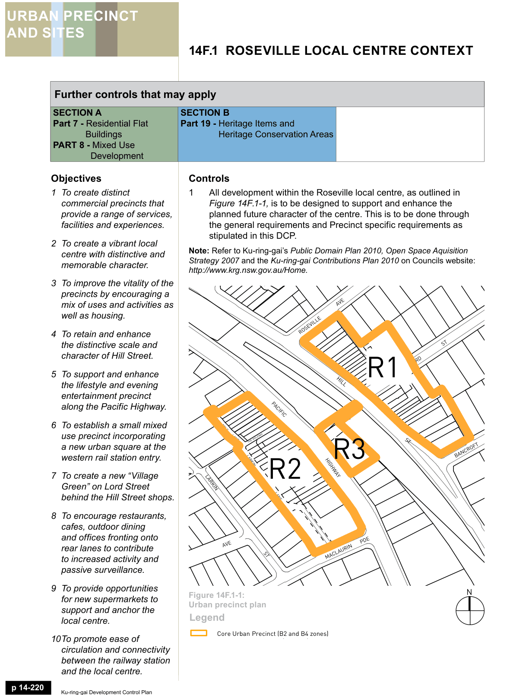

#### 14F		 Roseville Local Centre

14F.1 Roseville Local Centre Context 14F.2	 	Public Domain and Pedestrian Access 14F.3	 	Proposed Community Infrastructure 14F.4	 	Setbacks 14F.5	 	Built Form 14F.6	 	Building Entries, Car Parking and Service

Access

14F.7	 	Precinct R1: Hill Street Shops 14F.8	 	Precinct R2: Pacific Highway Shops 14F.9	 	Precinct R3: Pacific Highway to Roseville Station

### ROSEVILLE LOCAL CENTRE

URN 3

> [Picture on page 2: a map, saved as a picture (images/part-14f-roseville-local-centre-page-2-2.gif, 150 dpi); the street names and other small labels are on the picture.]
> Words printed on the picture (title and legend, copied from the PDF):
> 39 & 1A
> Heritage Conservation Areas
> 1	 To create distinct
> commercial precincts that
> facilities and experiences.
> stipulated in this DCP.
> centre with distinctive and
> Note: Refer to Ku-ring-gai’s Public Domain Plan 2010, Open Space Aquisition
> Strategy 2007 and the Ku-ring-gai Contributions Plan 2010 on Councils website:
> precincts by encouraging a
> well as housing.
> the distinctive scale and
> character of Hill Street.
> the lifestyle and evening
> along the Pacific Highway.
> LANE THE  RIFLEWAY
> use precinct incorporating
> western rail station entry.
> Green” on Lord Street
> 8	 To encourage restaurants,
> cafes, outdoor dining
> and offices fronting onto
> rear lanes to contribute
> to increased activity and
> 21 19 17
> Urban precinct plan
> GARRICK 1 272
> 12 10 8 6
> 4 RD 287A
> 9	 To provide opportunities
> for new supermarkets to
> support and anchor the
> Core Urban Precinct (B2 and B4 zones)
> - Fringe Urban Precinct (R4 zone)
> circulation and connectivity
> between the railway station
> and the local centre.
> - Precinct S1
> - Precinct S2
> - Precinct S3

Figure 14F.1-1, is to be designed to support and enhance the

Figure 14F.1-1:

### VOLUME B
