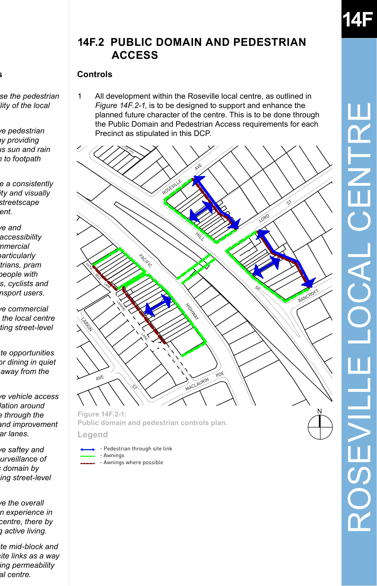

### 14F.1  ROSEVILLE LOCAL CENTRE CONTEXT

#### Further controls that may apply

#### SECTION B

Part 19 - Heritage Items and

32

#### SECTION A

Part 7 - Residential Flat

PART 8 - Mixed Use

3

31

#### Objectives

#### Controls

MARTIN

provide a range of services,

1 All development within the Roseville local centre, as outlined in

planned future character of the centre. This is to be done through

the general requirements and Precinct specific requirements as

2	 To create a vibrant local

Y

3	 To improve the vitality of the

mix of uses and activities as

4	 To retain and enhance

### R1

5	 To support and enhance

AVE

6	 To establish a small mixed

a new urban square at the

### R2

### R3

7	 To create a new “Village

behind the Hill Street shops.

ST

#### Legend

10	To promote ease of

KILLEATON

DAINTON

PDE

RAWHITI

ST

> [Picture on page 3: a map, saved as a picture (images/part-14f-roseville-local-centre-page-3-3.gif, 150 dpi); the street names and other small labels are on the picture.]
> Words printed on the picture (title and legend, copied from the PDF):
> permeability of the local
> continuous sun and rain
> high quality and visually
> ALIGNMENT AND SETBACKS
> ALIGNMENT AND SETBACKS
> disabilities, cyclists and
> by promoting street-level
> - 15m setback
> - 12m setback
> - 10m setback
> - 6m setback
> - 5m setback
> - 4m setback
> - 3m setback
> - 2m setback
> - Land dedication
> - Alternate deep soil landscaping
> (% of site)
> - 15m setback
> - 12m setback
> - 10m setback
> - 6m setback
> - 5m setback
> - 4m setback
> - 3m setback
> - 2m setback
> - Land dedication
> - Alternate deep soil landscaping
> (% of site)
> 123 125 127
> 123 125 127
> locations away from the
> 4 6 8 10
> 2 4 6 8 10
> 1 3 5
> 1 3 5
> - Primary active frontage
> - Secondary active frontage
> - 3 storey street wall
> - 2m upper level setback above street
> - 4m upper level setback above street
> - Primary active frontage
> - Secondary active frontage
> - 3 storey street wall
> - 2m upper level setback above street
> - 4m upper level setback above street
> Public domain and pedestrian controls plan.
> PUBLIC DOMAIN AND PEDESTRIAN
> PUBLIC DOMAIN AND PEDESTRIAN
> creation and improvement
> 4 8 10
> 4 8 10
> 5 7 9 11
> 5 7 9 11
> - Pedestrian through site link
> - Entry plaza/forecourt
> - Awnings where possible
> 10 12 14 16 18
> 4 6 8
> - Pedestrian through site link
> - Entry plaza/forecourt
> - Awnings where possible
> 10 12 14 16 18
> 4 6 8
> 3 5 7 11
> BUILDING ENTRIES AND CARPAT
> RD 15 19
> 3 5 7 11
> BUILDING ENTRIES AND CARPAT
> - Vehicular access to site
> - Pedestrian access to site
> - Vehicular access to site
> - Pedestrian access to site
> pedestrian experience in
> - Heritage/character item
> AVE - Heritage/character item
> of improving permeability

Figure 14F.2-1, is to be designed to support and enhance the

Figure 14F.2-1:
