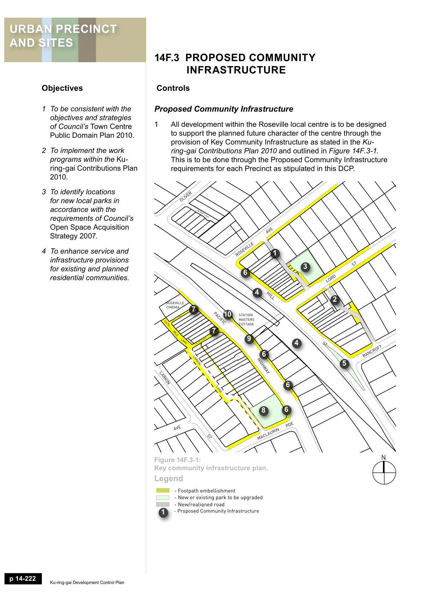

### 14F.2  PUBLIC DOMAIN AND PEDESTRIAN

### ACCESS

#### Objectives

#### Controls

1	 To increase the pedestrian

centre.

1 All development within the Roseville local centre, as outlined in

planned future character of the centre. This is to be done through

the Public Domain and Pedestrian Access requirements for each

Precinct as stipulated in this DCP.

2	 To improve pedestrian

amenity by providing

protection to footpath

areas. 3	 To provide a consistently

pleasing streetscape

environment.

21 19 17 15 11 7 5

9

8 16

3

14

21 19 17

VALE

GARRICK 1 272

274

12 10 8 6

15 11 7 5

9

8 16

4

3 RD

14

VALE

2

GARRICK 1

272

274

285

12 10 8

PL 6

4 RD 287A 2

4

3

285

PL

270

6 4

3 5 6A 270

287

283

281

279

4	 To improve and

enhance accessibility

to the commercial

precinct particularly

for pedestrians, pram

walkers, people with

public transport users.

8 6

266

268

277

5

12

6A

287

283

281

279

RD

8

258 266

268

277

12

258

275

271

273

260

264

262

269

275

271

273

258

260

264

262 MONA

267 269 258

107A

MONA

265 267

107A

99

97

265

101 103 105

5	 To improve commercial

activity in the local centre

activity. 107

KILLEATON

99

97

101 103 105 107

KILLEATON

RD

SHIRLEY

6	 To facilitate opportunities

for outdoor dining in quiet

highway.

RD

PL

#### Legend

7	 To improve vehicle access

and circulation around

the centre through the

of new rear lanes.

PL

#### Legend

#### Legend

RD

RD

NEWHAVEN

NEWHAVEN

8	 To improve saftey and

passive surveillance of

the public domain by

activity.

RD

ST

RD 6

AVE

ST 2 3

6 8

AVE

3

10 8

### ROSEVILLE LOCAL CENTRE

9	 To improve the overall

the local centre, there by

promoting active living.

12 14 10

12 14

15

11

9

7

5

14

12

10

8

6

11

9

7

5

82 3.66W PATHWAY 18

16

14

12

10

8

4

6

4

12

10

8

6

11

9

7

5

47 3.66W PATHWAY 18

14

12

10

8

4

6

4

9

7

5

10	To promote mid-block and

through-site links as a way

of the local centre.

ALEXANDER

GREVILLEA

3.66W PATHWAY

6 3.66W PATHWAY

LANCASTER

CL

MARIANA

CL

LANCASTER 3

CL

MARIANA

3.66W

CL

3.66W

RO

> [Picture on page 4: a map, saved as a picture (images/part-14f-roseville-local-centre-page-4-2.gif, 150 dpi); the street names and other small labels are on the picture.]
> Words printed on the picture (title and legend, copied from the PDF):
> 39 & 1A
> objectives and strategies
> of Council’s Town Centre
> Public Domain Plan 2010.
> ALIGNMENT AND SETBACKS
> programs within the Ku-
> ring-gai Contributions Plan
> - 9m setback
> 21 19 17
> - 15m setback
> - 13m setback
> GARRICK 1 272
> 12 10 8 6 4
> - 12m setback
> - 11m setback
> 21 19 17
> 3	 To identify locations
> accordance with the
> requirements of Council’s
> Open Space Acquisition
> GARRICK 1 272
> 12 10 8 6
> ALIGNMENT AND SETBACKS
> 4 RD 107A
> 21 19 17
> 265 2 293
> 12 10 8 101 103 105 107
> ALIGNMENT AND SETBACKS
> - 10m setback
> - 6m setback
> - 5m setback
> - 4m setback
> - 3m setback
> - 2m setback
> - Land dedication
> - Alternate deep soil landscaping
> (% of site)
> 123 125 127
> for existing and planned
> - 10m setback
> - 6m setback
> - 3m setback
> - Nil setback
> - Land dedication
> - Alternate deep soil requirement
> 4 6 8 10
> - 10m setback
> - 6m setback
> - 3m setback
> - Nil setback
> - Land dedication
> - Alternate deep soil requirement
> - Principal active frontage
> - Supporting active frontage
> - 3 storey street wall
> - 2m upper level setback above
> 101 103 105 107
> 1 3 5
> - 4m upper level setback above
> 123 125 127
> 101 103 105 107
> 123 125 127
> PUBLIC DOMAIN AND PEDESTRIAN
> LANE THE  RIFLEWAY
> 4 8 10
> RD 5 7 9 11
> 2 4 6 8 10
> - Primary active frontage
> - Secondary active frontage
> - 3 storey street wall
> - 2m upper level setback above street
> - 4m upper level setback above street
> 1 3 5
> 4 6 8 10
> - Primary active frontage
> - Secondary active frontage
> - 3 storey street wall
> - 2m upper level setback above street
> - 4m upper level setback above street
> PUBLIC DOMAIN AND PEDESTRIAN
> 24 2 1 3 5
> - Pedestrian through site link
> - Entry plaza/forecourt
> - Awnings where possible
> 10 12 14 16 18
> 4 6 8
> PUBLIC DOMAIN AND PEDESTRIAN
> 3 5 7 11
> BUILDING ENTRIES AND CARPAT
> 4 8 10
> 5 7 9 11
> - Vehicular access to site
> - Pedestrian access to site
> - Through site link
> - Entry plaza/forecourt
> - Continuous awnings
> - Continuous awnings where possible
> - Continuous colonnade
> 4 8 10
> 5 7 9 11
> - Through site link
> - Entry plaza/forecourt
> - Continuous awnings
> - Continuous awnings where possible
> - Continuous colonnade
> BUILDING ENTRIES AND CARPAT
> 10 12 14 16 18
> 4 6 8
> BUILDING ENTRIES AND CARPAT
> - Heritage item
> 2 15 19
> 3 5 7 11
> - Vehicular access to site
> - Pedestrian access to site
> 10 12 14 16 18
> 4 6 8
> 3 5 7 11
> - Vehicular access to site
> - Pedestrian access to site
> 82 3.66W PATHWAY
> - Landmark building
> KEY COMMUNITY INFRASTRUCTRE
> Key community infrastructure plan.
> KEY COMMUNITY INFRASTRUCTRE
> - Character item
> 17 6 15
> 6 3.66W PATHWAY
> - Refer to site specific DCP
> - Proposed road
> 7 3.66W PATHWAY
> - Proposed Community Infrastructure
> 3.66W PATHWAY 18
> - Footpath embellishment
> - New or existing park to be upgraded
> - Historic/character building to be
> - New/realigned road
> - Proposed pedestrian promenade
> - New community facility
> 82 3.66W PATHWAY 18
> - Footpath embellishment
> - New or existing park to be upgraded
> - Historic/character building to be
> - New/realigned road
> - Proposed pedestrian promenade
> - New community facility
> 7 3.66W PATHWAY

Figure 14F.3-1:

RAFALGAR
