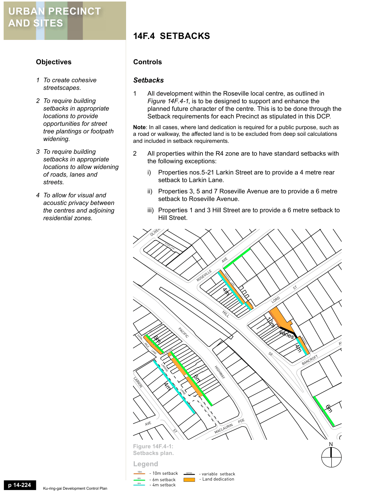

### 14F.3  PROPOSED COMMUNITY

### INFRASTRUCTURE

#### Objectives

#### Controls Proposed Community Infrastructure

1	 To be consistent with the

1 All development within the Roseville local centre is to be designed

to support the planned future character of the centre through the

provision of Key Community Infrastructure as stated in the Ku-

ring-gai Contributions Plan 2010 and outlined in Figure 14F.3-1.

This is to be done through the Proposed Community Infrastructure

requirements for each Precinct as stipulated in this DCP.

2	 To implement the work

for new local parks in

T

4	 To enhance service and

V

### *

#### Legend

### 14F.3  PROPOSED COMMUNITY

### INFRASTRUCTURE (continued)

#### Objectives

#### Controls

2 The following development is to be designed to support and

compliment the provision of Key Community Infrastructure through

the Ku-ring-gai Contributions Plan 2010, Voluntary Planning

Agreement (VPA) or other mechanism (refer to individual precincts

14F.8 to 14F.10): 1 Reconstruction of Roseville Lane from Roseville Avenue through

to Lord Street (6 metre wide carriage way with 2 metre wide

footpaths on both sides). Land to be dedicated to Council as part

of site redevelopment. 2 Extension and widening of Bancroft Lane from Bancroft Avenue

to Lord Street (6 metre wide carriage way with 2 metre wide

footpaths on both sides). Land to be dedicated to Council as part

of site redevelopment. 3 New village green with playground facilities on the Lord Street

Council car park site (car parking to be relocated to basement

parking on-site). 4 Embellishment of existing Railway Gardens on Hill Street to

urban park standard. 5 Embellishment existing Hill Street median garden (opposite

Bancroft Avenue) to urban park standard. 6 Embellishment of the public domain areas and footpaths on the

Pacific Highway and Hill Street including underground power

lines, new lighting, high quality paving and furniture.

#### 7

Upgrade of existing pedestrian lane ways including Sixth Mile

Lane and the Rifleway. 8 Embellishment of Roseville Memorial Park to urban park

standard. 9 Improvements to western rail station entry off Pacific Highway to

create new urban square including new paving, street trees and

street furniture. 10 Embellishment of existing “railway gardens” on the Pacific

Highway to urban park standard (Council to negotiate with Rail

Corp to gain public access to part or all of the Railway Gardens).

### ROSEVILLE LOCAL CENTRE

> [Picture on page 6: a map, saved as a picture (images/part-14f-roseville-local-centre-page-6-1.gif, 150 dpi); the street names and other small labels are on the picture.]
> Words printed on the picture (title and legend, copied from the PDF):
> 1	 To create cohesive
> 39 & 1A
> 2	 To require building
> setbacks in appropriate
> locations to provide
> opportunities for street
> tree plantings or footpath
> Note: In all cases, where land dedication is required for a public purpose, such as
> a road or walkway, the affected land is to be excluded from deep soil calculations
> and included in setback requirements.
> setback to Larkin Lane.
> 3	 To require building
> setbacks in appropriate
> locations to allow widening
> of roads, lanes and
> setback to Roseville Avenue.
> ALIGNMENT AND SETBACKS
> acoustic privacy between
> the centres and adjoining
> 39 & 1A
> - 15m setback
> - 12m setback
> - 10m setback
> - 6m setback
> - 5m setback
> - 4m setback
> - 3m setback
> - 2m setback
> - Land dedication
> - Alternate deep soil requirement
> - Primary active frontage
> - Secondary active frontage
> - 3 storey street wall
> - 2m upper level setback above street
> - 4m upper level setback above street
> PUBLIC DOMAIN AND PEDESTRIAN
> (2 - 12)
> ST LANE THE  RIFLEWAY
> - Through site link
> - Entry plaza/forecourt
> - Continuous awnings
> - Continuous awnings where possible
> - Continuous colonnade
> BUILDING ENTRIES AND CARPAT
> - Vehicular access to site
> - Pedestrian access to site
> ALIGNMENT AND SETBACKS
> - 9m setback
> 27 25 23
> 21 19 17
> - 15m setback
> 26 24 22
> - 13m setback
> ALIGNMENT AND SETBACKS
> 12 10 8
> - 12m setback
> ALIGNMENT AND SETBACKS
> ALIGNMENT AND SETBACKS
> - 11m setback
> - 9m setback
> 21 19 17
> - 9m setback
> 51 53 - 9m setback
> - 15m setback
> - 13m setback
> 21 19 17
> 21 19 17
> - 15m setback
> - 15m setback 5m
> 18 16 272
> 12 10 8
> 6 14 12
> 16 7.32 / 3.66 W.
> ESMT FOR SERVICES
> - 12m setback
> - 13m setback
> - 13m setback
> 2 258 VALE
> 5 - 11m setback
> 5 6A 270
> - variable setback
> - 10m setback
> - 6m setback
> - 5m setback
> - Land dedication
> - Alternate deep soil landscaping
> (% of site)
> - Land dedication

Figure 14F.4-1, is to be designed to support and enhance the

Figure 14F.4-1:

2
