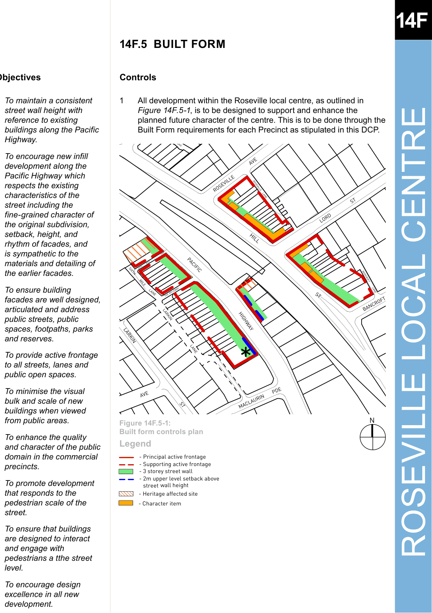

### 14F.4  SETBACKS

#### Objectives

#### Controls

4

#### Setbacks

1 All development within the Roseville local centre, as outlined in

planned future character of the centre. This is to be done through the

Setback requirements for each Precinct as stipulated in this DCP.

38

2 All properties within the R4 zone are to have standard setbacks with

the following exceptions:

i) Properties nos.5-21 Larkin Street are to provide a 4 metre rear

ii)	 Properties 3, 5 and 7 Roseville Avenue are to provide a 6 metre MARTIN

iii)	 Properties 1 and 3 Hill Street are to provide a 6 metre setback to

4	 To allow for visual and

#### Legend

BOUNDARY

KINGS

40%

KILLEATON

AINTON

40%

- Alternate deep soil landscaping (% of site)

40%

- Land dedication

- Alternate deep soil landscaping

- Principal active frontage

- Land dedication

- Alternate deep soil landscaping

VE

WHITI

THE

> [Picture on page 7: a map, saved as a picture (images/part-14f-roseville-local-centre-page-7-3.gif, 150 dpi); the street names and other small labels are on the picture.]
> Words printed on the picture (title and legend, copied from the PDF):
> street wall height with
> reference to existing
> buildings along the Pacific
> ALIGNMENT AND SETBACKS
> - 9m setback
> - 15m setback
> - 13m setback
> GARRICK 1 272
> - 12m setback
> ALIGNMENT AND SETBACKS
> - 11m setback
> - 9m setback
> 51 53 5
> - 15m setback
> - 13m setback
> GARRICK 1 272
> - 12m setback
> - 11m setback
> 101 103 105 107
> - 10m setback
> - 6m setback
> - 5m setback
> - 4m setback
> - 3m setback
> - 2m setback
> - Land dedication
> - Alternate deep soil landscaping
> (% of site)
> 123 125 127
> development along the
> Pacific Highway which
> respects the existing
> characteristics of the
> street including the
> fine-grained character of
> the original subdivision,
> setback, height, and
> rhythm of facades, and
> is sympathetic to the
> materials and detailing of
> the earlier facades.
> 101 103 105
> - 10m setback
> - 6m setback
> - 5m setback
> - 4m setback
> - 3m setback
> - 2m setback
> - Land dedication
> - Alternate deep soil landscaping
> (% of site)
> 123 125 127
> 2 4 6 8 10 BUILT FORM
> - Principal active frontage
> - Supporting active frontage
> - 3 storey street wall
> - 2m upper level setback above
> 1 3 5
> - 4m upper level setback above
> ALIGNMENT AND SETBACKS
> street wall height
> - 9m setback
> 4 6 8 10
> - Principal active frontage
> - Supporting active frontage
> - 3 storey street wall
> - 2m upper level setback above
> 3	 To ensure building
> facades are well designed,
> articulated and address
> public streets, public
> spaces, footpaths, parks
> - 15m setback
> PUBLIC DOMAIN AND PEDESTRIAN
> 1 3 5
> - 13m setback
> 4 8 10
> - 4m upper level setback above
> - 12m setback
> 5 7 9 11
> street wall height
> - 11m setback
> PUBLIC DOMAIN AND PEDESTRIAN
> public open spaces. 12
> 2 4 8 10
> - Pedestrian through site link
> - Entry plaza/forecourt
> - Awnings where possible
> 2 LAWSON 4m
> YARRABUNG 10 12 14 16 18
> 4 6 8
> 1 5 7 9 11
> 3 5 7 11
> BUILDING ENTRIES AND CARPAT
> - Pedestrian through site link
> - Entry plaza/forecourt
> - Awnings where possible
> 101 103 105
> buildings when viewed
> from public areas.
> - Vehicular access to site
> - Pedestrian access to site
> 10 12 14 16 18
> 4 6 8
> - 10m setback
> - 6m setback
> - 5m setback
> - 4m setback
> - 3m setback
> - 2m setback
> - Land dedication
> - Alternate deep soil landscaping
> (% of site)
> 3 5 7 11
> Built form controls plan
> BUILDING ENTRIES AND CARPAT
> 123 125 127
> - Vehicular access to site
> - Pedestrian access to site
> - Heritage item
> domain in the commercial
> 2 4 6 8 10
> - Principal active frontage
> - Supporting active frontage
> - 3 storey street wall
> - 2m upper level setback above
> - Landmark building
> 1 3 5
> - 4m upper level setback above
> - Heritage affected site
> street wall height NOLA
> - Character item
> 7	 To promote development
> that responds to the
> pedestrian scale of the
> PUBLIC DOMAIN AND PEDESTRIAN
> - Landmark building
> 4 8 10
> 9 4 2
> - Refer to site specific DCP
> - Proposed road
> 5 7 9 11
> - Character item
> - Proposed Community Infrastructure
> 1 2 5
> - Pedestrian through site link
> - Entry plaza/forecourt
> - Awnings where possible
> 10 12 14 16 18
> 4 6 8
> 1 4 2
> - Refer to site specific DCP
> - Proposed road
> are designed to interact
> and engage with
> pedestrians a tthe street
> 3 5 7 11
> - Proposed Community Infrastructure
> BUILDING ENTRIES AND CARPAT
> - Vehicular access to site
> - Pedestrian access to site
> 9	 To encourage design
> excellence in all new

Figure 14F.5-1, is to be designed to support and enhance the

Figure 14F.5-1:
