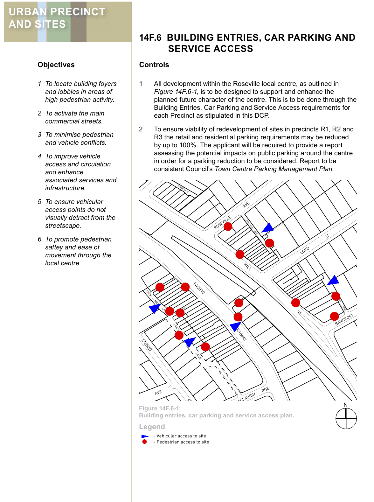

### 14F.5  BUILT FORM

#### Objectives

#### Controls

1 All development within the Roseville local centre, as outlined in

planned future character of the centre. This is to be done through the

Built Form requirements for each Precinct as stipulated in this DCP.

1	 To maintain a consistent

21 19 17 15 11 7 5

9

16 14 12 10 8 6 4

PL

3 4

6

5 6A

21 19 17

8 266

268

15 11 7 5

9

16 14

2 258 12 10 8 6 4

PL

271

260

264

262

3 4 269 258

MONA

6 267 5 6A 265

8 266

268

2

97

258

KILLEATON

271

260

264

262

269

258 MONA

267

265

2	 To encourage new infill

97

KILLEATON

RD

21 19 17

PL

15 11 7 5

9

16 14

GARRICK 1

12 10 8 6

RD 2 PL

3 4

NEWHAVEN

### *

6

5

6A

4	 To provide active frontage

to all streets, lanes and

8

PL RD

SHIRLEY

266

268

12

258 RD

271

260

264

262

269

258

NEWHAVEN

MONA

267

265

97

RD

5	 To minimise the visual

bulk and scale of new

KILLEATON

RD

ST

6

8

10

12 14 RD

ST

6

6	 To enhance the quality

and character of the public

15

11

9

7

5

8

84

82 3.66W PATHWAY

18

16

14

12

10

8

4

6

10

86

AVE

20

49

47

12

### *

5

14

15

11

9

7

5

17 84

82

15 3.66W PATHWAY

18

16

14

12

10

8

4

6

3.66W PATHWAY

PL 86

AVE

20

49

47

### 5 *

30

26

24

22

28

5

PL RD

11

9

7

3.66W PATHWAY

34

32

NEWHAVEN

17 15

3.66W PATHWAY

### ROSEVILLE LOCAL CENTRE

30

26

24

22

28

PL

11

9

8	 To ensure that buildings

7

3.66W PATHWAY

34

32

HERITATGGEA

ALEXANDER

- Heritage item

- Landmark building

### *

R

RAFALGAR

> [Picture on page 8: a map, saved as a picture (images/part-14f-roseville-local-centre-page-8-3.gif, 150 dpi); the street names and other small labels are on the picture.]
> Words printed on the picture (title and legend, copied from the PDF):
> 39 & 1A
> high pedestrian activity.
> 3	 To minimise pedestrian
> and vehicle conflicts.
> 4	 To improve vehicle
> access and circulation
> associated services and
> ALIGNMENT AND SETBACKS
> 5	 To ensure vehicular
> access points do not
> visually detract from the
> - 9m setback
> 1 19 17
> - 15m setback
> - 13m setback
> GARRICK 1 272
> 12 10 8 6 4
> - 12m setback
> - 11m setback
> 6	 To promote pedestrian
> saftey and ease of
> movement through the
> 101 103 105
> - 10m setback
> - 6m setback
> - 5m setback
> - 4m setback
> - 3m setback
> - 2m setback
> - Land dedication
> - Alternate deep soil landscaping
> (% of site)
> 123 125 127
> LANE THE  RIFLEWAY
> 2 4 6 8 10
> - Principal active frontage
> - Supporting active frontage
> - 3 storey street wall
> - 2m upper level setback above
> 1 3 5 street
> - 4m upper level setback above
> street wall height
> PUBLIC DOMAIN AND PEDESTRIAN
> 4 8 10
> 5 7 9 11
> - Pedestrian through site link
> - Entry plaza/forecourt
> - Awnings where possible
> 10 12 14 16 18
> 4 6 8
> Building entries, car parking and service access plan.
> 3 5 7 11
> BUILDING ENTRIES AND CARPAT
> - Vehicular access to site
> - Pedestrian access to site
> - Heritage item
> 82 3.66W PATHWAY
> - Landmark building

Figure 14F.6-1, is to be designed to support and enhance the

Figure 14F.6-1:

BELGIUM
