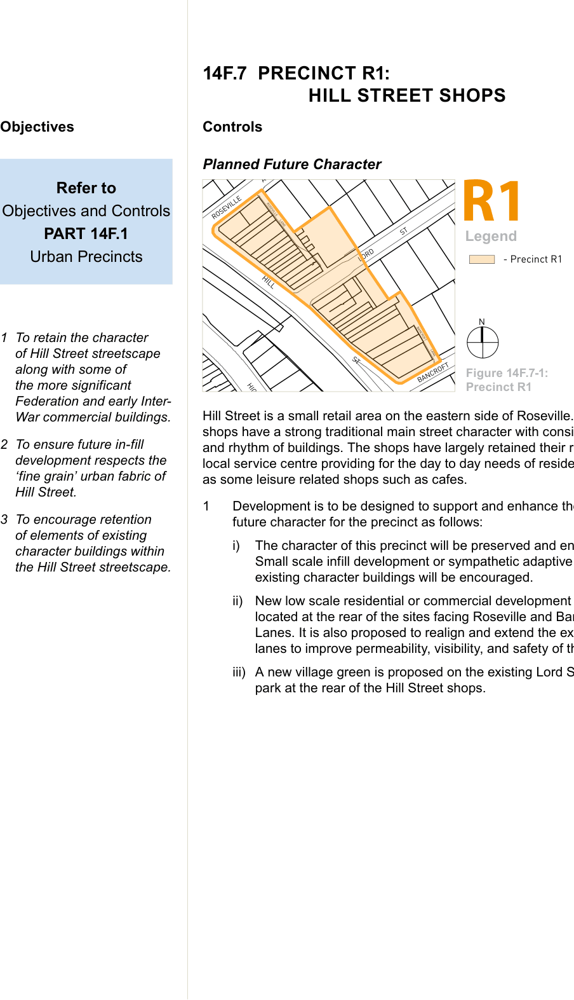

### 14F.6  BUILDING ENTRIES, CAR PARKING AND

### SERVICE ACCESS

#### Objectives

#### Controls

30

32

1	 To locate building foyers

and lobbies in areas of

31

1 All development within the Roseville local centre, as outlined in

planned future character of the centre. This is to be done through the

Building Entries, Car Parking and Service Access requirements for

each Precinct as stipulated in this DCP.

2	 To activate the main

MARTIN

2 To ensure viability of redevelopment of sites in precincts R1, R2 and

R3 the retail and residential parking requirements may be reduced

by up to 100%. The applicant will be required to provide a report

assessing the potential impacts on public parking around the centre

in order for a parking reduction to be considered. Report to be

consistent Council’s Town Centre Parking Management Plan.

AVE

#### Legend

ST

### *

- Character item

GREVILLEA

3.66W PATHWAY

LANCASTER

CL

MARIANA

- Refer to site specific DCP

- Proposed road

CL

PDE

- Proposed Community Infrastructure

IXTH MILE LANE THE  RIFLEWAY

28

LARKIN

> [Picture on page 9: a map, saved as a picture (images/part-14f-roseville-local-centre-page-9-6.gif, 150 dpi); the street names and other small labels are on the picture.]
> Words printed on the picture (title and legend, copied from the PDF):
> - Entry plaza/forecourt
> - Continuous awnings
> - Continuous colonnade
> - Vehicular access to site
> - Pedestrian access to site
> - Precinct R1
> - Precinct R2
> - Precinct R3
> LANE THE  RIFLEWAY
> of Hill Street streetscape
> along with some of
> the more significant
> Federation and early Inter-
> War commercial buildings.
> development respects the
> 3	 To encourage retention
> of elements of existing
> character buildings within
> the Hill Street streetscape.

Figure 14F.7-1:

26

### R2

### R3
