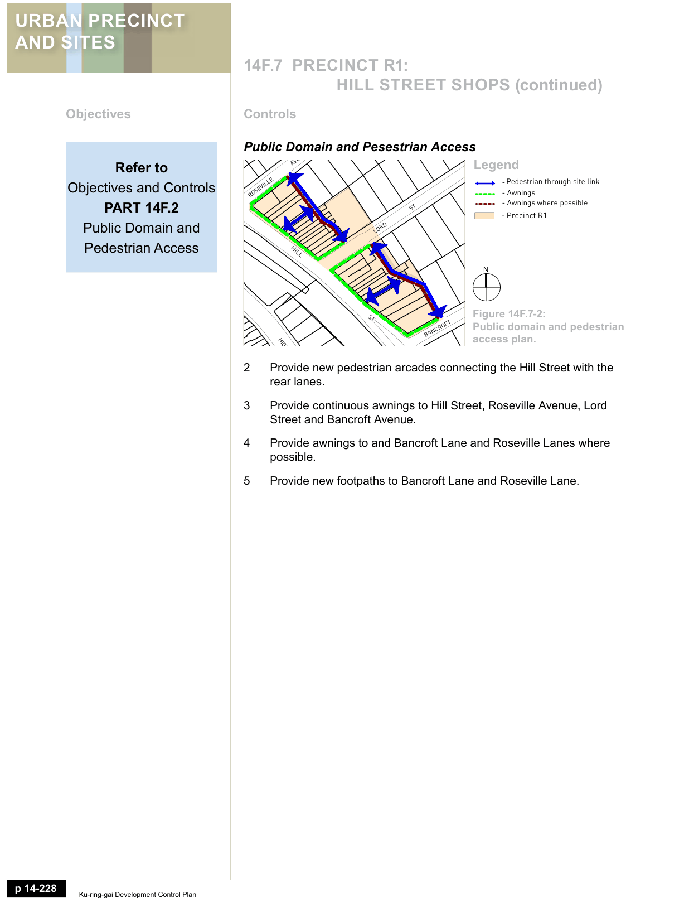
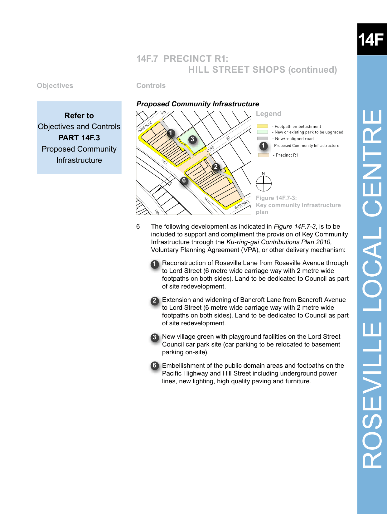
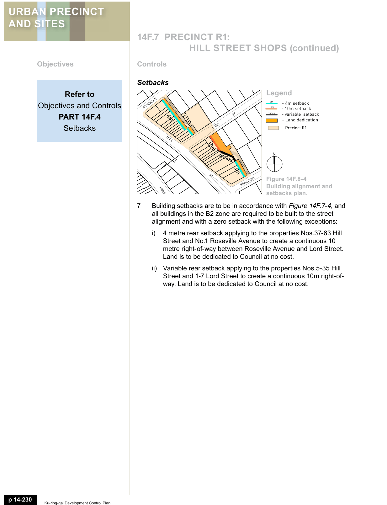
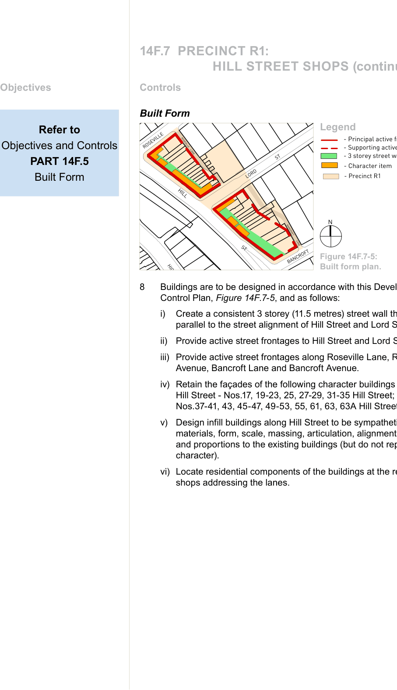
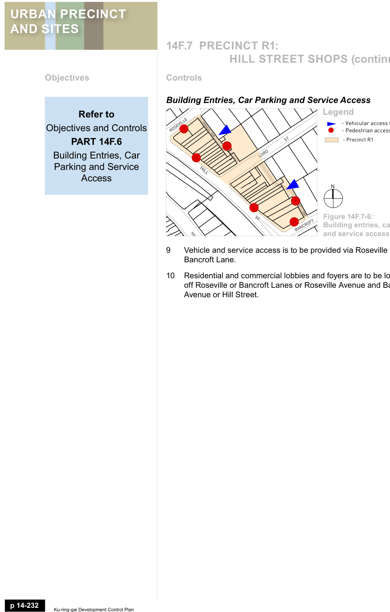
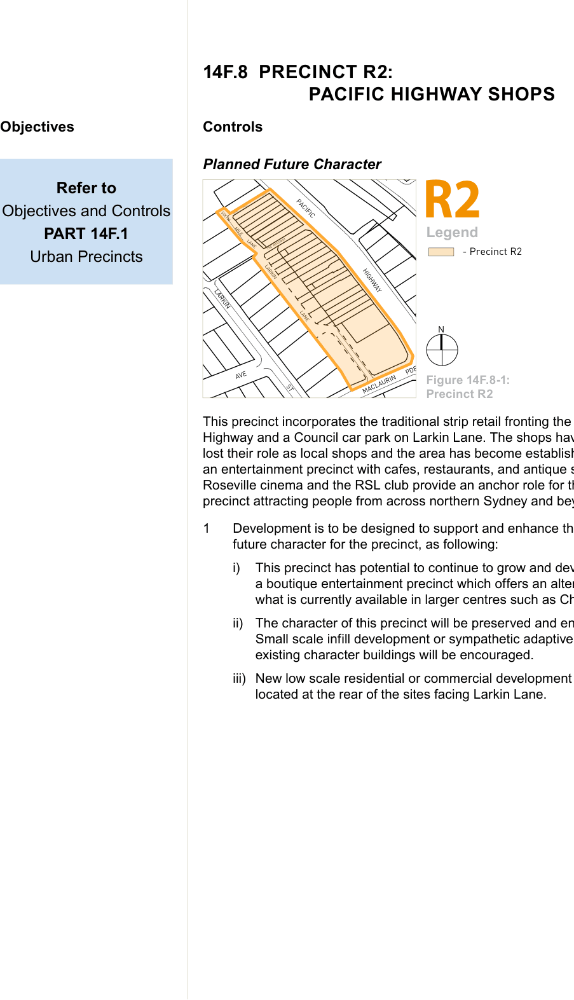

### 14F.7  PRECINCT R1:

### HILL STREET SHOPS

GLENCROFT

- Continuous awnings where possible

2

LANE

#### Objectives

#### Controls

BUILDING ENTRIES AND CARPAT

AVE ST

RKIN

#### Planned Future Character

NOLA RD

Refer to

#### Objectives and Controls

NOLA

#### Legend

### LN R1

### R1

#### PART 14F.1

#### Urban Precincts

12

E

CORONA

14 16

18

20

22 4

FINDLAY

1	 To retain the character

THE  RIFLEWAY

Hill Street is a small retail area on the eastern side of Roseville. The

shops have a strong traditional main street character with consistent scale

and rhythm of buildings. The shops have largely retained their role as a

local service centre providing for the day to day needs of residents as well

as some leisure related shops such as cafes.

2	 To ensure future in-fill

‘fine grain’ urban fabric of

1 Development is to be designed to support and enhance the planned

future character for the precinct as follows:

i) The character of this precinct will be preserved and enhanced.

Small scale infill development or sympathetic adaptive re-use of

existing character buildings will be encouraged.

ii)	 New low scale residential or commercial development may be

located at the rear of the sites facing Roseville and Bancroft

Lanes. It is also proposed to realign and extend the existing rear

lanes to improve permeability, visibility, and safety of the area.

iii)	 A new village green is proposed on the existing Lord Street car

park at the rear of the Hill Street shops.

ST

ARCHER

WILLIAM

33A

33B

WARATAH

35

### ROSEVILLE LOCAL CENTRE

37 39 41 43

NE

ADE

NCROFT

LINDFIELD

LINDFIELD

16-18

ST 1

KENILWORTH

16-18

21 ST

KENILWORTH

HIGHGATE

> [Picture on page 10: a map, saved as a picture (images/part-14f-roseville-local-centre-page-10-13.gif, 150 dpi); the street names and other small labels are on the picture.]
> Words printed on the picture (title and legend, copied from the PDF):
> - Land dedication
> - Alternate deep soil requirement
> 1 ( UNFORMED )
> - Land dedication
> - Alternate deep soil requirement
> 1 ( UNFORMED )
> - Entry plaza/forecourt
> - Continuous awnings
> - Continuous awnings where possible
> - Continuous colonnade
> BUILDING ENTRIES AND CARPAT
> - Primary active frontage
> - Secondary active frontage
> - 3 storey street wall
> - 2m upper level setback above street
> - 4m upper level setback above street
> - Primary active frontage
> - Secondary active frontage
> - 3 storey street wall
> - 2m upper level setback above street
> - 4m upper level setback above street
> - Vehicular access to site
> - Pedestrian access to site
> PUBLIC DOMAIN AND PEDESTRIAN
> PUBLIC DOMAIN AND PEDESTRIAN
> ROSEVILLE    LANE 1B
> - Pedestrian through site link
> - Entry plaza/forecourt
> Awnings where possible
> - Continuous colonnade
> - Pedestrian through site link
> - Entry plaza/forecourt
> Awnings where possible
> - Continuous colonnade
> BUILDING ENTRIES AND CARPAT
> - Precinct R1
> - Precinct R2
> - Precinct R3
> BUILDING ENTRIES AND CARPAT
> - Vehicular access to site
> - Pedestrian access to site
> - Vehicular access to site
> - Pedestrian access to site
> LANE THE  RIFLEWAY
> Public domain and pedestrian
> - Precinct L1
> - Precinct L2
> - Precinct L3
> - Precinct L4
> - Precinct L5
> - Precinct L6
> - Precinct L7
> - Precinct L8
> - Precinct L9
> - Precinct L1
> - Precinct L2
> - Precinct L3
> - Precinct L4
> - Precinct L5
> - Precinct L6
> - Precinct L7
> - Precinct L8
> - Precinct L9
> 1-3 5 7
> LLEWELLYN 9A 11
> Street and Bancroft Avenue.
> STRICKLAND LANE RD

Figure 14F.7-2:

### 14F.7  PRECINCT R1:

### HILL STREET SHOPS (continued)

#### R2

#### R3

NELSON

#### Objectives

#### Controls Public Domain and Pesestrian Access

#### Legend

Refer to

#### Objectives and Controls

0

#### PART 14F.2

Public Domain and

0

#### Pedestrian Access RUSSELL

WARK

WARK

2 Provide new pedestrian arcades connecting the Hill Street with the

3 Provide continuous awnings to Hill Street, Roseville Avenue, Lord

3

3

4 Provide awnings to and Bancroft Lane and Roseville Lanes where

5 Provide new footpaths to Bancroft Lane and Roseville Lane.

street

S E

W

> [Picture on page 11: a map, saved as a picture (images/part-14f-roseville-local-centre-page-11-4.gif, 150 dpi); the street names and other small labels are on the picture.]
> Words printed on the picture (title and legend, copied from the PDF):
> 45 CR 16
> - Pedestrian through site link
> - Awnings where possible
> 10 12 14 16 18
> RECREATION   WALK AVE
> PUBLIC DOMAIN AND PEDESTRIAN
> 5 7 9 11
> - Continuous awnings where possible
> - Continuous colonnade
> (2 - 12)
> 4 8 10
> - Vehicular access to site
> - Pedestrian access to site
> 5 7 9 11
> - Entry plaza/forecourt
> - Continuous awnings
> - Continuous awnings where possible
> - Continuous colonnade
> BUILDING ENTRIES AND CARPAT
> 10 12 14 16 18
> 4 6 8
> BUILDING ENTRIES AND CARPAT
> 24 22 20 18
> 3 5 7 11
> - Vehicular access to site
> - Pedestrian access to site
> - Heritage item
> - Through site link
> - Entry plaza/forecourt
> - Continuous awnings
> - Continuous awnings where possible
> - Continuous colonnade
> 10 12 14 16 18
> 4 6 8
> 3 5 7 11
> - Vehicular access to site
> - Pedestrian access to site
> OLIVER  LANE 5
> BUILDING ENTRIES AND CARPAT
> VICTORIA 3.66W PATHWAY
> - Landmark building
> KEY COMMUNITY INFRASTRUCTRE
> KEY COMMUNITY INFRASTRUCTRE
> - Vehicular access to site
> - Pedestrian access to site
> - Character item
> 8 4 2
> 24 22 20 18
> 24 22 20 18
> - Refer to site specific DCP
> - Proposed road
> AVE 8 4 AMINYA
> - Proposed Community Infrastructure
> - Footpath embellishment
> - New or existing park to be upgraded
> - Historic/character building to be
> - New/realigned road
> - Proposed pedestrian promenade
> - New community facility
> WILLIAM 34 8
> - Footpath embellishment
> - New or existing park to be upgraded
> - Historic/character building to be
> - New/realigned road
> - Proposed pedestrian promenade
> - New community facility
> - Precinct R1
> - Precinct R2
> - Precinct R3
> 6 10 74
> 44 6 4 2
> 48 4 2
> 30 3 ST
> 1 7 WARATAH
> Key community infrastructure

Figure 14F.7-3:

HE

### BUILDING ENTRIES AND CARPAT 14F

### 14F.7  PRECINCT R1:

### HILL STREET SHOPS (continued)

#### R2

#### R3

#### Objectives

#### Controls Proposed Community Infrastructure

### *

#### Legend

Refer to

#### Objectives and Controls 16

#### PART 14F.3

#### Proposed Community Infrastructure PL

6 The following development as indicated in Figure 14F.7-3, is to be

included to support and compliment the provision of Key Community

Infrastructure through the Ku-ring-gai Contributions Plan 2010,

Voluntary Planning Agreement (VPA), or other delivery mechanism:

#### 1

Reconstruction of Roseville Lane from Roseville Avenue through

to Lord Street (6 metre wide carriage way with 2 metre wide

footpaths on both sides). Land to be dedicated to Council as part

of site redevelopment. Extension and widening of Bancroft Lane from Bancroft Avenue

to Lord Street (6 metre wide carriage way with 2 metre wide

footpaths on both sides). Land to be dedicated to Council as part

of site redevelopment. New village green with playground facilities on the Lord Street

Council car park site (car parking to be relocated to basement

parking on-site). Embellishment of the public domain areas and footpaths on the

Pacific Highway and Hill Street including underground power

lines, new lighting, high quality paving and furniture.

### ROSEVILLE LOCAL CENTRE

VE

SIXTH PACIFIC

varies

GLENCROFT

LANE THE  RIFLEWAY

> [Picture on page 12: a map, saved as a picture (images/part-14f-roseville-local-centre-page-12-6.gif, 150 dpi); the street names and other small labels are on the picture.]
> Words printed on the picture (title and legend, copied from the PDF):
> - Continuous awnings where possible
> - Continuous colonnade
> ROSEVILLE ROSEVILLE    LANE
> BUILDING ENTRIES AND CARPAT
> PUBLIC DOMAIN AND PEDESTRIAN
> (2 - 12)
> - Vehicular access to site
> - Pedestrian access to site
> ALIGNMENT AND SETBACKS
> ALIGNMENT AND SETBACKS
> - 9m setback
> - 9m setback
> 27 25 23
> 27 25 23
> 21 19 17
> - 15m setback
> 21 19 17
> - 15m setback
> - Through site link
> - Entry plaza/forecourt
> - Continuous awnings
> - Continuous awnings where possible
> - Continuous colonnade
> 26 24 22
> 26 24 22
> - 13m setback
> - 13m setback
> 12 10 8 272
> ALIGNMENT AND SETBACKS
> 12 10 8
> - 12m setback
> - 12m setback
> BUILDING ENTRIES AND CARPAT
> - 11m setback
> - 11m setback
> 3 - 9m setback
> 27 25 23
> 21 19 17
> - 15m setback
> 26 24 22
> - 13m setback
> - Vehicular access to site
> - Pedestrian access to site
> 12 10 8
> 7.32 / 3.66 W. 14 12
> ESMT FOR SERVICES
> 7.32 / 3.66 W.
> - 12m setback
> ESMT FOR SERVICES
> - 11m setback
> 1 WILLIAM 269 ROSEVILLE    LANE
> - variable setback
> 7.32 / 3.66 W.
> ESMT FOR SERVICES
> LORD 3 3
> 101 103 105
> 101 103 105
> - 10m setback
> - 6m setback
> - 5m setback
> - 4m setback
> - 3m setback
> - 2m setback
> - Land dedication
> - Alternate deep soil landscaping
> (% of site)
> - 10m setback
> - 6m setback
> - 5m setback
> - 4m setback
> - 3m setback
> - 2m setback
> - Land dedication
> - Alternate deep soil landscaping
> (% of site)
> - Precinct R1
> - Precinct R2
> - Precinct R3
> 123 125 127
> 123 125 127
> 152 BUILT FORM
> 101 103 105
> - 10m setback
> - 6m setback
> - 5m setback
> - 4m setback
> - 3m setback
> - 2m setback
> - Land dedication
> - Alternate deep soil landscaping
> (% of site)
> varies 123 125 127
> 4 6 8 10
> 4 6 8 10
> - Principal active frontage
> - Supporting active frontage
> - 3 storey street wall
> - 2m upper level setback above
> - Principal active frontage
> - Supporting active frontage
> - 3 storey street wall
> - 2m upper level setback above
> LANE THE  RIFLEWAY
> 1 3 5
> 1 3 5 street
> - 4m upper level setback above
> - 4m upper level setback above
> street wall height
> street wall height
> 4 6 8 10
> Building alignment and
> - Principal active frontage
> - Supporting active frontage
> - 3 storey street wall
> - 2m upper level setback above
> 1 3 5
> PUBLIC DOMAIN AND PEDESTRIAN
> PUBLIC DOMAIN AND PEDESTRIAN
> - 4m upper level setback above
> 4 8 10
> 4 8 10
> street wall height
> 5 7 9 11
> 5 7 9 11
> THE  RIFLEWAY CLOSE GILLOTT
> PUBLIC DOMAIN AND PEDESTRIAN
> 4 8 10
> - Pedestrian through site link
> - Entry plaza/forecourt
> - Awnings where possible
> - Pedestrian through site link
> - Entry plaza/forecourt
> - Awnings where possible
> 5 7 9 11
> 10 12 14 16 18
> 4 6 8
> 10 12 14 16 18
> 4 6 8
> 3 5 7 11
> 3 5 7 11
> BUILDING ENTRIES AND CARPAT
> BUILDING ENTRIES AND CARPAT
> - Pedestrian through site link
> - Entry plaza/forecourt
> - Awnings where possible
> 10 12 14 16 18
> 4 6 8
> - Vehicular access to site
> - Pedestrian access to site
> - Vehicular access to site
> - Pedestrian access to site
> 3 5 7 11
> BUILDING ENTRIES AND CARPAT
> - Vehicular access to site
> - Pedestrian access to site
> 24 22 20 18
> 24 22 20 18
> - Heritage item
> - Heritage item
> 84 3.66W PATHWAY
> - Landmark building
> 24 22 20 18
> - Landmark building
> - Heritage item
> 24 6 10
> - Character item
> - Character item
> - Landmark building
> 28 5 IKARA
> 2 3.66W PATHWAY 20
> - Refer to site specific DCP
> - Proposed road
> - Refer to site specific DCP
> - Proposed road
> - Character item
> - Proposed Community Infrastructure
> 5 3.66W PATHWAY
> - Proposed Community Infrastructure
> 6 4 2
> - Refer to site specific DCP
> - Proposed road
> 1 7 3.66W PATHWAY
> - Proposed Community Infrastructure

Figure 14F.8-4

### 14F.7  PRECINCT R1:

### HILL STREET SHOPS (continued)

#### R2

#### R3

#### Controls Setbacks

#### Legend

Refer to

#### Objectives and Controls

#### PART 14F.4

#### Setbacks

7 Building setbacks are to be in accordance with Figure 14F.7-4, and

all buildings in the B2 zone are required to be built to the street

alignment and with a zero setback with the following exceptions:

RD

i) 4 metre rear setback applying to the properties Nos.37-63 Hill

Street and No.1 Roseville Avenue to create a continuous 10

metre right-of-way between Roseville Avenue and Lord Street.

Land is to be dedicated to Council at no cost.

ii)	 Variable rear setback applying to the properties Nos.5-35 Hill

Street and 1-7 Lord Street to create a continuous 10m right-of-

way. Land is to be dedicated to Council at no cost.

153

### *

### *

153

### *

street wall height

VALE

GLENCROFT

STANLEY

GILLOTT

OLIVER ST

MONA

MEMORIAL

ALIGNMENT AND SETBACKS

DURHAM

STANLEY

LAWSON

> [Picture on page 13: a map, saved as a picture (images/part-14f-roseville-local-centre-page-13-13.gif, 150 dpi); the street names and other small labels are on the picture.]
> Words printed on the picture (title and legend, copied from the PDF):
> 12 10 8 6 4
> - Awnings where possible
> 10 12 14 16 18
> 3 5 7 11
> 7.32 / 3.66 W.
> ESMT FOR SERVICES
> - Vehicular access to site
> - Pedestrian access to site
> - Through site link
> - Entry plaza/forecourt
> - Continuous awnings
> - Continuous colonnade
> 101 103 105 107
> - 6m setback
> - 5m setback
> - 4m setback
> - 3m setback
> - 2m setback
> - Land dedication
> (% of site)
> 24 22 20 18
> 123 125 127
> - Heritage item
> - Vehicular access to site
> - Pedestrian access to site
> 82 3.66W PATHWAY
> - Landmark building
> IKARA 1 80
> 9 4 6 8 10
> - Principal active frontage
> - Supporting active frontage
> - 3 storey street wall
> - Character item
> 1 3 5
> - Precinct R1
> - Precinct R2
> - Precinct R3
> - Refer to site specific DCP
> - Proposed road
> 4 8 10
> 5 7 9 11
> LANE THE  RIFLEWAY
> - Pedestrian through site link
> - Entry plaza/forecourt
> - Awnings where possible
> 10 12 14 16 18
> 4 6 8
> Built form plan.
> 3 5 7 11
> - Vehicular access to site
> - Pedestrian access to site
> 24 22 20 18
> - Heritage item
> 82 3.66W PATHWAY
> - Landmark building
> IKARA 1 80
> 47 Avenue, Bancroft Lane and Bancroft Avenue.
> - Character item
> 6 4 2
> - Refer to site specific DCP
> - Proposed road
> shops addressing the lanes.

Figure 14F.7-5:

m

20 AVE

ROSEDALE

- Pedestrian through site link

PORTERS

16 MILE 73B SIXTH

28

BUILDING ENTRIES AND CARPAT

27

29

SIXTH MILE LANE THE  RIFLEWAY

26

GLENCROFT

### 14F.7  PRECINCT R1:

### HILL STREET SHOPS (continued)

2

### R2

### R3

- Continuous awnings where possible

#### Objectives

#### Controls

RIFLEWAY

BUILDING ENTRIES AND CARPAT

- Alternate deep soil landscaping

SHINFIELD

LARKIN

#### Built Form

AVE

POCKLEY DR

D 155

#### Legend

5

4

7

153

151 NOLA

Refer to

#### Objectives and Controls

### *

6m 11

9

KINGS

- 2m upper level setback above

#### PART 14F.5

DORSET 16

21

19

17

15

#### Built Form

- 4m upper level setback above

18

14

12

8

6

10

PDE AVE

AVE

26

MONA

PUBLIC DOMAIN AND PEDESTRIAN

20

22 24

- Proposed Community Infrastructure

MEMORIAL

3m AVE

DURHAM

m 33A

23

29

31

33 35 AVE

ROSEDALE

RD

DULWICH

PORTERS

BUILDING ENTRIES AND CARPAT

8 Buildings are to be designed in accordance with this Development

Control Plan, Figure 14F.7-5, and as follows:

THE  RIFLEWAY

i) Create a consistent 3 storey (11.5 metres) street wall that is built

parallel to the street alignment of Hill Street and Lord Street.

SHINFIELD

DR

ii)	 Provide active street frontages to Hill Street and Lord Street.

D 155

5

4

7

iii)	 Provide active street frontages along Roseville Lane, Roseville

153

151

### *

11

9

iv)	 Retain the façades of the following character buildings fronting

DORSET 16

21

19

17

15

18

14

12

8

6

10

Hill Street - Nos.17, 19-23, 25, 27-29, 31-35 Hill Street; and

Nos.37-41, 43, 45-47, 49-53, 55, 61, 63, 63A Hill Street.

v)	 Design infill buildings along Hill Street to be sympathetic in

- Proposed Community Infrastructure

materials, form, scale, massing, articulation, alignments,

and proportions to the existing buildings (but do not replicate

vi)	 Locate residential components of the buildings at the rear of the

ST

ARCHER

WILLIAM

33A

33B

### ROSEVILLE LOCAL CENTRE

WARATAH

35 37 39 41

K

OFT 2

BANCROF

- Principal active frontage

> [Picture on page 14: a map, saved as a picture (images/part-14f-roseville-local-centre-page-14-5.gif, 150 dpi); the street names and other small labels are on the picture.]
> Words printed on the picture (title and legend, copied from the PDF):
> ROSEVILLE ROSEVILLE    LANE
> 2 4 6 8 10
> - 2m upper level setback above
> - 4m upper level setback above
> street wall height
> LANE THE  RIFLEWAY
> 4 8 10
> - Entry plaza/forecourt
> - Continuous awnings
> - Continuous colonnade
> 5 7 9 11
> BUILDING ENTRIES AND CARPAT
> - Pedestrian through site link
> - Entry plaza/forecourt
> - Awnings where possible
> - Vehicular access to site
> - Pedestrian access to site
> 10 12 14 16 18
> 4 6 8
> ST Building Entries, Car Parking and Service Access
> 3 5 7 11
> - Vehicular access to site
> - Pedestrian access to site
> - Precinct R1
> - Precinct R2
> - Precinct R3
> 24 22 20 18
> - Heritage item
> - Landmark building
> - Character item
> 5 THE  RIFLEWAY
> Building entries, car parking
> and service access plan.
> - Refer to site specific DCP
> - Proposed road
> 1 7 3.66W PATHWAY
> Avenue or Hill Street.

Figure 14F.7-6:

- Supporting active frontage

28

PUBLIC DOMAIN AND PEDESTRIAN 26

#### R2

#### R3

- Continuous awnings where possible

### 14F.7  PRECINCT R1:

### HILL STREET SHOPS (continued)

GLENCROFT

2

#### Controls

#### Objectives

BUILDING ENTRIES AND CARPAT

#### Legend

Refer to

#### Objectives and Controls

#### PART 14F.6

#### Building Entries, Car

#### Parking and Service

#### Access 5

153

### *

41

- Proposed Community Infrastructure

9 Vehicle and service access is to be provided via Roseville Lane or

10 Residential and commercial lobbies and foyers are to be located

off Roseville or Bancroft Lanes or Roseville Avenue and Bancroft

ST

ARCHER

WILLIAM

WARATAH

A

AY

TIN

ROSEV

> [Picture on page 15: a map, saved as a picture (images/part-14f-roseville-local-centre-page-15-5.gif, 150 dpi); the street names and other small labels are on the picture.]
> Words printed on the picture (title and legend, copied from the PDF):
> OLIVER  LANE 43
> - Continuous awnings where possible
> - Continuous colonnade
> BUILDING ENTRIES AND CARPAT
> - Vehicular access to site
> - Pedestrian access to site
> LANE THE  RIFLEWAY
> - Precinct R1
> - Precinct R2
> - Precinct R3

Figure 14F.8-1:

HIGHWAY

### R2

LANE
