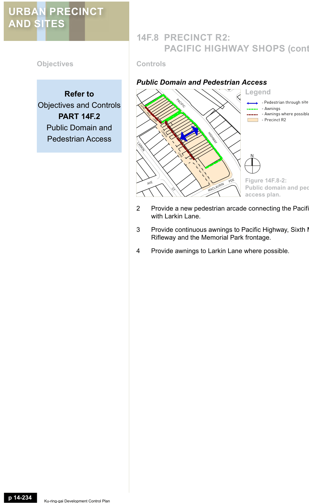
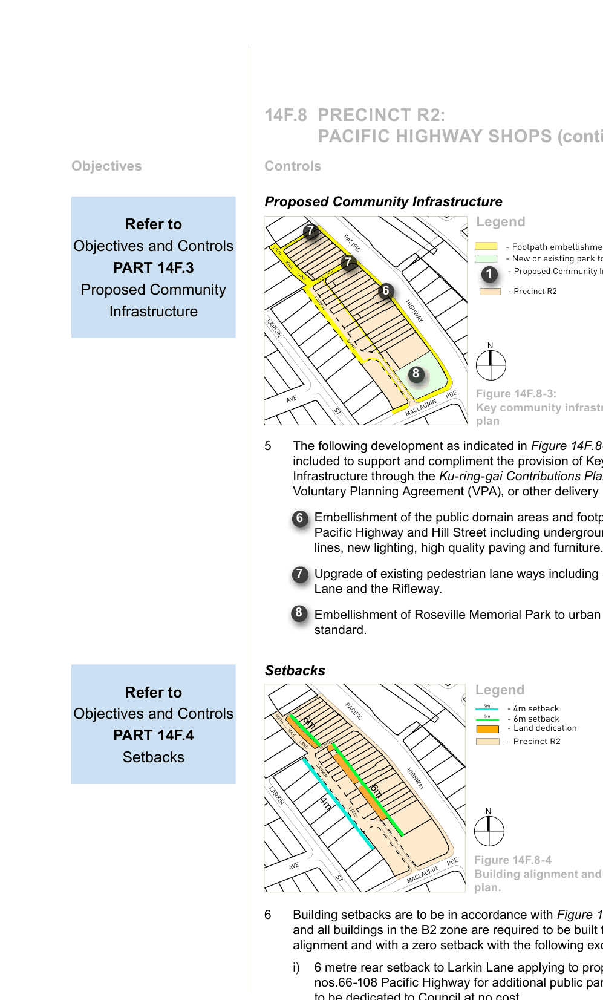
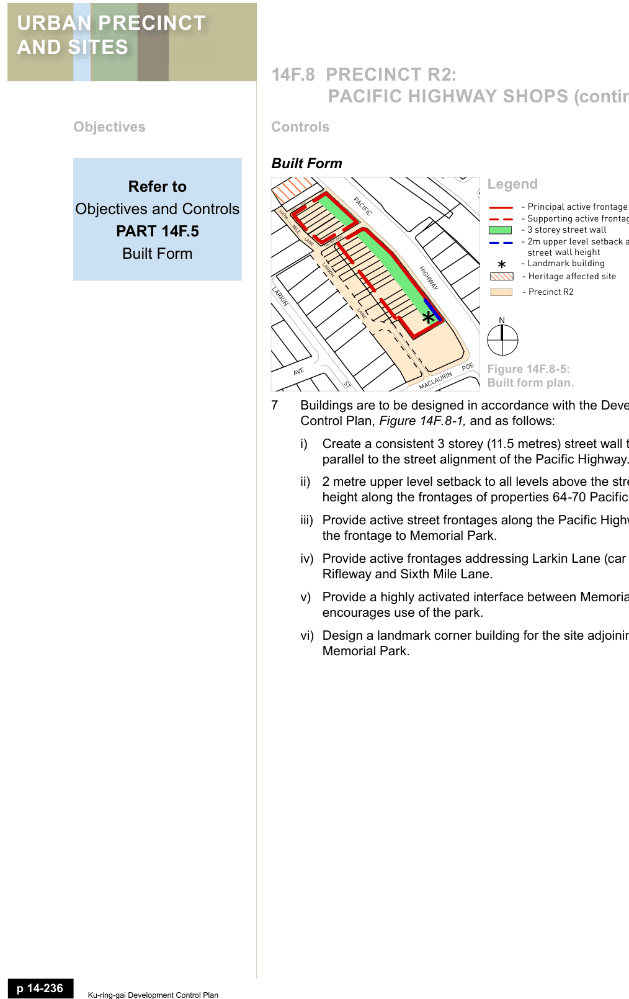
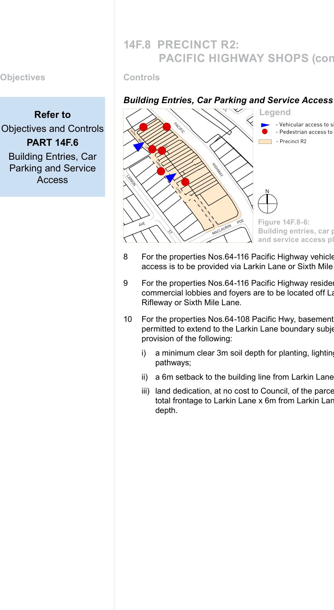
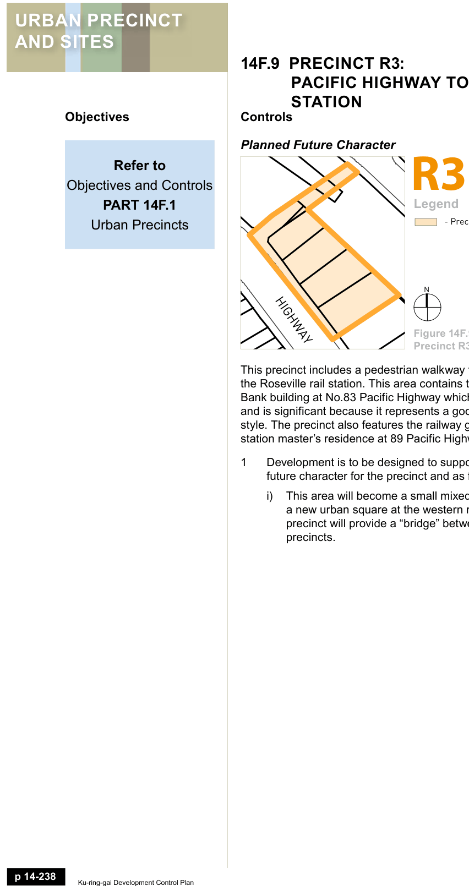
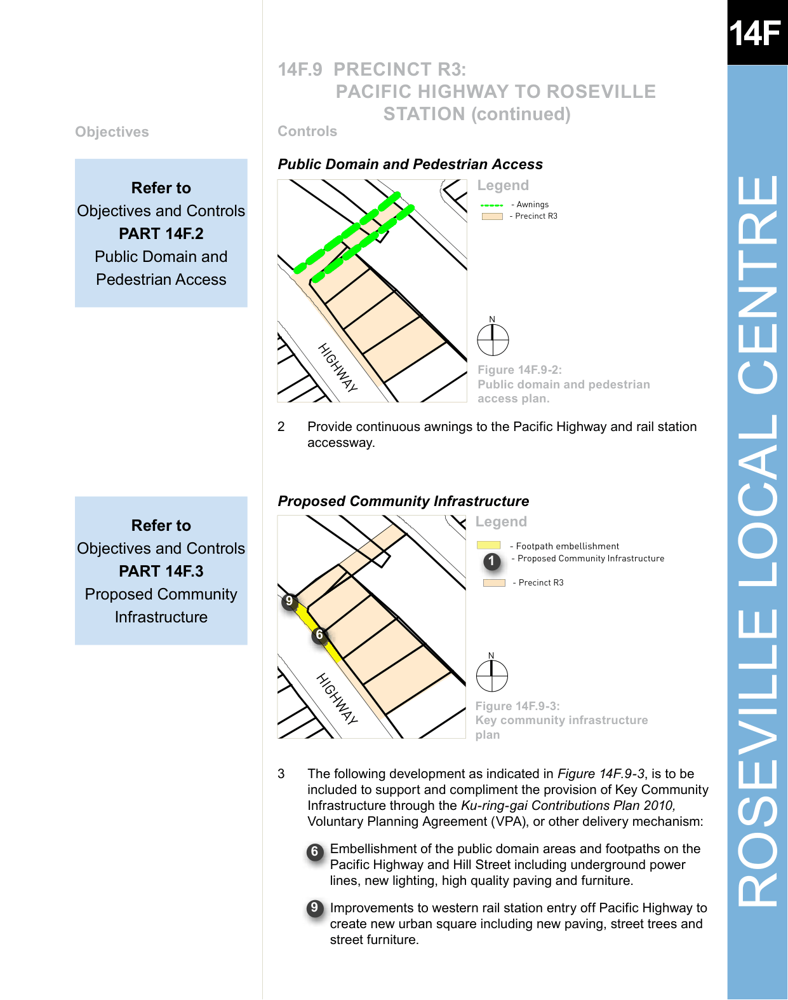
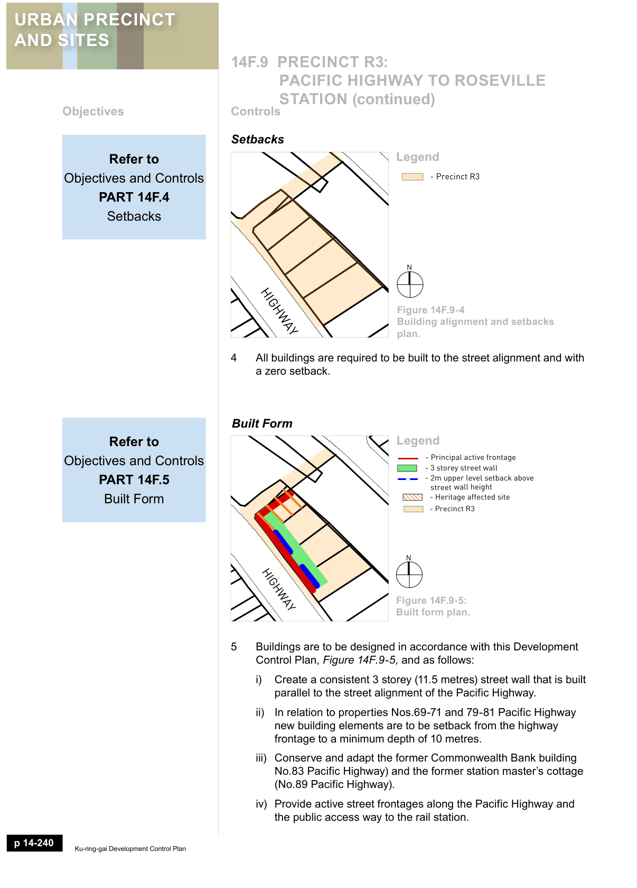

### 14F.8  PRECINCT R2:

### PACIFIC HIGHWAY SHOPS

PDE

#### Objectives

#### Controls

MACLAURIN

#### Planned Future Character

D

NOLA

Refer to

#### Objectives and Controls

### R2

### R2

LN

4 6 8 12

#### PART 14F.1

#### Urban Precincts

AVE

RD

14 16

2A

AVE

AY

VICTORIA

WYVERN

ST

This precinct incorporates the traditional strip retail fronting the Pacific

Highway and a Council car park on Larkin Lane. The shops have largely

lost their role as local shops and the area has become established as

an entertainment precinct with cafes, restaurants, and antique shops.

Roseville cinema and the RSL club provide an anchor role for this

precinct attracting people from across northern Sydney and beyond. 1 Development is to be designed to support and enhance the planned

future character for the precinct, as following:

i) This precinct has potential to continue to grow and develop as

a boutique entertainment precinct which offers an alternative to

what is currently available in larger centres such as Chatswood.

ii)	 The character of this precinct will be preserved and enhanced.

Small scale infill development or sympathetic adaptive re-use of

existing character buildings will be encouraged.

31

33

WILLIAM

iii)	 New low scale residential or commercial development may be

located at the rear of the sites facing Larkin Lane.

35

37

33A

W

AVE

### ROSEVILLE LOCAL CENTRE

R

LADE

ARTIN

GLENCROFT

ROSEVIL

LINDFIELD

LINDFIELD

16-18

ST 1

KENILWORTH

43 16-18

21 ST

RD 1

KENILWORTH

HIGHGATE

> [Picture on page 16: a map, saved as a picture (images/part-14f-roseville-local-centre-page-16-16.gif, 150 dpi); the street names and other small labels are on the picture.]
> Words printed on the picture (title and legend, copied from the PDF):
> - Land dedication
> - Alternate deep soil requirement
> 1 ( UNFORMED )
> - Land dedication
> - Alternate deep soil requirement
> 1 ( UNFORMED )
> AVE 51 56A
> - Entry plaza/forecourt
> - Continuous awnings
> - Continuous awnings where possible
> - Continuous colonnade
> ROSEVILLE    LANE 1
> BUILDING ENTRIES AND CARPAT
> - Primary active frontage
> - Secondary active frontage
> - 3 storey street wall
> - 2m upper level setback above street
> - 4m upper level setback above street
> - Vehicular access to site
> - Pedestrian access to site
> - Primary active frontage
> - Secondary active frontage
> - 3 storey street wall
> - 2m upper level setback above street
> - 4m upper level setback above street
> PUBLIC DOMAIN AND PEDESTRIAN
> PUBLIC DOMAIN AND PEDESTRIAN
> - Pedestrian through site link
> - Entry plaza/forecourt
> Awnings where possible
> - Continuous colonnade
> LANE THE  RIFLEWAY
> - Pedestrian through site link
> - Entry plaza/forecourt
> Awnings where possible
> - Continuous colonnade
> - Precinct R1
> - Precinct R2
> - Precinct R3
> BUILDING ENTRIES AND CARPAT
> BUILDING ENTRIES AND CARPAT
> - Vehicular access to site
> - Pedestrian access to site
> - Vehicular access to site
> - Pedestrian access to site
> THE  RIFLEWAY HARBOUR
> Public domain and pedestrian
> - Precinct L1
> - Precinct L2
> - Precinct L3
> - Precinct L4
> - Precinct L5
> - Precinct L6
> - Precinct L7
> - Precinct L8
> - Precinct L9
> - Precinct L1
> - Precinct L2
> - Precinct L3
> - Precinct L4
> - Precinct L5
> - Precinct L6
> - Precinct L7
> - Precinct L8
> - Precinct L9
> with Larkin Lane.
> 1-3 5 7
> LLEWELLYN 9A 11
> STRICKLAND LANE RD

Figure 14F.8-2:

#### R2

#### R3

### 14F.8  PRECINCT R2:

### PACIFIC HIGHWAY SHOPS (continued)

NELSON

#### Objectives

#### Controls Public Domain and Pedestrian Access

#### Legend

ST Refer to

#### Objectives and Controls

AVE

#### PART 14F.2

Public Domain and

2

#### Pedestrian Access WILLIAM

VICTORIA

L

4

L

4

ST

2 Provide a new pedestrian arcade connecting the Pacific Highway

3 Provide continuous awnings to Pacific Highway, Sixth Mile Lane, the

Rifleway and the Memorial Park frontage.

ARC

4 Provide awnings to Larkin Lane where possible.

WILLIAM

WARATAH

AVE

ARTIN

OLI

- Pedestrian through site link

> [Picture on page 17: a map, saved as a picture (images/part-14f-roseville-local-centre-page-17-4.gif, 150 dpi); the street names and other small labels are on the picture.]
> Words printed on the picture (title and legend, copied from the PDF):
> 51 5 7 9 11
> NEWHAVEN GLENCROFT 2
> - Awnings where possible
> 10 12 14 16 18
> BUILDING ENTRIES AND CARPAT
> - Vehicular access to site
> - Pedestrian access to site
> 4 8 10
> 5 7 9 11
> LANE THE  RIFLEWAY
> - Continuous awnings
> - Continuous awnings where possible
> - Continuous colonnade
> 24 22 20 18
> - Heritage item
> BUILDING ENTRIES AND CARPAT
> - Through site link
> - Entry plaza/forecourt
> - Continuous awnings
> - Continuous awnings where possible
> - Continuous colonnade
> 10 12 14 16 18
> 4 6 8
> BUILDING ENTRIES AND CARPAT
> 82 3.66W PATHWAY
> - Landmark building
> IKARA 1 80
> 3 5 7 11
> - Vehicular access to site
> - Pedestrian access to site
> - Vehicular access to site
> - Pedestrian access to site
> - Character item
> KEY COMMUNITY INFRASTRUCTRE
> - Refer to site specific DCP
> - Proposed road
> - Proposed Community Infrastructure
> 24 22 20 18
> BYRON 20 9
> - Precinct R1
> - Precinct R2
> - Precinct R3
> ALIGNMENT AND SETBACKS
> 5 PL 2
> - Footpath embellishment
> - New or existing park to be upgraded
> - Historic/character building to be
> - New/realigned road
> - Proposed pedestrian promenade
> - New community facility
> - Landscaping 39 & 1A
> 3.66W PATHWAY 46
> 1 69A 5
> 39 & 1A
> 1 7 3.66W PATHWAY
> - 15m setback
> - 12m setback
> - 10m setback
> - 6m setback
> - 5m setback
> - 4m setback
> - 3m setback
> - 2m setback
> - Land dedication
> - Alternate deep soil requirement
> Key community infrastructure
> - Primary active frontage
> - Secondary active frontage
> - 3 storey street wall
> - 2m upper level setback above street
> - 4m upper level setback above street
> PUBLIC DOMAIN AND PEDESTRIAN
> (2 - 12)
> E THE  RIFLEWAY
> ALIGNMENT AND SETBACKS
> 55 ALIGNMENT AND SETBACKS
> - 9m setback
> 27 25 23
> - Through site link
> - Entry plaza/forecourt
> - Continuous awnings
> - Continuous awnings where possible
> - Continuous colonnade
> 21 19 17
> - 15m setback
> - 9m setback
> 26 24 22
> 27 25 23
> ROSEVILLE    LANE 15m - 13m setback
> 21 19 17
> - 15m setback
> 12 10 8
> BUILDING ENTRIES AND CARPAT
> ALIGNMENT AND SETBACKS
> - 12m setback
> 26 24 22
> - 13m setback
> 12 10 8
> - 11m setback
> - 9m setback
> - 12m setback
> 27 25 23
> 5 - 11m setback
> 21 19 17
> - Vehicular access to site
> - Pedestrian access to site
> - 15m setback
> 26 24 22
> - 13m setback
> 14 12 12 10 8
> 7.32 / 3.66 W.
> ESMT FOR SERVICES
> - 12m setback
> - 11m setback
> 1 7.32 / 3.66 W.
> ESMT FOR SERVICES
> 14 12 23
> 7.32 / 3.66 W.
> ESMT FOR SERVICES
> 101 103 105
> - Precinct R1
> - Precinct R2
> - Precinct R3
> - 10m setback
> - 6m setback
> - 5m setback
> - 4m setback
> - 3m setback
> - 2m setback
> - Land dedication
> - Alternate deep soil landscaping
> (% of site)
> 101 103 105
> DAINTON 123 125 127
> - 10m setback
> - 6m setback
> - 5m setback
> - 4m setback
> - 3m setback
> - 2m setback
> - Land dedication
> - Alternate deep soil landscaping
> (% of site)
> 123 125 127
> 101 103 105 107
> - 10m setback
> - 6m setback
> - 5m setback
> - 4m setback
> - 3m setback
> - 2m setback
> - Land dedication
> - Alternate deep soil landscaping
> (% of site)
> RD 123 125 127
> 2 4 6 8 10
> - Principal active frontage
> - Supporting active frontage
> - 3 storey street wall
> - 2m upper level setback above
> 1 3 5
> 4 6 8 10 street
> - Principal active frontage
> - Supporting active frontage
> - 3 storey street wall
> - 2m upper level setback above
> - 4m upper level setback above
> 1 3 5 street
> street wall height
> - 4m upper level setback above
> 4 6 8 10
> - Principal active frontage
> - Supporting active frontage
> - 3 storey street wall
> - 2m upper level setback above
> street wall height
> 1 3 5
> PUBLIC DOMAIN AND PEDESTRIAN
> Building alignment and setbacks
> 3m RD 3m
> - 4m upper level setback above
> 4 8 10
> PUBLIC DOMAIN AND PEDESTRIAN
> street wall height
> 5 7 9 11
> 4 8 10
> 5 7 9 11
> PUBLIC DOMAIN AND PEDESTRIAN
> 4 8 10
> - Pedestrian through site link
> - Entry plaza/forecourt
> - Awnings where possible
> 10 12 14 16 18
> 4 6 8 5 7 9 11
> - Pedestrian through site link
> - Entry plaza/forecourt
> - Awnings where possible
> 9 10 12 14 16 18
> BUILDING ENTRIES AND CARPAT
> BUILDING ENTRIES AND CARPAT
> - Pedestrian through site link
> - Awnings where possible

Figure 14F.8-3:

Figure 14F.8-4

### 14F.8  PRECINCT R2:

### PACIFIC HIGHWAY SHOPS (continued)

#### R2

#### R3

20 9

7

#### Objectives

#### Controls

### *

DUDLEY

#### Proposed Community Infrastructure

1

3

5

2

4

6

8

10

14

16

12

#### Legend

10

Refer to

#### Objectives and Controls

8

6

4

2

5

3

1

1A

DE

#### PART 14F.3

#### Proposed Community

AVE

AVE

#### Infrastructure

27

22

20

43

21

VICTORIA

34

36

30

32

40

44

38

37

39

41

33

35

31

ST

MARTIN

VER

5 The following development as indicated in Figure 14F.8-3, is to be

included to support and compliment the provision of Key Community

Infrastructure through the Ku-ring-gai Contributions Plan 2010,

Voluntary Planning Agreement (VPA), or other delivery mechanism:

28

26

30

LANE

#### 6

Embellishment of the public domain areas and footpaths on the

Pacific Highway and Hill Street including underground power

lines, new lighting, high quality paving and furniture.

#### R1

Upgrade of existing pedestrian lane ways including Sixth Mile

Lane and the Rifleway.

#### R2

#### R3

Embellishment of Roseville Memorial Park to urban park

#### Setbacks

WILLIAM

#### Legend

Refer to

#### Objectives and Controls

#### PART 14F.4

WARATA

#### Setbacks

AVE

AVE

AVE

VICTORIA

### ROSEVILLE LOCAL CENTRE

ST

6 Building setbacks are to be in accordance with Figure 14F.8-4,

and all buildings in the B2 zone are required to be built to the street

alignment and with a zero setback with the following exceptions:

RS

RS

24 RD 2

i) 6 metre rear setback to Larkin Lane applying to properties

nos.66-108 Pacific Highway for additional public parking. Land is

to be dedicated to Council at no cost.

- Colonnade BOUNDARY

KINGS

STANLEY

10 12 14 16 18

CATHERINE

- Vehicular access to site

- Pedestrian access to site

RS

CL

CRESTA

ST 59

BUILDING ENTRIES AND CARPAT

- Vehicular access to site

- Pedestrian access to site

CL

CRESTA

2 ST RD

STANLEY

ST 3 4

HERITATGGEA

RICHARD

E 24 22 20

CRESTA

FIELD

- Vehicular access to site

- Pedestrian access to site

HERITATGGEA

N

RO

LINK 31 31

CR

1 CARCOOLA

- Supporting active frontage

- 2m upper level setback above

1 3 5 ALIGNMENT AND SETBACKS

street

GLENCROFT

- Principal active frontage

> [Picture on page 18: a map, saved as a picture (images/part-14f-roseville-local-centre-page-18-12.gif, 150 dpi); the street names and other small labels are on the picture.]
> Words printed on the picture (title and legend, copied from the PDF):
> GLENCROFT 2 2
> - 4m upper level setback above
> - Supporting active frontage
> - 2m upper level setback above
> - 4m upper level setback above
> 5 7 9 11
> PUBLIC DOMAIN AND PEDESTRIAN
> PUBLIC DOMAIN AND PEDESTRIAN
> PUBLIC DOMAIN AND PEDESTRIAN
> 7.32 / 3.66 W. PACIFIC
> ESMT FOR SERVICES
> (2 - 12)
> (2 - 12)
> 4 8 10
> - Pedestrian through site link
> - Entry plaza/forecourt
> - Awnings where possible
> 5 7 9 11
> 10 12 14 16 18
> 4 6 8
> 3 5 7 11
> BUILDING ENTRIES AND CARPAT
> 101 103 105 24
> - Through site link
> - Entry plaza/forecourt
> - Continuous awnings
> - Continuous awnings where possible
> - Continuous colonnade
> - Through site link
> - Entry plaza/forecourt
> - Continuous awnings
> - Continuous awnings where possible
> - Continuous colonnade
> - Pedestrian through site link
> - Entry plaza/forecourt
> - Awnings where possible
> - 10m setback
> - 6m setback
> - 5m setback
> - 4m setback
> - 3m setback
> - 2m setback
> - Land dedication
> - Alternate deep soil landscaping
> (% of site)
> 10 12 14 16 18
> 4 6 8
> Built Form ST
> - Vehicular access to site
> - Pedestrian access to site
> 123 125 127
> BUILDING ENTRIES AND CARPAT
> BUILDING ENTRIES AND CARPAT
> 3 5 7 11
> BUILDING ENTRIES AND CARPAT
> - Vehicular access to site
> - Pedestrian access to site
> - Vehicular access to site
> - Pedestrian access to site
> 24 22 20 18
> - Vehicular access to site
> - Pedestrian access to site
> - Heritage item
> 4 6 8 10
> - Principal active frontage
> - Supporting active frontage
> - 3 storey street wall
> - 2m upper level setback above
> 1 3 5 street
> 1 1 5
> - Landmark building
> - 4m upper level setback above
> 24 22 20 18 80
> - Heritage affected site
> 6 10 6
> - Character item
> PUBLIC DOMAIN AND PEDESTRIAN
> - Precinct R1
> - Precinct R2
> - Precinct R3
> - Precinct R1
> - Precinct R2
> - Precinct R3
> - Landmark building
> 4 8 10
> 26 26 10m
> 2 3.66W PATHWAY 20
> 5 7 9 11
> 37 6 10
> - Refer to site specific DCP
> - Proposed road
> - Character item
> - Proposed Community Infrastructure
> - Pedestrian through site link
> - Entry plaza/forecourt
> - Awnings where possible
> 10 12 14 16 18
> 4 6 8
> Built form plan.
> 3 5 7 11
> - Refer to site specific DCP
> - Proposed road
> BUILDING ENTRIES AND CARPAT
> POCKLEY 3.66W PATHWAY
> - Proposed Community Infrastructure
> - Vehicular access to site
> - Pedestrian access to site
> 24 22 20 18
> - Heritage item 1
> KINGS 3.66W PATHWAY
> - Landmark building
> - Character item
> - Refer to site specific DCP
> - Proposed road
> 1 7 3.66W PATHWAY
> - Proposed Community Infrastructure
> 26 vi)	 Design a landmark corner building for the site adjoining

Figure 14F.8-5:

#### R1

#### R1

### 14F.8  PRECINCT R2:

### PACIFIC HIGHWAY SHOPS (continued)

#### Objectives

#### R2

#### R3

#### R2

#### R3

#### Legend

EY

Refer to

#### Objectives and Controls

#### PART 14F.5

#### Built Form

NGS

AVE

### * *

### *

VICTORIA

7 Buildings are to be designed in accordance with the Development

Control Plan, Figure 14F.8-1, and as follows:

ST

i) Create a consistent 3 storey (11.5 metres) street wall that is built

parallel to the street alignment of the Pacific Highway.

ii)	 2 metre upper level setback to all levels above the street wall

height along the frontages of properties 64-70 Pacific Highway.

iii)	 Provide active street frontages along the Pacific Highway and

### *

the frontage to Memorial Park.

iv)	 Provide active frontages addressing Larkin Lane (car park), the

Rifleway and Sixth Mile Lane.

v)	 Provide a highly activated interface between Memorial Park that

encourages use of the park.

WILLIAM

W

AVE

NK

OFT

BANCROF

ROSEVILLE ROSEVILLE    LANE

- Principal active frontage

> [Picture on page 19: a map, saved as a picture (images/part-14f-roseville-local-centre-page-19-6.gif, 150 dpi); the street names and other small labels are on the picture.]
> Words printed on the picture (title and legend, copied from the PDF):
> - 2m upper level setback above
> 1 3 5 street
> OLIVER (2 - 12)
> - 4m upper level setback above
> street wall height
> PUBLIC DOMAIN AND PEDESTRIAN
> - Continuous awnings
> - Continuous awnings where possible
> - Continuous colonnade
> 4 8 10
> 5 7 9 11
> BUILDING ENTRIES AND CARPAT
> - Vehicular access to site
> - Pedestrian access to site
> - Pedestrian through site link
> - Entry plaza/forecourt
> - Awnings where possible
> 10 12 14 16 18
> 4 6 8
> 3 5 7 11
> BUILDING ENTRIES AND CARPAT
> - Vehicular access to site
> - Pedestrian access to site
> - Precinct R1
> - Precinct R2
> - Precinct R3
> 24 22 20 18
> - Heritage item
> - Landmark building
> - Character item
> 6 4 2
> - Refer to site specific DCP
> - Proposed road
> Building entries, car parking
> and service access plan.
> 1 7 3.66W PATHWAY
> 26 ii)	 a 6m setback to the building line from Larkin Lane;

Figure 14F.8-6:

- Supporting active frontage

LANE THE  RIFLEWAY

VALE STANLEY MONA

LN

2m

#### R2

#### R3

3m

STANLEY

Y

### 14F.8  PRECINCT R2:

### PACIFIC HIGHWAY SHOPS (continued)

10m

#### Objectives

#### Controls

ST

LARKIN

STANLEY

AVE

POCKLEY

#### Building Entries, Car Parking and Service Access

NOLA

#### Legend

KINGS

Refer to

#### Objectives and Controls

CRESTA

PDE AVE

CORONA

26

#### PART 14F.6

#### Building Entries, Car

18

20

22 24

AVE

LD

AVE

AVE

#### Parking and Service

DR

5 23

#### Access

4

FINDLAY

7

29

31

33 AVE

### *

11

9 DULWICH

19

17

15

VICTORIA

DORSET 16

18

14

12

8

6

10

- Proposed Community Infrastructure

ST

8 For the properties Nos.64-116 Pacific Highway vehicle and service

access is to be provided via Larkin Lane or Sixth Mile Lane.

ARCHER

9 For the properties Nos.64-116 Pacific Highway residential and

commercial lobbies and foyers are to be located off Larkin Lane, The

Rifleway or Sixth Mile Lane. 10 For the properties Nos.64-108 Pacific Hwy, basement levels are

permitted to extend to the Larkin Lane boundary subject to the

provision of the following:

i) a minimum clear 3m soil depth for planting, lighting and

31

iii)	 land dedication, at no cost to Council, of the parcel of land of the

33

WILLIAM

total frontage to Larkin Lane x 6m from Larkin Lane x 3m soil

35

37

33A

WARATAH

AVE

### ROSEVILLE LOCAL CENTRE

OSEVILLE

> [Picture on page 20: a map, saved as a picture (images/part-14f-roseville-local-centre-page-20-2.gif, 150 dpi); the street names and other small labels are on the picture.]
> Words printed on the picture (title and legend, copied from the PDF):
> HIGHWAY 5-17 1
> LANE THE  RIFLEWAY

Figure 14F.9-1:

ROSEVILLE    LANE 3

LORD

- Continuous awnings where possible

- Continuous colonnade

BUILDING ENTRIES AND CARPAT

#### HILL

### 14F.9  PRECINCT R3:

### PACIFIC HIGHWAY TO ROSEVILLE

### STATION

#### Objectives

#### Controls

- Vehicular access to site

- Pedestrian access to site

#### Planned Future Character

Refer to

#### Objectives and Controls

### R3

#### Legend

BANCROFT

- Precinct R1

- Precinct R2

- Precinct R3

#### PART 14F.1

#### Urban Precincts

LANE

ST

BANCROFT

This precinct includes a pedestrian walkway from the Pacific Highway to

the Roseville rail station. This area contains the former Commonwealth

Bank building at No.83 Pacific Highway which is a listed heritage item

and is significant because it represents a good example of the Art Deco

style. The precinct also features the railway gardens and the listed former

station master’s residence at 89 Pacific Highway. 1 Development is to be designed to support and enhance the planned

future character for the precinct and as follows:

ARKIN

i) This area will become a small mixed use precinct incorporating

a new urban square at the western rail station entry. This

precinct will provide a “bridge” between the two main commercial

19-21 HIGHWAY 5-17

1

1

BOUNDARY

#### VE

16-18

KENILWORTH

AVE 21 19 17

VALE

GARRICK

GARRICK

1 RECREATION   WALK

SMITH

18 287A

20 AVE

A

HIGHGATE

#### R2

Y

NELSON

> [Picture on page 21: a map, saved as a picture (images/part-14f-roseville-local-centre-page-21-17.gif, 150 dpi); the street names and other small labels are on the picture.]
> Words printed on the picture (title and legend, copied from the PDF):
> - Land dedication
> - Alternate deep soil requirement
> ( UNFORMED )
> 7.32 / 3.66 W.
> ESMT FOR SERVICES
> 49 TRYON 3m
> - Continuous awnings where possible
> - Continuous colonnade
> ALIGNMENT AND SETBACKS
> 70 6 6A
> 40% BUILDING ENTRIES AND CARPAT
> 27 25 23
> 101 103 105 68
> 21 19 17
> - 2m setback
> - Land dedication
> - Alternate deep soil landscaping
> (% of site)
> 26 24 22
> 123 125 127
> 10 12 10 8
> ALIGNMENT AND SETBACKS
> - Vehicular access to site
> - Pedestrian access to site
> 285 12 4
> - Primary active frontage
> - Secondary active frontage
> - 3 storey street wall
> - 2m upper level setback above street
> - 4m upper level setback above street
> PUBLIC DOMAIN AND PEDESTRIAN
> 7.32 / 3.66 W.
> ESMT FOR SERVICES
> 39 & 1A
> 4 6 8 10
> - Principal active frontage
> - Supporting active frontage
> - 3 storey street wall
> - 2m upper level setback above
> 1 3 5
> - 10m setback
> - 6m setback
> - 3m setback
> - Nil setback
> - Land dedication
> - Alternate deep soil requirement
> - 4m upper level setback above
> - Precinct R1
> - Precinct R2
> - Precinct R3
> - 15m setback
> - 12m setback
> - 10m setback
> - 6m setback
> - 5m setback
> - 4m setback
> - 3m setback
> - 2m setback
> - Land dedication
> - Alternate deep soil requirement
> street wall height
> - Pedestrian through site link
> - Entry plaza/forecourt
> Awnings where possible
> - Continuous colonnade
> 101 103 105
> PUBLIC DOMAIN AND PEDESTRIAN
> BUILDING ENTRIES AND CARPAT
> 123 125 127
> 4 8 10
> 5 7 9 11
> - Vehicular access to site
> - Pedestrian access to site
> - Pedestrian through site link
> - Entry plaza/forecourt
> - Awnings where possible
> 10 12 14 16 18
> 4 6 8
> 4 6 8 10
> - Primary active frontage
> - Secondary active frontage
> - 3 storey street wall
> - 2m upper level setback above street
> - 4m upper level setback above street
> 3 5 7 11
> BUILDING ENTRIES AND CARPAT
> 1 3 5
> - Primary active frontage
> - Secondary active frontage
> - 3 storey street wall
> - 2m upper level setback above street
> - 4m upper level setback above street
> ROSEVILLE    LANE MARJORIE
> PUBLIC DOMAIN AND PEDESTRIAN
> PUBLIC DOMAIN AND PEDESTRIAN
> - Vehicular access to site
> - Pedestrian access to site
> (2 - 12) ST
> - Precinct L1
> - Precinct L2
> - Precinct L3
> - Precinct L4
> - Precinct L5
> - Precinct L6
> - Precinct L7
> - Precinct L8
> - Precinct L9
> Public domain and pedestrian
> 4 8 10
> 5 7 9 11
> 24 22 20 18
> - Through site link
> - Entry plaza/forecourt
> - Continuous awnings
> - Continuous awnings where possible
> - Continuous colonnade
> - Heritage item
> - Through site link
> - Entry plaza/forecourt
> - Continuous awnings
> - Continuous awnings where possible
> - Continuous colonnade
> BUILDING ENTRIES AND CARPAT
> BUILDING ENTRIES AND CARPAT
> - Landmark building
> 10 12 14 16 18
> 4 6 8
> 2 ST 20
> 3 5 7 11
> - Vehicular access to site
> - Pedestrian access to site
> - Vehicular access to site
> - Pedestrian access to site
> - Character item
> 6.10W Proposed Community Infrastructure
> PRIESTLEY HIGHWAY 5-17 RD
> KEY COMMUNITY INFRASTRUCTRE
> - Refer to site specific DCP
> - Proposed road
> 1 7 3.66W PATHWAY
> - Proposed Community Infrastructure
> 24 22 20 18
> - Precinct R1
> - Precinct R2
> - Precinct R3
> 3.66W PATHWAY 18
> IKARA 1 80
> THE  RIFLEWAY PL
> - Footpath embellishment
> - New or existing park to be upgraded
> - Historic/character building to be
> - New/realigned road
> - Proposed pedestrian promenade
> - New community facility
> 28 5 39
> 44 6 4 2
> 1 7 3.66W PATHWAY
> Key community infrastructure

Figure 14F.9-2:

Figure 14F.9-3:

### 14F.9  PRECINCT R3:

### PACIFIC HIGHWAY TO ROSEVILLE

### STATION (continued)

#### Controls

#### Objectives

#### Public Domain and Pedestrian Access

#### Legend

Refer to

#### Objectives and Controls

#### PART 14F.2

Public Domain and

#### Pedestrian Access

A

#### R1

ELD

#### R2

#### R3

2 Provide continuous awnings to the Pacific Highway and rail station

#### HILL

### *

9

E

#### Legend

Refer to

#### Objectives and Controls

#### PART 14F.3

#### Proposed Community Infrastructure

3 The following development as indicated in Figure 14F.9-3, is to be

included to support and compliment the provision of Key Community

Infrastructure through the Ku-ring-gai Contributions Plan 2010,

Voluntary Planning Agreement (VPA), or other delivery mechanism: Embellishment of the public domain areas and footpaths on the

Pacific Highway and Hill Street including underground power

lines, new lighting, high quality paving and furniture.

### ROSEVILLE LOCAL CENTRE

Improvements to western rail station entry off Pacific Highway to

create new urban square including new paving, street trees and

ONA

VE

#### ROSEVI

AVE SEVILLE    LANE

> [Picture on page 22: a map, saved as a picture (images/part-14f-roseville-local-centre-page-22-4.gif, 150 dpi); the street names and other small labels are on the picture.]
> Words printed on the picture (title and legend, copied from the PDF):
> - Continuous awnings where possible
> - Continuous colonnade
> BUILDING ENTRIES AND CARPAT
> ALIGNMENT AND SETBACKS
> - Vehicular access to site
> - Pedestrian access to site
> - 9m setback
> 27 25 23
> ALIGNMENT AND SETBACKS
> 21 19 17
> - 15m setback
> 26 24 22
> - 13m setback
> 12 10 8
> - 12m setback
> - 11m setback
> 7.32 / 3.66 W.
> ESMT FOR SERVICES
> 39 & 1A
> - Precinct R1
> - Precinct R2
> - Precinct R3
> - 15m setback
> - 12m setback
> - 10m setback
> - 6m setback
> - 5m setback
> - 4m setback
> - 3m setback
> - 2m setback
> - Land dedication
> - Alternate deep soil requirement
> 101 103 105
> - 10m setback
> - 6m setback
> - 5m setback
> - 4m setback
> - 3m setback
> - 2m setback
> - Land dedication
> - Alternate deep soil landscaping
> (% of site)
> 123 125 127
> ALIGNMENT AND SETBACKS
> ALIGNMENT AND SETBACKS
> - 9m setback
> 4 6 8 10
> 27 25 23
> - Principal active frontage
> - Supporting active frontage
> - 3 storey street wall
> - 2m upper level setback above
> - 9m setback
> 21 19 17
> - 15m setback
> 1 3 5
> 27 25 23
> 4 15m street
> 26 24 22
> 21 19 17
> - 13m setback
> - 15m setback
> 12 10 8
> - Primary active frontage
> - Secondary active frontage
> - 3 storey street wall
> - 2m upper level setback above street
> - 4m upper level setback above street
> - 4m upper level setback above
> 26 24 22
> - 12m setback
> - 13m setback
> 12 10 8
> street wall height ST
> - 11m setback
> - 12m setback
> PUBLIC DOMAIN AND PEDESTRIAN
> 5 - 11m setback
> (2 - 12)
> Building alignment and setbacks
> 5 PUBLIC DOMAIN AND PEDESTRIAN
> 7.32 / 3.66 W.
> ESMT FOR SERVICES
> 4 8 10
> LANE 18 16
> 7.32 / 3.66 W.
> ESMT FOR SERVICES
> 5 7 9 11
> a zero setback.
> - Through site link
> - Entry plaza/forecourt
> - Continuous awnings
> - Continuous awnings where possible
> - Continuous colonnade
> - Pedestrian through site link
> - Entry plaza/forecourt
> - Awnings where possible
> 101 103 105
> BUILDING ENTRIES AND CARPAT
> 10 12 14 16 18
> 4 6 8
> - 10m setback
> - 6m setback
> - 5m setback
> - 4m setback
> - 3m setback
> - 2m setback
> - Land dedication
> - Alternate deep soil landscaping
> (% of site)
> 101 103 105 24 26
> 3 5 7 11
> BUILDING ENTRIES AND CARPAT
> - 10m setback
> - 6m setback
> - 5m setback
> - 4m setback
> - 3m setback
> - 2m setback
> - Land dedication
> - Alternate deep soil landscaping
> (% of site)
> 117 123 125 127
> 123 125 127
> - Vehicular access to site
> - Pedestrian access to site
> - Vehicular access to site
> - Pedestrian access to site
> 4 6 8 10
> - Principal active frontage
> - Supporting active frontage
> - 3 storey street wall
> - 2m upper level setback above
> 4 6 8 10
> 1 3 5
> - Principal active frontage
> - Supporting active frontage
> - 3 storey street wall
> - 2m upper level setback above
> 24 22 20 18
> 1 3 5
> - Heritage affected site BANCROFT
> - 4m upper level setback above
> - 4m upper level setback above
> street wall height
> - Precinct R1
> - Precinct R2
> - Precinct R3
> street wall height
> 82 3.66W PATHWAY
> - Landmark building
> PUBLIC DOMAIN AND PEDESTRIAN
> PUBLIC DOMAIN AND PEDESTRIAN
> 4 8 10
> 4 8 10
> 5 7 9 11
> - Character item
> 5 7 9 11
> 6m 74 NEWHAVEN
> - Pedestrian through site link
> - Entry plaza/forecourt
> - Awnings where possible
> 10 12 14 16 18
> 4 6 8
> 2 CATHERINE 4 2
> - Refer to site specific DCP
> - Proposed road
> - Pedestrian through site link
> - Entry plaza/forecourt
> - Awnings where possible
> 10 12 14 16 18
> 4 6 8
> CATHERINE 15 19
> 3 5 7 11
> - Proposed Community Infrastructure
> BUILDING ENTRIES AND CARPAT
> 3 5 7 11
> Built form plan.
> BUILDING ENTRIES AND CARPAT
> - Vehicular access to site
> - Pedestrian access to site
> - Vehicular access to site
> - Pedestrian access to site
> 24 22 20 18
> - Heritage item
> 24 22 20 18
> - Heritage item
> - Landmark building
> 2 3.66W PATHWAY
> - Landmark building
> RD 1 80 45
> 27 8 PL
> - Character item
> - Character item
> PL 3.66W PATHWAY
> - Refer to site specific DCP
> - Proposed road
> (No.89 Pacific Highway).
> - Refer to site specific DCP
> - Proposed road
> - Proposed Community Infrastructure
> - Proposed Community Infrastructure

Figure 14F.9-4

Figure 14F.9-5:

#### HILL

#### Objectives

### 14F.9  PRECINCT R3:

### PACIFIC HIGHWAY TO ROSEVILLE

### STATION (continued)

#### Controls

LA

#### Legend

Refer to

#### Objectives and Controls

#### PACIFIC

### varies
