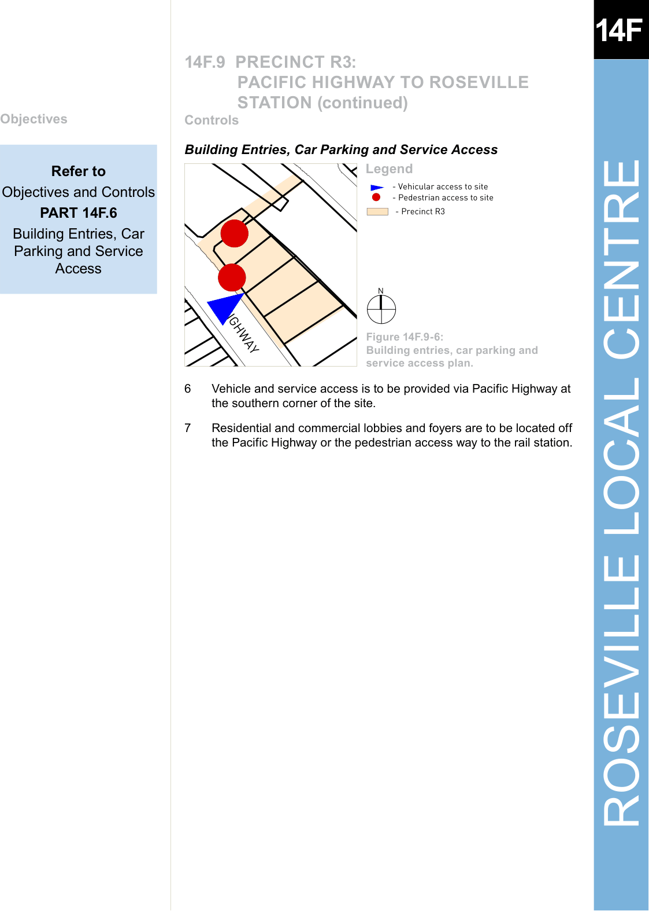

## 5 PART 14F.4

### 6m

H

#### Setbacks

### 4m

### 10m

#### ST

6m

#### BANCROFT

22

20

4

22

18

#### R1

18

#### HIGHWAY

### 6m

4 All buildings are required to be built to the street alignment and with

#### R2

#### R3

### LANE 4m

#### Built Form

Refer to

#### Objectives and Controls

#### PART 14F.5

#### PDE

#### Built Form

#### AVE

#### ST

#### N

#### MACLAURIN 34A

### *

5 Buildings are to be designed in accordance with this Development

Control Plan, Figure 14F.9-5, and as follows:

i) Create a consistent 3 storey (11.5 metres) street wall that is built

parallel to the street alignment of the Pacific Highway.

5

5

ii)	 In relation to properties Nos.69-71 and 79-81 Pacific Highway

#### HIGHWAY

### *

### *

new building elements are to be setback from the highway

frontage to a minimum depth of 10 metres.

iii)	 Conserve and adapt the former Commonwealth Bank building

No.83 Pacific Highway) and the former station master’s cottage

#### BOUNDAR

iv)	 Provide active street frontages along the Pacific Highway and

the public access way to the rail station.

NK

A

ROSEVILLE ROSEVILLE    LANE

- Principal active frontage

> [Picture on page 23: a map, saved as a picture (images/part-14f-roseville-local-centre-page-23-5.gif, 150 dpi); the street names and other small labels are on the picture.]
> Words printed on the picture (title and legend, copied from the PDF):
> ST 4 6 8 10
> - Supporting active frontage
> - 2m upper level setback above
> - 4m upper level setback above
> street wall height
> - Continuous awnings where possible
> - Continuous colonnade
> PUBLIC DOMAIN AND PEDESTRIAN
> BUILDING ENTRIES AND CARPAT
> 4 8 10
> 5 7 9 11
> - Vehicular access to site
> - Pedestrian access to site
> - Pedestrian through site link
> - Entry plaza/forecourt
> - Awnings where possible
> 10 12 14 16 18
> 4 6 8
> 3 5 7 11
> BUILDING ENTRIES AND CARPAT
> - Vehicular access to site
> - Pedestrian access to site
> - Precinct R1
> - Precinct R2
> - Precinct R3
> 24 22 20 18
> 16 12 WILLIAM
> - Heritage item
> 82 3.66W PATHWAY
> - Landmark building
> IKARA 1 80
> - Character item
> 28 5 39
> 6 3.66W PATHWAY
> 6 4 2
> - Refer to site specific DCP
> - Proposed road
> Building entries, car parking and
> service access plan.
> 1 7 3.66W PATHWAY
> - Proposed Community Infrastructure

Figure 14F.9-6:

THE  RIFLEWAY LARKIN 6m

VALE

STANLEY

LANE GILLOTT

NA

ST

LN

2m

3m

STANLEY

10m PDE

ST MACLAURIN CLOSE

#### Objectives

STANLEY

### 14F.9  PRECINCT R3:

### PACIFIC HIGHWAY TO ROSEVILLE

### STATION (continued)

#### HILL

LANE

RD

#### Building Entries, Car Parking and Service Access

NOLA

#### Legend

MILE

LN SIXTH

Refer to

#### Objectives and Controls

CL

CRESTA 4 6 8 12

ORONA

14 16

18

2A

SIXTH MILE

#### PART 14F.6

#### Building Entries, Car

AVE

#### Parking and Service

DR
