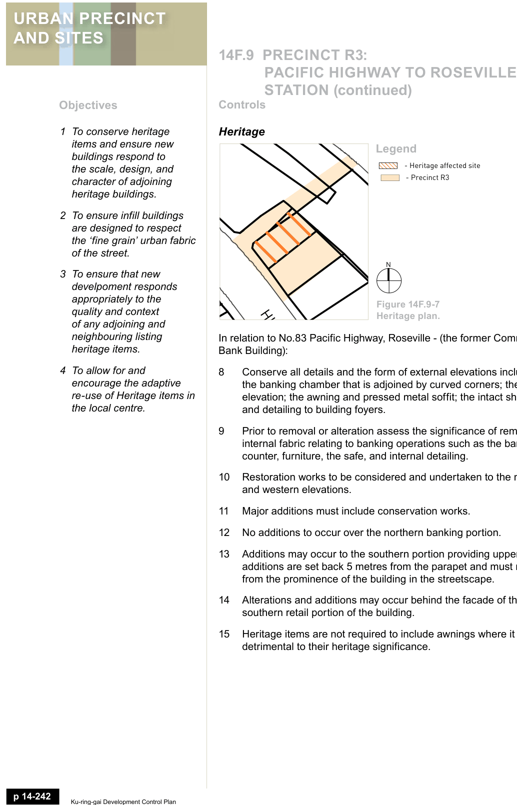

#### 7 10 Access

FINDLAY 4

8

6

### *

23

25

20A

22

24

29

31

35

33

6 Vehicle and service access is to be provided via Pacific Highway at

the southern corner of the site. 7 Residential and commercial lobbies and foyers are to be located off

the Pacific Highway or the pedestrian access way to the rail station.

AVE

LARKIN

NOLA

### ROSEVILLE LOCAL CENTRE

A

2 4 6 8 10

ROSEVIL

CARCOOLA - 2m upper level setback above

OSEVILLE    LANE

street

E    LANE

- 4m upper level setback above street wall height

> [Picture on page 24: a map, saved as a picture (images/part-14f-roseville-local-centre-page-24-9.gif, 150 dpi); the street names and other small labels are on the picture.]
> Words printed on the picture (title and legend, copied from the PDF):
> - Continuous awnings where possible
> - Continuous colonnade
> BUILDING ENTRIES AND CARPAT
> - Pedestrian through site link
> - Awnings where possible
> 10 12 14 16 18
> 4 6 8
> 3 5 7 11
> BUILDING ENTRIES AND CARPAT
> - Vehicular access to site
> - Pedestrian access to site
> - Vehicular access to site
> - Pedestrian access to site
> 24 22 20 18
> - Heritage affected site
> - Precinct R1
> - Precinct R2
> - Precinct R3
> 82 3.66W PATHWAY
> - Landmark building
> IKARA 1 80
> 1	 To conserve heritage
> items and ensure new
> buildings respond to
> the scale, design, and
> character of adjoining
> - Character item
> 28 5 39
> 6 3.66W PATHWAY
> are designed to respect
> of the street.
> 6 4 2
> - Refer to site specific DCP
> - Proposed road
> 7 3.66W PATHWAY
> - Proposed Community Infrastructure
> appropriately to the
> quality and context
> of any adjoining and
> encourage the adaptive
> the local centre.
> and western elevations.

Figure 14F.9-7
