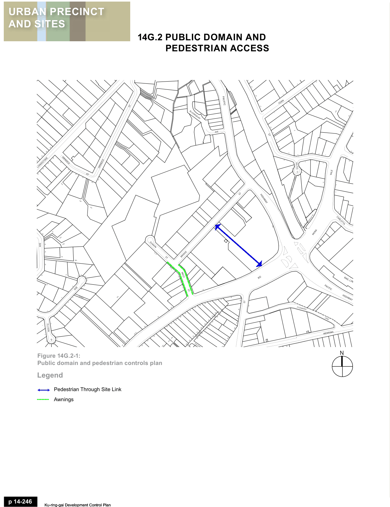

### 14G.1 URBAN PRECINCT:

### PYMBLE BUSINESS PARK

#### Legend

#### Objectives

1	 To create a vibrant

precinct capable of

attracting commercial

investment and quality

tenants.

2	 To encourage the growth

of local businesses that

provide employment

and support the local

economy.

3	 To promote development

that provides an excellent

working environment

alongside associated

services and facilities. 4	 To ensure development

contributes to the

urban character, quality

and amenity of the

employment precinct.

### 14G.1 URBAN PRECINCT:

### PYMBLE BUSINESS PARK (continued)

#### Controls Planned Future Character

All development within the Pymble Business Park precinct, as outlined

in Figure 14G.1-1, is to be designed to support and enhance the planned

future character of the precinct.

This is to be done through compliance with the specific requirements

outlined in Part 14G of the DCP, compliance with the non-residential and

office buildings controls at Part 9 of the DCP, as well as other relevant

parts of Section A, B and C of the DCP.

Where there is an inconsistency between Part 14G and other sections

of the DCP, the controls in Part 14G will prevail to the extent of that

inconsistency.

Pymble Business Park is a unique precinct as it is the only urban services

land within the Ku-ring-gai area, which the North District Plan categorises

as ‘retain and manage’. Urban Services support the activities of the local

population and businesses. The Business Park accommodates a broad

range of land uses including light industries, warehouses, hardware,

offices and limited specialised retail uses.

The precinct has historically housed a concentration of business uses

with associated ancillary facilities. It is a self contained precinct separated

from residential development by the Pacific Highway, Ryde Road and

C2 Environmental Conservation Lands. The exception to this is the

established medium density housing to its north.

Pymble Business Park will be encouraged to consolidate its urban fabric

and provide high quality buildings and a landscaped environment to

create a green employment precinct which supports the local economy

and provides employment opportunities.

The planned future character for Pymble Business Park varies due to

topography and location. The precinct has several sub-precincts:

i) Bridge Street - new development is to address the street and

provide building entries and frontages with direct physical access

and visual surveillance from ground floors of the buildings.

Developments are to have well-considered and landscaped front,

side and rear setbacks.

ii)	 Pacific Highway (North Side) - new development is to provide a

continuous street wall with buildings built to the street alignment

with primary active frontages.

iii)	 Pacific Highway (South Side) - new development is to respect

the Heritage Item and ensure its continued prominence in the

streetscape.

### PYMBLE BUSINESS PARK

iv)	 West Street and Suakin Street - new development is to create a

‘neighbourhood centre’ character with buildings built to the street

alignment, active uses at street level and continuous awnings for

pedestrian amenity.

v)	 Ryde Road - new development is to provide a strong landscape

character with wide street setbacks and quality planting.

RD

GRANDVIEW LN

EDWARD

ALMA

AVON

24A

GRANDVIEW

HIGHWAY

19A

MOCATTA

ST

RD

> [Picture on page 4: a map, saved as a picture (images/part-14g-pymble-business-park-page-4-14.gif, 150 dpi); the street names and other small labels are on the picture.]
> Words printed on the picture (title and legend, copied from the PDF):
> 11 7 3
> ALIGNMENT AND SETBACKS
> ALIGNMENT AND SETBACKS
> 8 10 12 5m
> 8 10 12 5m
> 3m 8 13A
> 14 76 2
> - 15m setback
> - 12m setback
> - 10m setback
> - 6m setback
> - 5m setback
> - 4m setback
> - 3m setback
> - 2m setback
> - Land dedication
> - Alternate deep soil landscaping
> (% of site)
> 9 11 15 PENRHYN
> - 15m setback
> - 12m setback
> - 10m setback
> - 6m setback
> - 5m setback
> - 4m setback
> - 3m setback
> - 2m setback
> - Land dedication
> - Alternate deep soil landscaping
> (% of site)
> 9 11 15
> 12 14 16 18
> 12 14 16 18
> - Primary active frontage
> - Secondary active frontage
> - 3 storey street wall
> - 2m upper level setback above street
> - 4m upper level setback above street
> Public domain and pedestrian controls plan
> - Primary active frontage
> - Secondary active frontage
> - 3 storey street wall
> - 2m upper level setback above street
> - 4m upper level setback above street
> 3.66   WIDE ST
> PUBLIC DOMAIN AND PEDESTRIAN
> PUBLIC DOMAIN AND PEDESTRIAN
> Pedestrian Through Site Link
> PL 65 68
> - Pedestrian through site link
> - Entry plaza/forecourt
> - Awnings where possible
> - Street tree planting
> - Pedestrian through site link
> - Entry plaza/forecourt
> - Awnings where possible
> - Street tree planting
> BUILDING ENTRIES AND CARPAT
> BUILDING ENTRIES AND CARPAT
> - Vehicular access to site
> - Pedestrian access to site
> - Vehicular access to site
> - Pedestrian access to site
> - Heritage/character item
> - Heritage/character item

Figure 14G.2-1:

47

45
