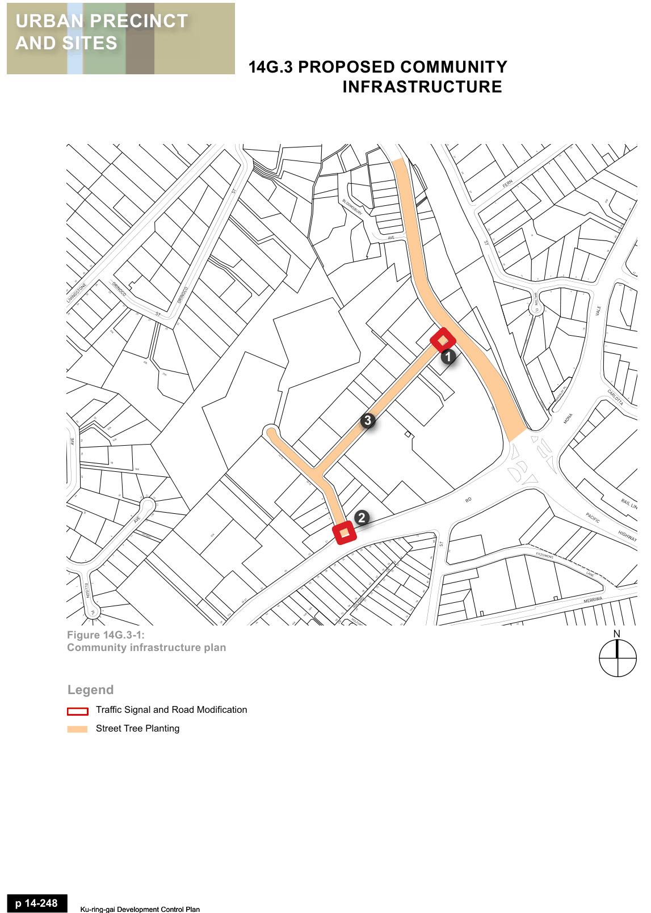

### 14G.2 PUBLIC DOMAIN AND

### PEDESTRIAN ACCESS

43

12

65

MT

8A

C

HIGHWAY

HIGHWA

#### Objectives

1	 To increase the pedestrian

permeability within the

Pymble Business Park. 2	 To improve the pedestrian

amenity of the footpath

areas.

3	 To improve the

streetscape quality and

character of the streets

within the Pymble

Business Park precinct. 4	 To enable safe and active

streets with good passive

surveillance.

### 14G.2  PUBLIC DOMAIN AND

### PEDESTRIAN ACCESS (continued)

#### Controls Public Domain and Pedestrian Access

Enhancement of the public domain and improvement of pedestrian

amenity is required to improve the pedestrian access and permeability

through the area.

1 Provide a new public pedestrian laneway between Bridge Street and

Ryde Road as illustrated in Figure 14G.2-1. The access way is to be

open to the sky with natural light, and be publicly accessible during

business hours.

2 Provide continuous awnings to West Street as illustrated in Figure

14G.2-1.

### PYMBLE BUSINESS PARK

### PYMBLE BUSINESS PARK

> [Picture on page 6: a map, saved as a picture (images/part-14g-pymble-business-park-page-6-1.gif, 150 dpi); the street names and other small labels are on the picture.]
> Words printed on the picture (title and legend, copied from the PDF):
> ALIGNMENT AND SETBACKS
> 8 10 12
> 11 7 3
> - 10m setback
> - 6m setback
> - 3m setback
> - Nil setback
> - Land dedication
> - Alternate deep soil requirement
> 9 11 15
> 12 14 16 18
> ALIGNMENT AND SETBACKS
> - Primary active frontage
> - Secondary active frontage
> - 3 storey street wall
> - 2m upper level setback above street
> - 4m upper level setback above street
> PUBLIC DOMAIN AND PEDESTRIAN
> 8 10 12
> - Through site link
> - Entry plaza/forecourt
> - Continuous awnings
> - Continuous awnings where possible
> - Continuous colonnade
> - 15m setback
> - 12m setback
> - 10m setback
> - 6m setback
> - 5m setback
> - 4m setback
> - 3m setback
> - 2m setback
> - Land dedication
> - Alternate deep soil landscaping
> (% of site)
> BUILDING ENTRIES AND CARPAT
> 9 11 15 17
> - Vehicular access to site
> - Pedestrian access to site
> 12 14 16 18 ELLISON KEY COMMUNITY INFRASTRUCTRE
> - Primary active frontage
> - Secondary active frontage
> - 3 storey street wall
> - 2m upper level setback above street
> - 4m upper level setback above street
> 25A Figure 14G.3-1:
> Community infrastructure plan
> PUBLIC DOMAIN AND PEDESTRIAN
> - Footpath embellishment
> - New or existing park to be upgraded
> - Historic/character building to be
> - New/realigned road
> - Proposed pedestrian promenade
> - New community facility
> - Traffic signal and road modification
> Traffic Signal and Road Modification
> - Pedestrian through site link
> - Entry plaza/forecourt
> - Awnings where possible
> - Street tree planting
> Street Tree Planting
> BUILDING ENTRIES AND CARPAT
> - Vehicular access to site
> - Pedestrian access to site
> - Heritage/character item

### 14G.3 PROPOSED COMMUNITY

### INFRASTRUCTURE

5

#### Legend

HIGHWAY
