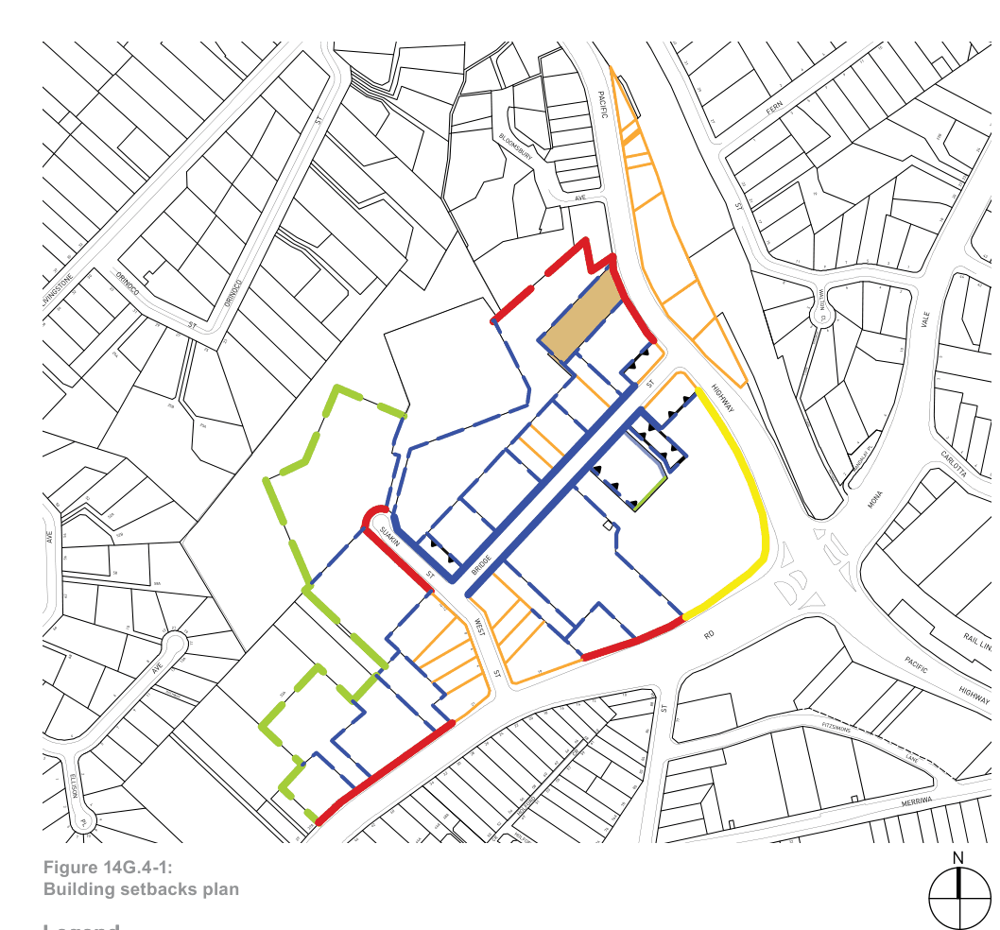

### 14G.4 BUILDING SETBACKS

> [Picture on page 8: a map, saved as a picture (images/part-14g-pymble-business-park-page-8-2.gif, 150 dpi); the street names and other small labels are on the picture.]
> Words printed on the picture (title and legend, copied from the PDF):
> 11 7 3
> 68 8 13A
> Building setbacks plan

Figure 14G.4-1:

#### Legend

#### Legend

Heritage Item Setbacks to adjoining bushland are to be merit-based to allow best fit on site,

and in accordance with biodiversity and riparian requirements Landscaped street setback 5m min Landscaped street setback 10m min Landscaped street setback 20m min Landscaped side/rear setback 5m min Landscaped side/rear setback 10m min Zero setback to boundary Zero setback to flagged side/rear of one property with 5m setback to other

0m 5m

7m deep soil setback 2m deep soil setback

#### Objectives

1	 To create cohesive

streetscapes with

consistent building

alignments and setbacks. 2	 To maximise opportunities

for street tree planting and

landscaping.

3	 To encourage modulation

and articulation of building

facades.

4	 To ensure appropriately

sized floor plates can

be provided to facilitate

the broad mix of uses

permitted in the Business

Park.

5	 Retain existing trees and

vegetation and minimise

the impacts of new

development.

### 14G.4 BUILDING SETBACKS (continued)

#### Controls

1 All buildings within the Pymble Business Park are to comply with the

setback controls illustrated in Figure 14G.4-1.

2 Setbacks on properties adjacent to the Heritage Item are to comply

with the controls in Part 14G.6 and Part 19 of this DCP. 3 Building setbacks stipulated in Figure 14G.4-1 respond to the

location within the business park. They are:

i) zero setbacks to sites that are constrained or where an urban

frontage would benefit the location;

ii)	 landscaped setbacks to sites where a landscaping element

within the setback is required to enhance the character of the

streetscape.

4 Building setbacks for 4-10 Bridge Street are illustrated in Figure

14G.4-1 and are to comply with the following:

i) 5m front landscaped setback to front boundary along Bridge

Street;

ii)	 zero setback to the south side boundary adjoining the driveway

to 950 Pacific Highway;

iii)	 2m minimum deep soil setback to north side boundary adjoining

the driveway to 950 Pacific Highway.

iv)	 7m minimum deep soil setback to rear east boundary adjoining

950 Pacific Highway to ensure the retention of existing trees. Note: where deep soil setbacks are required, the whole setback area is

to comprise of deep soil.

### PYMBLE BUSINESS PARK

ALIGNMENT AND SETBACKS
