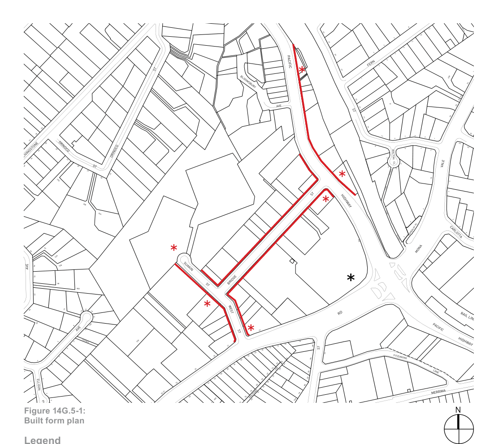
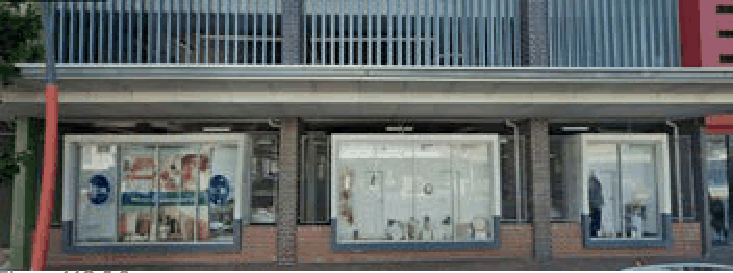
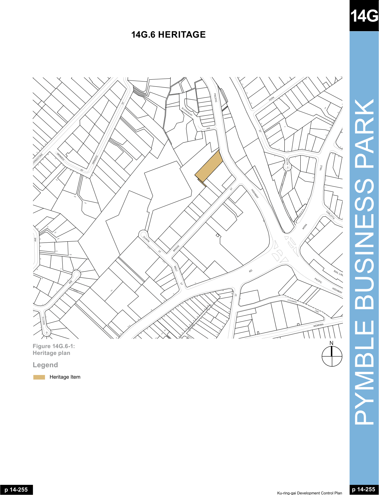

### 14G.5 BUILT FORM

20m

15m

12m

12 14

17

15

### *

14 16

- 20m setback

- 15m setback

- 12m setback

> [Picture on page 10: a map, saved as a picture (images/part-14g-pymble-business-park-page-10-16.gif, 150 dpi); the street names and other small labels are on the picture.]
> Words printed on the picture (title and legend, copied from the PDF):
> - 10m setback
> - 6m setback
> - 5m setback
> - 4m setback
> - 3m setback
> - 2m setback
> - Land dedication
> - Alternate deep soil landscaping
> (% of site)
> 11 7 3
> - Primary active frontage
> - Secondary active frontage
> - 3 storey street wall
> - 2m upper level setback above street
> - 4m upper level setback above street
> PUBLIC DOMAIN AND PEDESTRIAN
> - Pedestrian through site link
> - Entry plaza/forecourt
> - Awnings where possible
> 68 8 13A
> BUILDING ENTRIES AND CARPAT
> - Vehicular access to site
> - Pedestrian access to site
> Built form plan
> - Heritage/character item

Figure 14G.5-1:

15 17

21B

16 18

17 19

### * *

A

25 23

12

14

### *

### *

30

32

CARLOTTA

23

27

25

### *

### *

31

33 ARSON

29

2

27

#### Legend

Active frontage Corner or visually prominent site

### BURGOYNE * Landmark site

- Corner or visually prominent site

- Landmark site

### *

#### Objectives

1	 To ensure building

facades are well designed,

articulated and address

public streets, public

spaces, footpaths, parks

and reserves.

2	 To provide active street

frontages to encourage

physical and visual

connection between the

building and the street. 3	 To support pedestrian

activity and enhance

the amenity, safety and

surveillance of the public

domain.

4	 To enhance the quality

and character of the public

domain in the employment

precinct.

5	 To contribute to the

locality by creating

distinctive buildings. 6	 Ensure any above ground

parking is of high-quality

design that is integrated

within the building,

screened from the public

domain and does not

adversely impact the

streetscape.

7	 To ensure appropriately

sized floor plates can be

provided to facilitate the

broad mix of use permitted

in the Business Park.

### 14G.5 BUILT FORM (continued)

#### Controls

The topography and road orientation within Pymble Business Park

creates a number of sites that are visually prominent. Many of these are

either corner sites or sites at the end of a street. Building design at these

locations have the potential to be designed to respond to their prominent

location. There is one landmark site at the corner of Ryde Road and

Pacific Highway. This is a visually prominent site with the potential to

serve as a memorable marker in this locality.

The steep topography of Bridge Street creates challenges for the

provision of continuous active frontages along the street, especially for

uses that require large floorplates, such as specialised retail premises,

and multiple vehicle access/egress points. Due to the topography a

split level approach to the ground plane treatments for buildings on

Bridge Street is an acceptable design solution. The desired character is

combination of active frontage (such as building foyers, small commercial

premises) and landscaped gardens.

Buildings are to be designed in accordance with Figure 14G.5-1. 1 Provide active street frontages along Pacific Highway, Suakin Street

and West Street in line with Part 9C.10 of this DCP. 2 Provide active street frontages along Bridge Street with a

combination of landscaped setback and a minimum of 50% active

street frontage. All ground floor frontages are to provide for active

uses that contribute to the active street frontage, examples include:

i) Window displays or display cases for displaying goods.

ii)	 Floor to ceiling clear glazing for visual connection with ground

floor internal uses/activities.

iii)	 Well defined pedestrian entries and foyers.

4 Building entries are to be designed as per Part 9C.4 of the DCP and

are to be level with adjoining footpaths, with openings (doors and

windows) that allow a direct visual connection between the building

and the street. See Figure 9C.10-1.

Note: Variations may be permitted on very steep streets. 5 To facilitate the development of Specialised Retail Premises and

other uses which require large floor plates, Part 9C.8 Control 1 and

Control 2 do not apply within the Pymble Business Park. 6 Provide buildings on corner and visually prominent sites that have

distinct articulation addressing their location in line with Part 9C.9 of

this DCP.

### PYMBLE BUSINESS PARK

### PYMBLE BUSINESS PARK

7 Landmark sites are to have a landmark building that is unique and

site responsive. The building design is to be visually prominent and

distinctive in architectural form and identify the location of Pymble

Business Park within the region.

8 Buildings facades are to be designed and articulated to emphasise

vertical proportions, rather than horizontal to minimise the bulk of

Specialised Retail Premises and other uses which require large floor

plates.

### 14G.5 BUILT FORM (continued)

9 Building facades are to incorporate architectural details and

materials that create shadows and depth to achieve three-

dimensional modulation. 10 The preferred location for any car parking within Pymble Business

Park is basement carparking. Where there are identified constraints

such as topography or level changes across a site, a proportion of

the required parking spaces may be provided above ground. 11 Where Council is satisfied that a proportion of above ground parking

is justified, the above ground parking areas are to:

i) be integrated into the building;

ii)	 be concealed by utilising innovative and aesthetically pleasing

screening methods, examples include above ground parking

areas sleeved with a permitted use or glazed display cases;

iii)	 not result in any blank walls facing the street or public areas;

iv)	 not adversely impact the streetscape character.

> [Picture on page 12: a picture, saved as a picture (images/part-14g-pymble-business-park-page-12-17.gif, 150 dpi).]

#### Figure 14G.5-2:

#### Example of above ground car parking sleeved with glazed display cases

> [Picture on page 13: a map, saved as a picture (images/part-14g-pymble-business-park-page-13-1.gif, 150 dpi); the street names and other small labels are on the picture.]
> Words printed on the picture (title and legend, copied from the PDF):
> 68 8 13A
> 11 7 3

Figure 14G.6-1:

#### Legend
