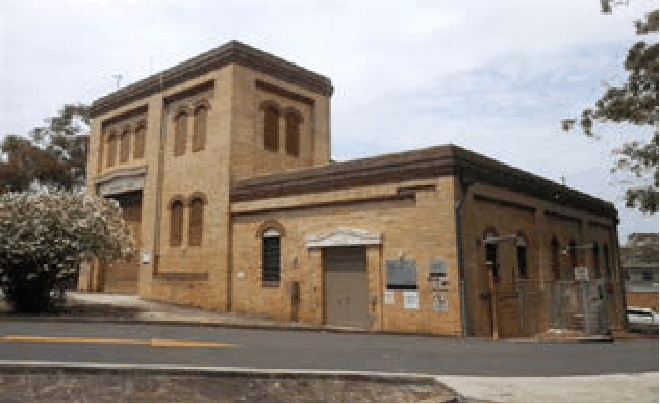

### 14G.6 HERITAGE

### PYMBLE BUSINESS PARK

#### Objectives

1	 To conserve heritage

items and ensure new

buildings respond to

the scale, design, and

character of adjoining

heritage buildings.

### 14G.6 HERITAGE (continued)

#### Controls

The Pymble Business Park has a state listed Heritage Item located on the

Pacific Highway as illustrated in Figure 14G.6-1. The Pymble Substation

and Depot is significant as an example of a purpose-built infrastructure

building designed in the inter-war period.

1 Conserve all details and the form of the external elevations. 2 Removal or alteration to any interior feature is generally not

supported and is to have an assessment as to the significance of

remnant internal fabric relating to operations and internal detailing. 3 Front setbacks to buildings adjacent to the Heritage Item are to

ensure significant views from the Pacific Highway in both directions

of the Heritage Items.

4 Front setbacks of buildings adjacent to the Heritage Item are to have

a minimum front setback equal or greater than the front setback of

the Heritage Item.

> [Picture on page 14: a picture, saved as a picture (images/part-14g-pymble-business-park-page-14-24.gif, 150 dpi).]

#### Figure 14G.6-2

#### Pymble Substation and Depot
