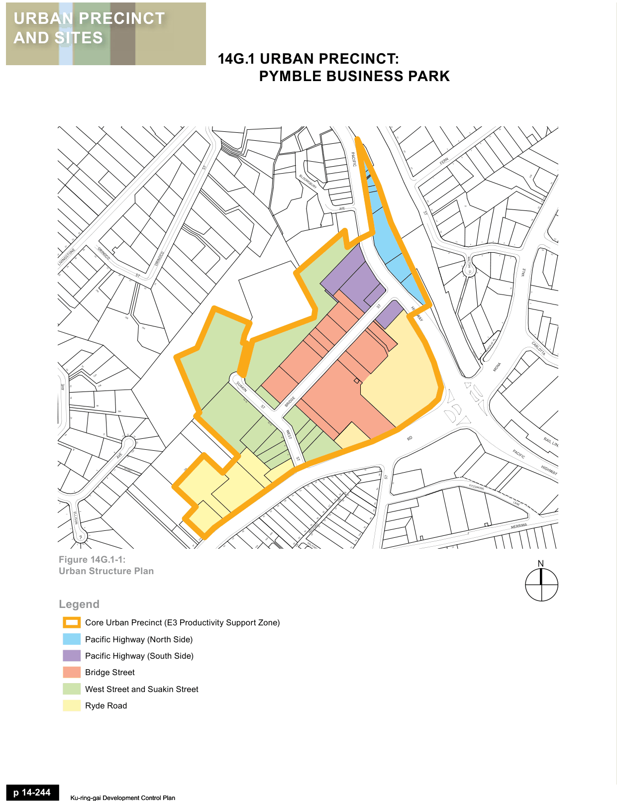

# Ku-ring-gai Development Control Plan - Part 14G Pymble Business Park

> This chapter is split into 7 section file(s), one per numbered heading, in the order they appear in the PDF.

Source PDF: [kdcp-section-b-part-14g-pymble-business-park.pdf](kdcp-section-b-part-14g-pymble-business-park.pdf)

### PART

#### Pymble Business Park

14G.1 	 Urban Precinct 14G.2 	Public Domain and Pedestrian Access 14G.3 	Proposed Community Infrastructure 14G.4 	Building Setbacks 14G.5 	Built Form

14G.6 	 Heritage

14G.7	 Shared On-site Parking

### PYMBLE BUSINESS PARK

> [Picture on page 2: a map, saved as a picture (images/part-14g-pymble-business-park-page-2-1.gif, 150 dpi); the street names and other small labels are on the picture.]
> Words printed on the picture (title and legend, copied from the PDF):
> 11 7 3
> 68 8 13A
> Urban Structure Plan
> Core Urban Precinct (E3 Productivity Support Zone)
> Pacific Highway (North Side)
> Pacific Highway (South Side)
> West Street and Suakin Street

Figure 14G.1-1:

<!-- sections -->
## Sections

1. [14G.1 URBAN PRECINCT:](01-14g-1-urban-precinct.md)
2. [14G.2 PUBLIC DOMAIN AND](02-14g-2-public-domain-and.md)
3. [14G.3 PROPOSED COMMUNITY](03-14g-3-proposed-community.md)
4. [14G.4 BUILDING SETBACKS](04-14g-4-building-setbacks.md)
5. [14G.5 BUILT FORM](05-14g-5-built-form.md)
6. [14G.6 HERITAGE](06-14g-6-heritage.md)
7. [14G.7 SHARED ON-SITE PARKING](07-14g-7-shared-on-site-parking.md)
