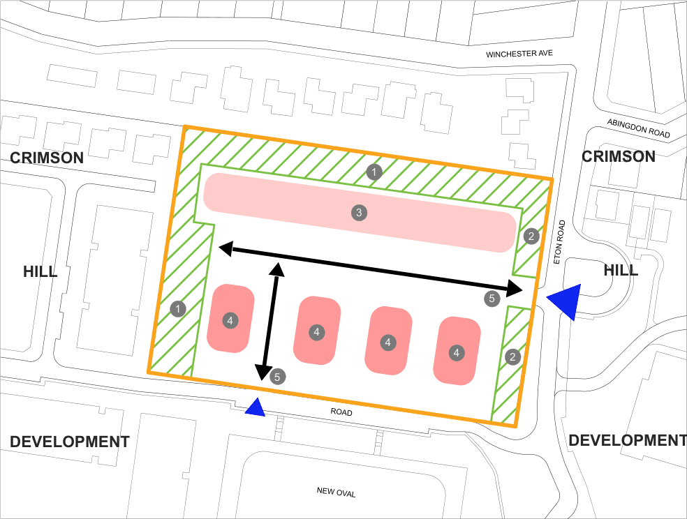

### 14H.1 URBAN PRECINCT:

### SCREEN AUSTRALIA SITE

> [Picture on page 2: a map, saved as a picture (images/part-14h-screen-australia-site-page-2-3.gif, 150 dpi); the street names and other small labels are on the picture.]

#### CRIMSON

#### CRIMSON

#### HILL

#### HILL

#### DEVELOPMENT

#### DEVELOPMENT

#### Figure 14H.1-1:

#### Urban Structure plan

Site Location

R1 - Up to 4 storey residential

R2 - 2 storey residential

Site access points Pedestrian and Vehicle access

Landscape buffer

### 14H.1 URBAN PRECINCT:

### SCREEN AUSTRALIA SITE (continued)

#### Objectives

#### Controls Planned Future Character

1	 To reinforce the bushland

character of the site. 2	 To retain significant

vegetation.

The site at 101 Eton Road, Lindfield, which is currently occupied by

Screen Australia is zoned for a combination of low density detached

residential dwellings and residential flat buildings. The site provides a

transitional role between the low-density residential neighbourhoods

and the higher density Crimson Hill Development on the adjoining UTS

Ku-ring-gai campus. Both sites are set within the bushland setting of the

Lane Cove National Park. The planned future character of the site seeks

to retain and enhance the existing features of the site and integrating

them within the planned scale and density of the proposed residential

development.

3	 To provide a transition

between the low-

density residential

neighbourhoods and the

higher density Crimson

Hill Development and

adjoining UTS Ku-ring-gai

campus.

i) Existing vegetation is retained along the northern and western

boundaries, establishing a landscaped buffer between the site

and adjacent residential development.

ii)	 The vegetation along Eton road is retained and enhanced to

4	 To ensure the

development complements

surrounding residential

areas.

reinforce the historical Bushland Entry Area of the UTS Ku-ring-

gai Campus.

iii)	 Low-density residential development will be aligned within the

northern portion of the site to create an appropriate transition

between the site and the existing low density neighbourhoods.

iv)	 Higher density development will be focused to the south of the

site transitioning up to four storey residential flat buildings which

will be oriented towards the sporting fields.

v)	 Vehicle and pedestrian access to the site will continue to be

gained from Eton Road to the east. Secondary access will be

gained from the south.

vi)	 New development is orientation towards street frontages and

open spaces to reduce passive and inactive edges to the

streetscape.

vii)	 Dwelling houses in the R2 zone are to reflect the character of

houses in adjoining residential areas through compatible roof

forms, response to topography and the garden settings of the

buildings.

viii)	Higher density development is orientation north/south to present

a less dominating visual impact overlooking the oval and

providing view corridors through the site both from the oval and

the main UTS campus building.

ix)	 The design of the residential flat building within this area is to

be consistent with those in within the adjoining Crimson Hill

development to achieve a unified development character.

### SCREEN AUSTRALIA SITE
