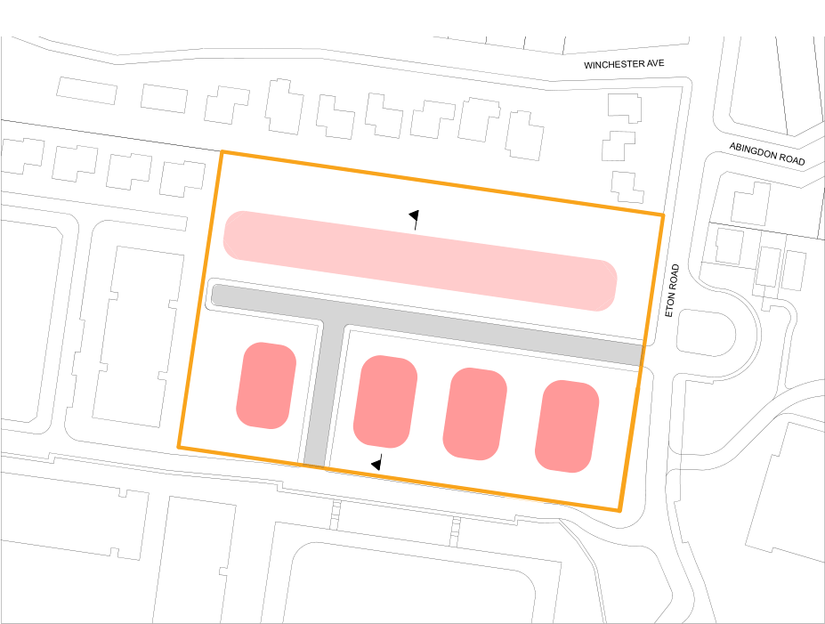
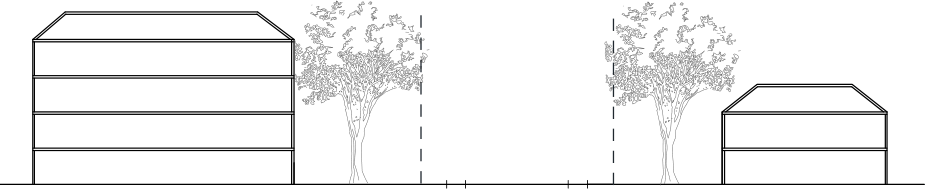
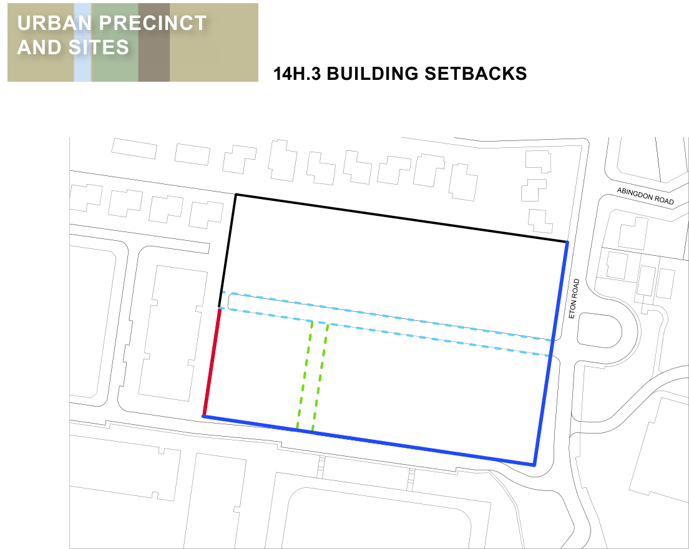

### 14H.2 PUBLIC DOMAIN AND

### PEDESTRIAN ACCESS

> [Picture on page 4: a picture, saved as a picture (images/part-14h-screen-australia-site-page-4-3.gif, 150 dpi).]
> Words printed on the picture (title and legend, copied from the PDF):
> WINCHESTER AVE
> ABINGDON ROAD
> ETON ROAD

> [Picture on page 4: a picture, saved as a picture (images/part-14h-screen-australia-site-page-4-4.gif, 150 dpi).]

1600

8500

1600

2150

2150

16000

9000

9000

#### Figure 14H.2-1:

#### Public domain

and pedestrian

controls plan

Site Location

R2 - 2 storey residential

R1 - Up to 4 storey residential

Site internal road

#### Objectives

1	 To provide for good

vehicle access and

pedestrian permeability

through the site that

integrates with the

surrounding road networks

and activities.

2	 To provide new intimately

scaled residential streets

that reinforce and

enhance the unique leafy,

green landscape character

of Ku-ring-gai.

### 14H.2  PUBLIC DOMAIN AND

### PEDESTRIAN ACCESS (continued)

#### Controls

1 The primary vehicle and pedestrian access to the site is to be

from Eton Road to the east and should be integrated with existing

movement network ensuring that congestion along Eton Road is

minimised and patronage of the bus service is maximised. 2 Secondary access will be gained from the south. 3 The road corridors are to be included as a part of the site for FSR

calculations.

4 The new east/west and north/south road corridors are to have

a width of 16m the dimensions of the carriage way and verges

are to be in accordance with Figure 14H.2-1 both streets should

accommodate two way traffic and one land of on street parking. 5 The siting of new roadways is to consider the location of major trees

with existing significant trees to be retained where possible. 6 New trees should be planted and integrated with the design

proposal, as part of the public and private domain. 7 New streets and verges are to incorporate appropriate landscaping

and water sensitive urban design (WSUD) to support stormwater

management including elements such as permeable paving, rain

gardens, tree pits and swales.

8 All power lines and utilities are to be underground.

### SCREEN AUSTRALIA SITE

> [Picture on page 6: a picture, saved as a picture (images/part-14h-screen-australia-site-page-6-1.gif, 150 dpi).]
> Words printed on the picture (title and legend, copied from the PDF):
> WINCHESTER AVE
> ABINGDON ROAD
> ETON ROAD
