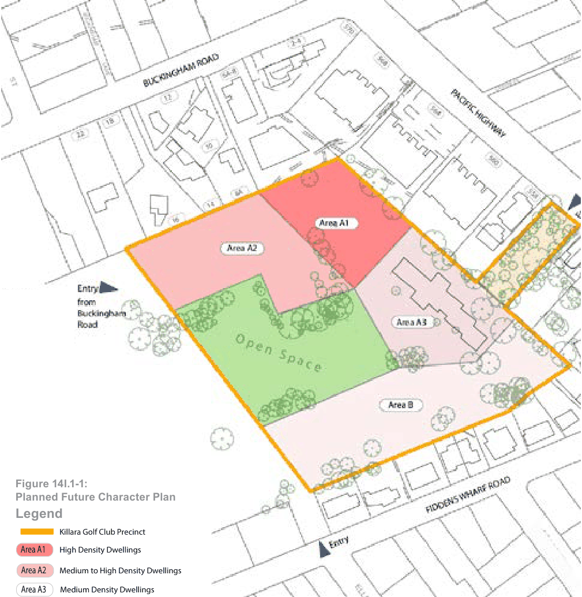
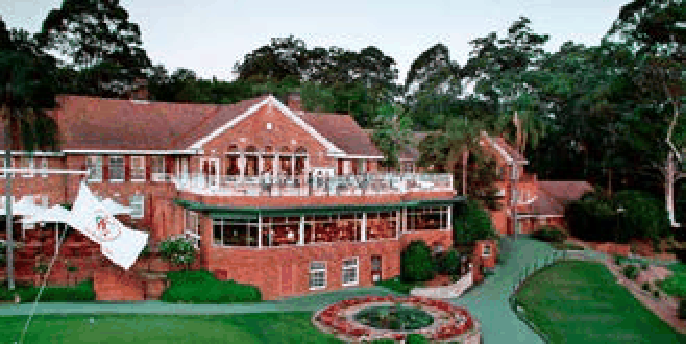

### 14I.1 URBAN PRECINCT:

### KILLARA GOLF CLUB

> [Picture on page 2: a picture, saved as a picture (images/part-14i-killara-golf-club-page-2-3.gif, 150 dpi).]
> Words printed on the picture (title and legend, copied from the PDF):
> Planned Future Character Plan
> Killara Golf Club Precinct
> High Density Dwellings
> Area A1
> Medium to High Density Dwellings
> Area A2
> Medium Density Dwellings
> Area A3

Figure 14I.1-1:

#### Legend

Low Density Dwellings

N

Area B

Open Space

Existing Trees

Existing Trees

#### Objectives

1	 To ensure new built form

is integrated into the

existing landscape to

reflect the Ku-ring-gai

character of buildings

within a garden setting

and tall canopy trees. 2	 To reduce the impacts

of bulk and scale on

adjacent residential

neighbourhoods and on

the Clubhouse Heritage

Item.

3	 To provide a transition

between the new medium

to high density residential

buildings and the adjacent

established low density

residential neighbourhood

fronting Buckingham

Road.

4	 To retain the curtilage

setting of the Clubhouse

Heritage Item.

5	 To ensure long term

improvement and

protection of the Blue

Gum High Forest.

### 14I.1 URBAN PRECINCT:

### KILLARA GOLF CLUB (continued)

#### Controls Planned Future Character

The site is located to the north-east of the Killara Golf Course at 556

Pacific Highway, Killara. The land slopes from the site down to the golf

course lands which extend to and beyond Golf Links Road to the east and

Fiddens Wharf Road to the south.

The site comprises four areas as illustrated in Figure 14I.1 that are zoned

for residential development as follows:

i) Area A1 – high density apartment buildings relating to the high

density neighbourhood to the north and west.

ii)	 Area A2 – medium to high density apartment buildings with

reduced heights to facilitate the interface with the low density

residential neighbourhood to the north.

iii)	 Area A3 – medium density apartments provided through the

adaptive reuse of the Heritage Item Clubhouse.

iv)	 Area B – low density detached dwellings relating to the low

density residential neighbourhood to the south and/or existing

mature significant vegetation.

The planned future character of the site seeks to retain key existing

features, integrate them into the new residential development and reflect

the Ku-ring-gai area character of high quality buildings located within high

quality landscaped gardens including tall canopy trees. 5 All development within the Killara Golf Club site, as outlined in Figure

14I.1-1, is to be designed to support and enhance the planned

> [Picture on page 3: a picture, saved as a picture (images/part-14i-killara-golf-club-page-3-56.gif, 150 dpi).]

### KILLARA GOLF CLUB

#### Figure 14I.1-2

#### Photo of Heritage Item Clubhouse

### 14I.1 URBAN PRECINCT:

### KILLARA GOLF CLUB (continued)

#### Controls

future character of the site, and ensure its integration into the overall

Ku-ring-gai character. This is to be done through compliance with

the site specific requirements stipulated in this Part 14C of the DCP,

and compliance with all other relevant parts of Section A, B, C of the

DCP. 2 New development is to include the following key components:

i) retention of the Blue Gum High Forest trees located within and

adjacent to the site;

ii) retention of significant trees within the boundaries of the

Heritage Item and the established mature trees that form the

setting of the Heritage Item;

iii) residential flat buildings in Area A1 and Area A2 are to provide

high quality integration of new residential flat buildings into

their landscaped gardens, and include tall canopy trees and

screening to adjacent low density and other neighbouring

dwellings, and to the adjacent Clubhouse and golf course;

iv) view corridors are to be provided between new buildings in

Area A1 and Area A2 to reduce bulk and scale impacts to

adjacent dwellings and in particular to the low density houses to

Buckingham Road;

v) retention of the historical association of the Clubhouse in Area

A3 with the Killara Golf Club through its views and vistas to the

Golf Course; and

vi) dwelling houses in Area B are to reflect the character of houses

in adjoining residential areas through their built forms, response

to topography and garden settings.

#### Objectives

1	 To provide good vehicle

access and pedestrian

permeability through the

site.

2	 To enable safe pedestrian

access and active public

domains with good

surveillance throughout

the site.

3	 To provide vehicle access

for residents and service

providers that integrates

with the surrounding road

networks and activities. 4	 To provide new residential

streets that reinforce

and enhance the unique

landscape character of the

Ku-ring-gai area. 5	 To ensure street trees

are able to achieve

their mature height and

contribute to the tree

canopy of the Ku-ring-gai

area.

6	 To retain the historical

views and vistas from the

Heritage Item Clubhouse

to the golf course lands.
