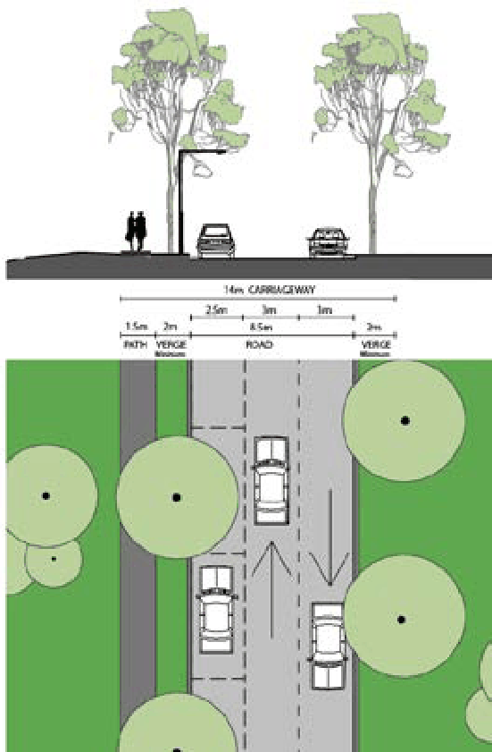
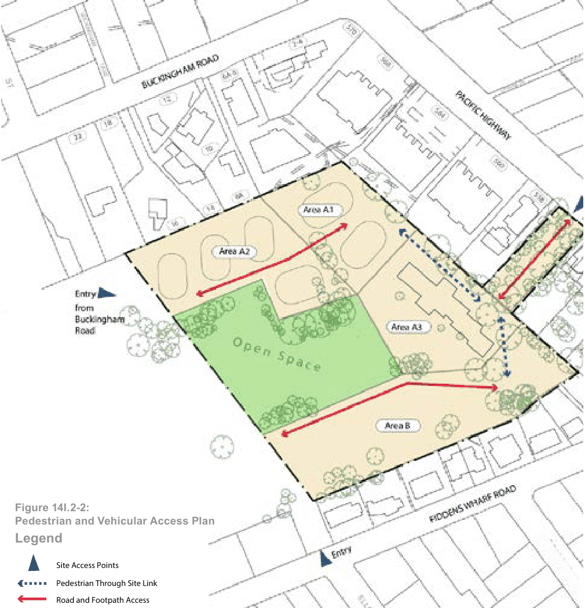

### 14I.2 PEDESTRIAN AND VEHICULAR ACCESS

#### Controls

1 Pedestrian and vehicular access to Area A1 and Area A2 is to be

provided from Buckingham Road.

2 Pedestrian and vehicular acess to Area A3 is to be provided from the

Pacific Highway.

3 Pedestrian and vehicular access to Area B is to be provided from

Fiddens Wharf Road.

4 All new roads including access through the golf course are to have

a minimum width of 8.5m and accommodate two way traffic and one

lane of on-street parking. Pedestrian pathways are to be separated

from the new internal roads by landscaped verges. Refer to Figure

14I.2-1 and to the Public Domain Plan.

Note: See 14C.2(5) for exception to road width.

> [Picture on page 5: a picture, saved as a picture (images/part-14i-killara-golf-club-page-5-45.gif, 150 dpi).]

### KILLARA GOLF CLUB

### KILLARA GOLF CLUB

#### Figure 14I.2-1:

#### Internal road footpaths, verges and tree planting

### 14I.2  PEDESTRIAN AND VEHICULAR ACCESS

### (continued)

> [Picture on page 6: a picture, saved as a picture (images/part-14i-killara-golf-club-page-6-3.gif, 150 dpi).]
> Words printed on the picture (title and legend, copied from the PDF):
> Pedestrian and Vehicular Access Plan
> Site Access Points
> Pedestrian Through Site Link
> Road and Footpath Access

Figure 14I.2-2:

#### Legend

Site Boundary Line

N

Open Space

Existing Trees

Existing Trees

### 14I.2  PEDESTRIAN AND VEHICULAR ACCESS

### (continued)

#### Controls

5 New internal roads at the following locations are to have a minimum

width of 6m to accommodate two way traffic, and a pedestrian

pathway of minimum 1.5m adjacent to the road and incorporate

street planting:

i) within the boundaries of Area A3;

ii) from Fiddens Wharf Road to the boundary of Area B; and

iii) the access road from Pacific Highway to Area A3. 6 Access to Area A1, Area A2 and Area A3 is to accommodate

movement and turning of vehicles up to the size of a medium size

rigid truck. 7 Access to Area B is to accommodate movement and turning for

Council’s standard sized waste collection vehicle. 8 The siting of new roadways is to consider the location and retention

of existing large mature trees. 9 New street trees with a mature height of minimum 15m are to be

planted along both sides of the new internal streets at maximum 12m

spacing. Note: Street tree planting and landscaping plans are to be provided. All street tree species selection subject to Council approval.

10 Street tree planting is to be integrated with the site landscaping and

other infrastructure and services. 11 New streets and verges are to incorporate appropriate landscaping

and Water Sensitive Urban Design (WSUD) to support stormwater

management including elements such as permeable paving, rain

gardens, tree pits and swales. 12 Provide new through-site pedestrian links as follows and as indicated

in Figure 14C.2-2:

i) from Area A3 to Area B; and

ii) from Area A3 to Area A1. 13 Where the Clubhouse is adaptively reused for residential dwellings,

parking rates are to comply with the requirements of the DCP. This

parking may be provided in the basement of adjoining buildings.

### KILLARA GOLF CLUB

### KILLARA GOLF CLUB

### KILLARA GOLF CLUB

14 Where the Clubhouse use is to be retained, any car parking that is

lost as a result of the development of the existing carpark is to be

provided in the basement of new building within Area A1. Where

the commercial and residential uses share the same vehicle entry/

exit, clear demarcation of parking areas is to be made. Residential

parking is to be secure and separate from the commercial parking

serving the Clubhouse. 15 Any new road/footpath on the boundary of the Heritage Item and

the golf course is to avoid utility/street furniture,street parking and

landscaping elements that obstruct the views and vistas from the

Clubhouse building to the golf course beyond the Heritage Item’s site

boundary.
