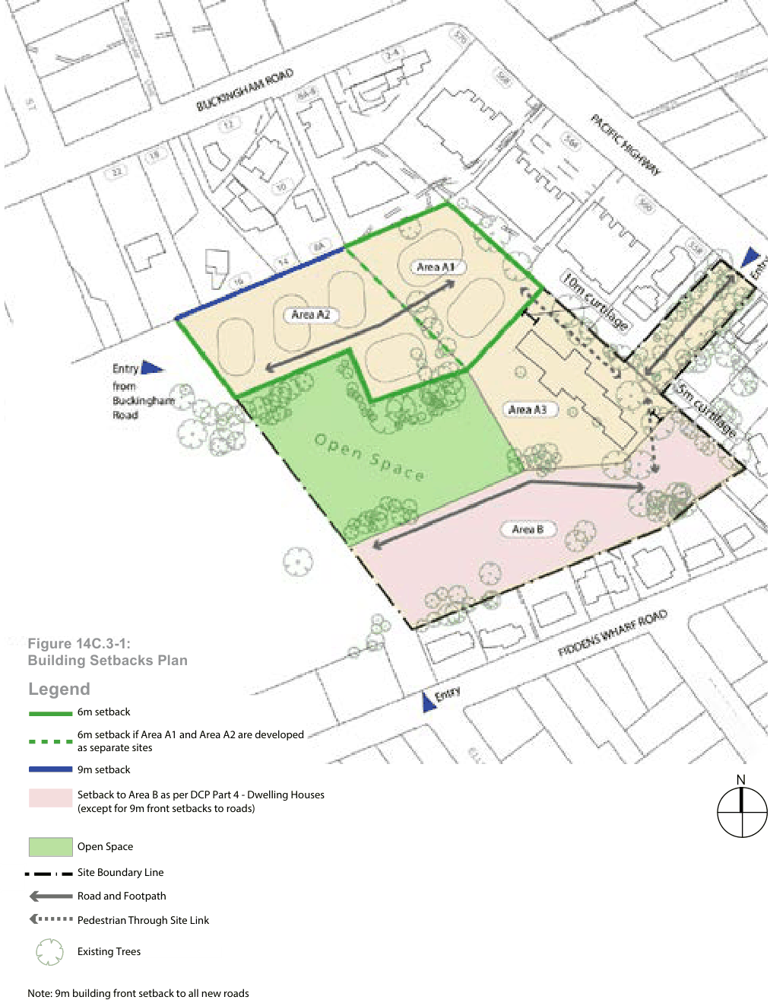

### 14I.3 BUILDING SETBACKS

> [Picture on page 8: a map, saved as a picture (images/part-14i-killara-golf-club-page-8-2.gif, 150 dpi); the street names and other small labels are on the picture.]
> Words printed on the picture (title and legend, copied from the PDF):
> Building Setbacks Plan
> 6m setback if Area A1 and Area A2 are developed
> as separate sites
> Setback to Area B as per DCP Part 4 - Dwelling Houses
> (except for 9m front setbacks to roads)
> Site Boundary Line
> Road and Footpath
> Pedestrian Through Site Link
> Note: 9m building front setback to all new roads

Figure 14C.3-1:

#### Legend

in Area A1, Area A2 and Area A3

#### Objectives

1	 To provide building

setbacks that allow the

retention of existing

established vegetation

and planting of new

vegetation, including

large trees, to enhance

the unique Ku-ring-gai

landscape character. 2	 To create cohesive

streetscapes defined by a

landscaped setback to the

street and public domain. 3	 To ensure provision of

deep soil landscaping

areas to all site

boundaries.

4	 To ensure new residential

development reflects

the standards and

character of similar scale

development in the Ku-

ring-gai area.

5	 To ensure long term

improvement and

protection of the Blue

Gum High Forest.

### 14I.3 BUILDING SETBACKS (continued)

#### Controls

1 Building setbacks are to be in accordance with Figure 14I.3-1. 2 All new buildings within Area A1, Area A2 and Area B are to provide

a minimum 9m front setback to the new internal road carriageway. Note: The carriageway includes footpaths and verges.

3 Within Area A1, provide a minimum 6m setback to:

i) the boundary with 6A-8 Buckingham Road;

ii) the  boundary with 560 to 564 Pacific Highway;

iii) the boundary with Area A3.

4 Within Area A2, provide:

i) a minimum 9m setback to the boundary with 8A to 22

Buckingham Road;

ii) a minimum 6m setback to the open space to the south and

west; and

iii) a minimum 6m setback to the boundary with the golf course

land to the west.

5 If Area A1 and Area A2 are developed as separate sites then provide

minimum 6m setbacks to the boundary between Area A1 and Area

A2.

6 Within Area A3, the Clubhouse Building is to retain the following:

i) 10m curtilage to the north-west boundary adjoining Area A1;

and

ii) 5m curtilage to the south-east boundary adjoining Area B. 7 Side and rear setbacks for low density dwelling houses located in

Area B are to comply with the requirements of Part 4 of this DCP.

### KILLARA GOLF CLUB
