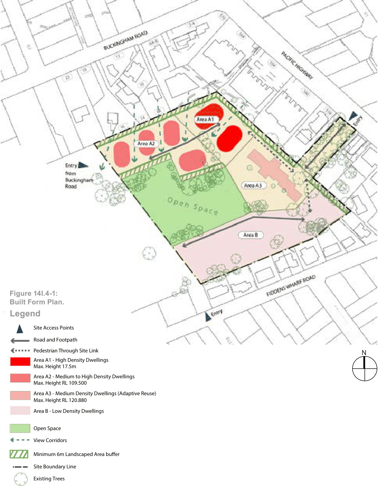

### 14I.4 BUILT FORM

> [Picture on page 10: a map, saved as a picture (images/part-14i-killara-golf-club-page-10-2.gif, 150 dpi); the street names and other small labels are on the picture.]
> Words printed on the picture (title and legend, copied from the PDF):
> Built Form Plan.
> Site Access Points
> Road and Footpath
> Pedestrian Through Site Link
> Area A1 - High Density Dwellings
> Max. Height 17.5m
> Area A2 - Medium to High Density Dwellings
> Max. Height RL 109.500
> Area A3 - Medium Density Dwellings (Adaptive Reuse)
> Max. Height RL 120.880
> Area B - Low Density Dwellings
> Minimum 6m Landscaped Area buffer
> Site Boundary Line

Figure 14I.4-1:

#### Legend

#### Objectives

1	 To reduce the impacts

of bulk and scale of new

medium and high density

development on the

adjacent neighbourhood. 2	 To ensure preservation of

visual amenity from:

• neighbouring

properties up-slope of

the new buildings;

• the Clubhouse

Heritage Item;

• the golf course lands

down slope of the site.

3	 To ensure adequate

screening of balcony and

terrace areas for storage

and utility purposes. 4	 To ensure the built form

reflects the character

of the Ku-ring-gai area,

of buildings within high

quality garden settings

including tall canopy trees. 5	 To reduce Ku-ring-gai’s

heat island effect by

minimising hard surfaces

that absorb and emit heat. 6	 To ensure safety,

surveillance and visibility

of pedestrian pathways. 7	 To ensure long term

improvement and

protection of the Blue

Gum High Forest.

### 14I.4 BUILT FORM (continued)

#### Controls

1 All buildings in Area A1 and Area A2 are to be sited and orientated to

provide view corridors to adjacent neighbouring residential buildings. Note: Within Area A1: consideration may be given to the excavation

and setting down of buildings to reduce building height impacts to

neighbouring residential areas, provided deep soil areas are not compromised and hydrological impacts are addressed.

2 The siting of buildings are to demonstrate clear, visible entry points

and surveillance of through site links, paths and communal areas. 3 All plant equipment and services to buildings within Area A1, Area

A2 and Area A3 are to be located within the basement of buildings. 4 Clear glass balustrades are not permitted to the entire length of a

balcony or terrace.

5 A minimum 6m Landscaped Area buffer, including retention of

existing trees, is to be provided on the boundary of Area A1, Area

A2, Area A3 and Area B as per the Figure 14I.4-1. This Landscaped

Area buffer is to consist only of deep soil area. The following will not

be permitted within the Landscaped Area buffer;

i) utilities and service corridors;

ii) pathways and roads;

iii) any structures and hard surfaces; or

iv) basements.

Note: Refer to the definition of Landscaped Area under KLEP.

6 Where the Landscaped Area buffer contains Greenweb areas,

planting within the Greenweb area is to comprise of species from

the Blue Gum High Forest community including ground shrub and

canopy, and include trees with a mature height of minimum 15m. 7 The site layout is to minimise impact to the Blue Gum High

Forest including consideration of overshadowing and changes to

hydrological conditions (storm water / ground water supply). 8 A Vegetation Management Plan addressing the ongoing

management of the Blue Gum High Forest within the site is to be

prepared by an appropriately qualified consultant.

### KILLARA GOLF CLUB

### KILLARA GOLF CLUB
