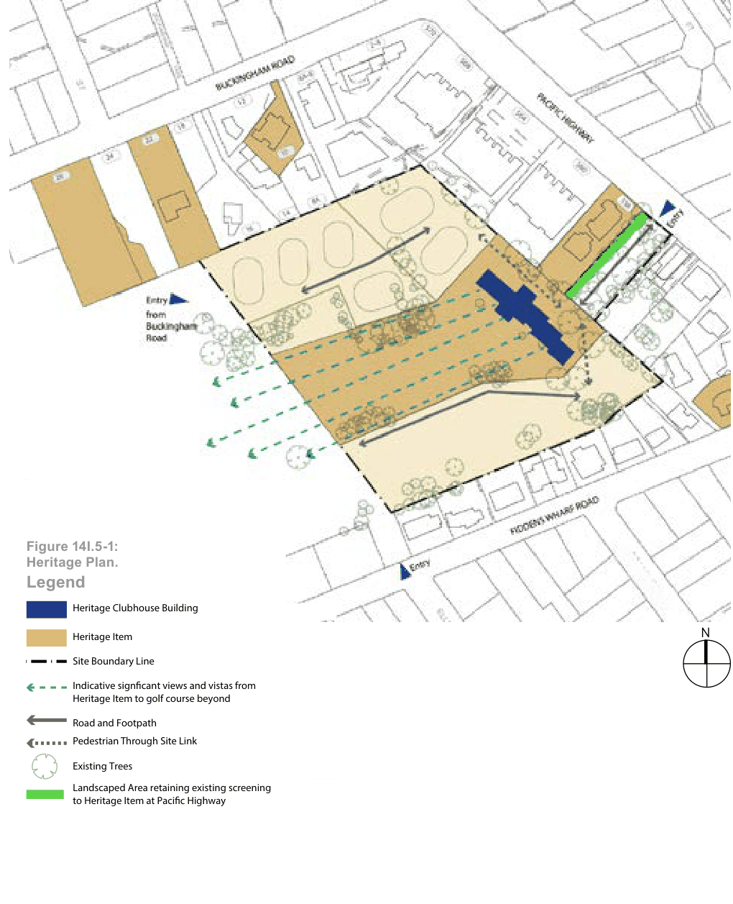

### 14I.5 HERITAGE

> [Picture on page 12: a map, saved as a picture (images/part-14i-killara-golf-club-page-12-2.gif, 150 dpi); the street names and other small labels are on the picture.]
> Words printed on the picture (title and legend, copied from the PDF):
> Heritage Clubhouse Building
> Site Boundary Line
> Indicative signficant views and vistas from
> Heritage Item to golf course beyond
> Road and Footpath
> Pedestrian Through Site Link
> Landscaped Area retaining existing screening
> to Heritage Item at Pacific Highway

Figure 14C.5-1:

Figure 14I.5-1:

#### Legend

#### Objectives

1	 To conserve the Heritage

Item and ensure new

buildings respond to the

scale, design, setting and

character of the Item. 2	 To improve pedestrian

access, permeability,

activation and surveillance

to the north-west of the

Heritage Item.

3	 To ensure adaptive reuse

of the Heritage Item

retains the integrity of the

Item.

4	 To retain the historically

significant views and

vistas from the Clubhouse

Building to the golf course

lands.

#### Figure 14C.5-2

#### Landscape screen to adjacent

#### Item at 558 Pacific Highway

### 14I.5 HERITAGE (continued)

#### Controls

The Killara Golf Clubhouse and its curtilage area (encompassing the

putting green and garden, front fairway and significant trees at the front,

rear and side) is a locally listed Heritage Item.

1 All buildings within Area A1, Area A2 and Area B are to demonstrate

consideration of the Clubhouse Heritage Item and its curtilage. 2 The fabric and form of the external elevations of the Clubhouse

Heritage Item building are to be conserved.

3 Removal or alteration to any significant interior feature is generally

not supported and must have an assessment as to the significance

of remnant internal fabric (operational and internal details) and the

impact of any works.

4 Any alterations and additions to the Heritage Item, or its adaptive

reuse, are to have consideration to the current Conservation

Management Plan (CMP) as recognised by Council. A current CMP

must have been completed or updated within the last 5 years. 5 The portico to the north-east of the building may be removed only

if the removal is to facilitate a demonstrated improvement of the

following:

i) access and connection between the different areas (Area A1,

Area A2, Area A3, Area B and Pacific Highway access area);

ii) Landscaped Area buffer to the boundary.

The renovation works replacing the portico are to reinstate the

original fabric and architectural details or reflect the façade

symmetry of the existing Heritage Item.

6 Any new builds or structures that obstruct the views and vistas to

the golf course are not supported, including:

i) boundary fences;

ii) pathways utilities, street furniture parking; and

iii) trees and landscaping.

7 Provide a Landscaped Area adjacent to the neighbouring Heritage

Item known as Dormie House at 558 Pacific Highway. This is to

retain existing plant screening.

### KILLARA GOLF CLUB

#### Figure 14C.5-3

#### Heritage Item Clubhouse, and putting green and fairway.

### THIS PAGE IS INTENTIONALLY BLANK
