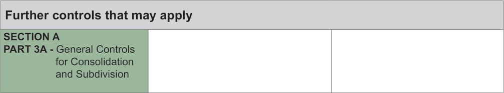
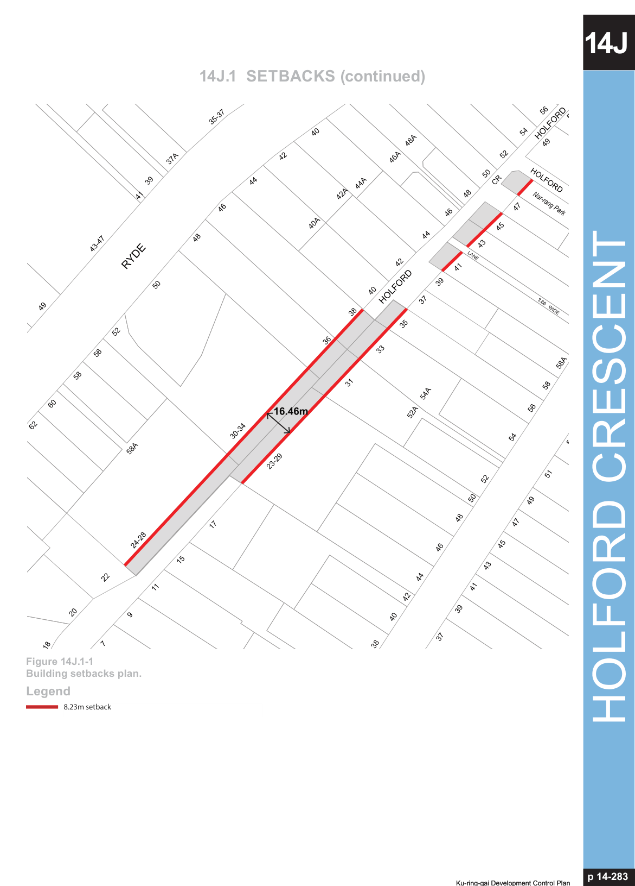

# Ku-ring-gai Development Control Plan - Part 14J Holford Crescent, Gordon

Source PDF: [kdcp-section-b-part-14j-holford-crescent-gordon.pdf](kdcp-section-b-part-14j-holford-crescent-gordon.pdf)

### 14J

### PART

#### Holford Crescent, Gordon

14J.1  Building Setbacks

### HOLFORD CRESCENT

### URBAN PRECINCT

### AND SITES

### URBAN PRECINCT

### AND SITES

### URBAN PRECINCT

### AND SITES

### 14J.1  SETBACKS

> [Picture on page 2: a picture, saved as a picture (images/part-14j-holford-crescent-gordon-page-2-8.gif, 150 dpi).]
> Words printed on the picture (title and legend, copied from the PDF):
> for Consolidation
> and Subdivision

#### Further controls that may apply

#### SECTION A

PART 3A - General Controls

#### Objectives

#### Controls

1 All future development of the affected properties are to provide

8.23m setbacks to allow the extension and widening of Holford

Crescent to achieve a continuous 16.46 metre wide public road in

accordance with Figure 14J.1-1. 2 The land is to be dedicated to Council at no cost to facilitate the

provision of vehicular access to the subject property as part of any

development of that property.

1	 To support the future

subdivision and

development of the

identified properties

by facilitating vehicular

access to a formal street

frontage on Holford

Crescent. 2	 To provide for the

progressive extension

and widening of Holford

Crescent in Gordon.

3 The new roadway is to be designed in accordance with 3A.4 and

3A.5 of this DCP. Council will provide an indicative horizontal and

vertical alignment so that the road can integrate with the northern

and southern ends, and make provision for a defined low point to

accommodate stormwater/drainage needs. 4 The new road is to be constructed in accordance with Council’s

Specification for Road and Drainage Works.

3	 To ensure that safe

pedestrian and vehicular

access can be provided

from the Holford Crescent

frontage.

5 Future subdivision of affected properties is to ensure that public

utilities and services are to be provided to new lots. Such services

are to be located underground where new road construction occurs.

Refer to 3A.6 Infrastructure of this DCP.

4	 To ensure that public

utilities and services can

be provided.

Affected properties:

• 24-28 Holford Crescent (58A Ryde Road)

5	 To ensure all road works

conform with Council’s

standard specifications.

• 52 Ryde Road (30-34 Holford Crescent)

• 36 Holford Crescent (48 Ryde Road)

• 46 Ryde Road (38 Holford Crescent)

• 50 Ridge Street (23-29 Holford Crescent)

• 52A Ridge Street (31 Holford Crescent)

• 54A Ridge Street (33 Holford Crescent)

• 56 Ridge Street (35 Holford Crescent)

• 60 Ridge Street (41 Holford Crescent)

• 64 Ridge Street (43 Holford Crescent)

• 66 Ridge Street (45 Holford Crescent)

• 70 Ridge Street (Nar-rang Park)

p 14 - 282

> [Picture on page 3: a map, saved as a picture (images/part-14j-holford-crescent-gordon-page-3-1.gif, 150 dpi); the street names and other small labels are on the picture.]
> Words printed on the picture (title and legend, copied from the PDF):
> Building setbacks plan.

Figure 14J.1-1

### 14J

### 14J.1  SETBACKS (continued)

#### Legend

### HOLFORD CRESCENT

### URBAN PRECINCT

### AND SITES

### THIS PAGE IS INTENTIONALLY BLANK

p 14 - 284
