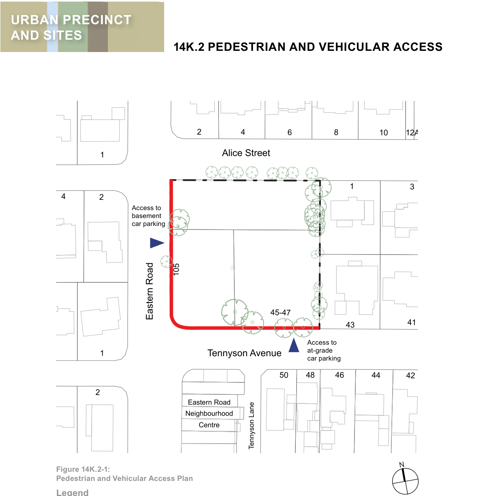

### 14K.1 URBAN PRECINCT:

### 45-47 TENNYSON AVE AND 105 EASTERN RD

#### (continued)

#### Objectives

#### Controls Planned Future Character

1	 To ensure new built form

is cohesive with the

streetscape character. The site at 45-47 Tennyson Avenue and 105 Eastern Road, Turramurra

is bounded by Eastern Road, Tennyson Avenue and Alice Street. The

site is currently occupied by a Service Station and Nursery. The site

adjoins the existing Eastern Road Neighbourhood Centre to the south

which comprises of small scale, fine grain retail shops, and low density

residential housing to the north, west and east.

2	 To provide a transition

between the existing

Eastern Road

Neighbourhood Centre

Shops and the adjacent

low density residential

character.

The planned future character of the site seeks to retain existing key

features of the site, ensure future development is cohesive with

surrounding character and facilitate the integration of the site into the

existing Neighbourhood Centre so that it forms an extension of the

existing Eastern Road retail strip. While small, these shops provide a

valuable local function servicing the day-to-day needs of local residents.

3	 To promote pedestrian

connectivity between

the site and the

existing Eastern Road

Neighbourhood Centre

shops.

1 All development within the site, as outlined in Figure 14K.1-1, is to be

designed to support and enhance the planned future character of the

site. This is to be done through compliance with these site specific

requirements within Part 14K of the DCP, and compliance with other

relevant parts of Section A, B, C of the DCP. 2 New development is to include the following key elements:

4	 Ensure future

development contributes

to creating a vibrant

Neighbourhood Centre.

i) Retention, restoration and revegetation of trees and vegetation

associated with Blue Gum High Forest Critically Endangered

Ecological Community (CEEC) located within the areas

identified as biodiversity setback in Figure 14K.3-1 Building

Setbacks Plan. Refer to Part 18.4 of the DCP.

5	 To retain the scale,

character and local

function of Eastern Road

as a Neighbourhood

Centre. 6	 To enhance the amenity of

the streetscape and public

domain.

ii) Ensure new development is cohesive with the street character,

including existing Eastern Road Neighbourhood Centre

retail strip to the south of the site, and adjacent low density

residential dwellings to the north, east and west of the site.

iii) Ensure new development provides active street frontages to

both Eastern Road and Tennyson Avenue.

iv) Ensure new development is appropriately sited and designed

to minimise amenity and visual impacts to adjoining residential

properties.

7	 To retain, and protect, the

local native vegetation

including Blue Gum

High Forest Critically

Endangered Ecological

Community (CEEC)* and

to restore and revegetate

a mix of local Blue Gum

High Forest species.

### 45-47 TENNYSON AVENUE AND 105 EASTERN ROAD

\*Blue Gum High Forest CEEC refers to the Blue Gum High Forest in the Sydney Basin Bioregion as listed

under the NSW Biodiversity Conservation Act 2016.

> [Picture on page 4: a picture, saved as a picture (images/part-14k-45-47-tennyson-avenue-and-105-eastern-road-turramu-page-4-1.gif, 150 dpi).]
> Words printed on the picture (title and legend, copied from the PDF):
> 115A
> 12
> 12A
> 10
> 8
> 6
> 4
> 2
