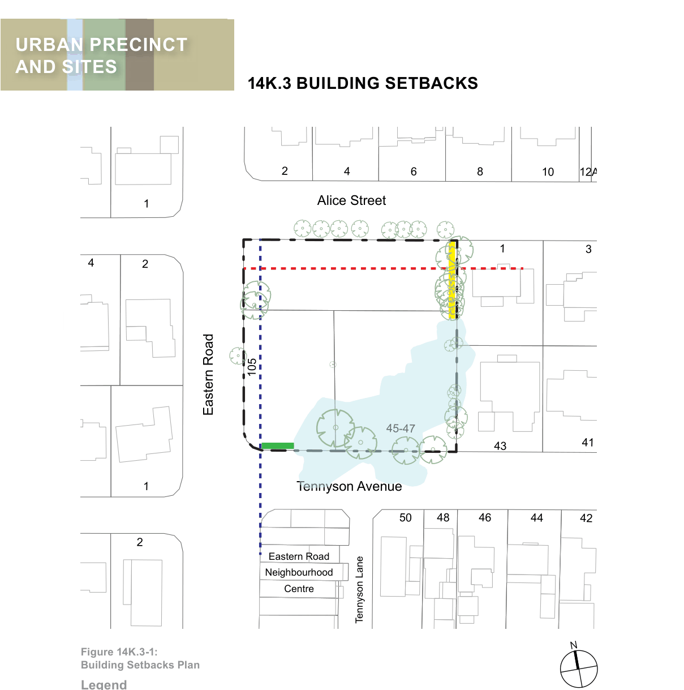

### 14K.2 PEDESTRIAN AND VEHICULAR ACCESS

#### Alice Street

3

1

5

#### cester Place

5

6

Access to

basement

car parking

#### Eastern Road

39

5

#### Tennyson Avenue

car parking

#### shire Place

40 38

2

4

Eastern Road Neighbourhood Centre

Tennyson Lane

#### Figure 14K.2-1:

#### Pedestrian and Vehicular Access Plan

93A

94

#### Legend

Pedestrian Access

Indicative Site Access Point

Existing Trees

#### Objectives

1	 To provide vehicle access

for customers and service

vehicles that is integrated

into the surrounding road

network.

2	 To enable safe pedestrian

access and permeability. 3	 To minimise pedestrian

and vehicle conflicts. 4	 To minimise the number of

vehicle access points on

active street frontages. 5	 To provide adequate

and accessible on-site

service areas and loading

facilities.

6	 To locate and design

car parking so that it is

integrated into the design

of the site and building. 7	 To retain, and protect, the

local native vegetation

including Blue Gum

High Forest Critically

Endangered Ecological

Community (CEEC)* and

to restore and revegetate

a mix of local Blue Gum

High Forest species. 8	 To provide for future

transport and vehicle

options including Electric

Vehicle charging stations,

e-bicycles and the like.

### 14K.2 PEDESTRIAN AND VEHICULAR ACCESS

### (continued)

#### Controls

1 Pedestrian access is to be provided from Eastern Road and

Tennyson Avenue.

2 Car parking is to be provided within the basement of new

development.

3 Vehicle access for basement car parking is to be provided from

Eastern Road.

4 Where provision of all required car parking within the basement is

not feasible due to impacts on native trees and vegetation, a limited

amount may be provided at grade, as follows:

• It is to be located behind the building line.

• Screened from view.

• Not adversely impact on street activation, amenity or native trees

and vegetation.

• Access to be provided from Tennyson Avenue at location of

existing driveway crossover.

• Refer to 9B.2 for additional requirements for at grade parking

areas.

5 Active street frontages are to be provided to Eastern Road and

Tennyson Avenue. Opaque and blank walls are to be minimised at

ground level.

6 Service/loading areas are to be located in the basement to minimise

conflict between pedestrians and vehicles, and minimise amenity

impacts to adjoining residential properties.

7 Service vehicle access must be combined with parking access. 8 All development is to be setback from native trees and vegetation

on the site and adjoining properties, to ensure their protection and

retention. The following are to apply:

i) Setbacks are to meet the requirements of Part 18.4 of the DCP

relating to landscape remnant.

ii) Verification of exact setbacks is to be subject to demonstration

of meeting the requirements in Protection of Trees on

Development Sites (AS 4970-2009).

iii) Consideration should also be had to the potential hydrological

impacts on Blue Gum High Forest CEEC.

9 Parking areas are to be designed and constructed so that electric

vehicle charging points can be installed.

### 45-47 TENNYSON AVENUE AND 105 EASTERN ROAD

> [Picture on page 6: a picture, saved as a picture (images/part-14k-45-47-tennyson-avenue-and-105-eastern-road-turramu-page-6-1.gif, 150 dpi).]
> Words printed on the picture (title and legend, copied from the PDF):
> 115A
> 12
> 12A
> 10
> 8
> 6
> 4
> 2
