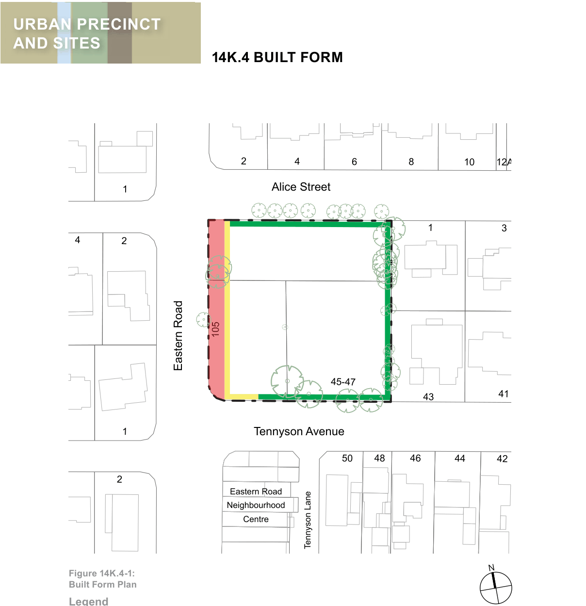

### 14K.3 BUILDING SETBACKS

#### Alice Street

3

1

5

#### rcester Place

5

6

#### Eastern Road

39

5

#### Tennyson Avenue

#### shire Place

40 38

2

4

#### Figure 14K.3-1:

#### Building Setbacks Plan

94

#### Legend

Front Setback to align with front building line of Eastern Road Shops Side Setback to align with front building line of residential properties to the east

Nil Setback Minimum 6m Setback

Biodiversity Setback (to comply with requirements of Part 18.4 of the DCP to ensure protection and retention of native trees)

Existing Trees

#### Objectives

1	 To create a cohesive

streetscape with

consistent building

alignments and setbacks. 2	 To protect the privacy

and amenity of adjoining

residential land uses. 3	 To provide building and

basement setbacks that

allow the retention of

existing significant trees

and vegetation on the site. 4	 To ensure adequate areas

to enable landscaping

within setbacks where

appropriate.

### 14K.3 BUILDING SETBACKS (continued)

#### Controls

1 All building setbacks are to be in accordance with Figure 14K.3-1. 2 The front building line of new development is to be setback from

Eastern Road boundary so that it aligns with front building line of the

existing Eastern Road retail shops.

3 The side setback to Alice Street is to align with front building line of

residential properties to the east.

4 A corner building at the Eastern Road and Tennyson Avenue

intersection is to be built to the street alignment along Tennyson

Avenue with zero setback.

5 A minimum 6m setback is to be provided from the rear boundary

adjoining 1 Alice Street.

6 All buildings and basements are to be setback from native trees

and vegetation on the site and adjoining properties, to ensure their

protection and retention. The following are to apply:

i) Setbacks are to meet the requirements of Part 18.4 of the DCP

relating to landscape remnant.

ii) Verification of exact setbacks is to be subject to demonstration

of meeting the requirements in Protection of Trees on

Development Sites (AS 4970-2009).

iii) Consideration should also be had to the potential hydrological

impacts on Blue Gum High Forest CEEC.

### 45-47 TENNYSON AVENUE AND 105 EASTERN ROAD

> [Picture on page 8: a picture, saved as a picture (images/part-14k-45-47-tennyson-avenue-and-105-eastern-road-turramu-page-8-1.gif, 150 dpi).]
> Words printed on the picture (title and legend, copied from the PDF):
> 115A
> 12
> 12A
> 10
> 8
> 6
> 4
> 2
