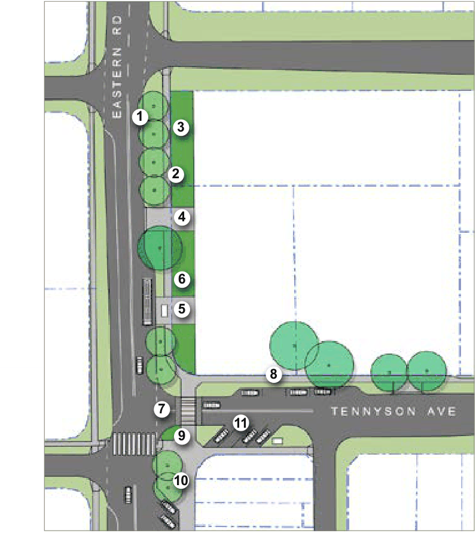

### 14K.5 PUBLIC DOMAIN

> [Picture on page 10: a picture, saved as a picture (images/part-14k-45-47-tennyson-avenue-and-105-eastern-road-turramu-page-10-2.gif, 150 dpi).]
> Words printed on the picture (title and legend, copied from the PDF):
> 1
> 3
> 2
> 4
> 6
> 5
> 8
> 7
> 11
> 9
> 10

N

#### Figure 14K.5-1

#### Public Domain Controls

#### Legend 1

Public Domain Controls

#### Objectives

1	 To provide a high

quality streetscape that

engages and activates the

Neighbourhood Centre,

and contributes to its

economic viability. 2	 To improve and enhance

pedestrian connection and

access within the Eastern

Road Neighbourhood

Centre.

3	 To provide continuity in the

streetscape and promote

pedestrian amenity. 4	 To service the public

parking demands for the

Neighbourhood Centre.

### 14K.5 PUBLIC DOMAIN (continued)

#### Controls

1 Public domain works are to be in accordance with Figure 14K.5-1. It

is to be delivered through a Voluntary Planning Agreement (VPA) or

other delivery mechanism and include the following: 1 Kerb extension on Eastern Road for wider footpath and street

tree planting

2 New wider footpath

Landscape zone in building setback area

#### 3

Indicative vehicular crossover for basement parking

#### 4

Upgraded bus stop and bus shelter

#### 5

Landscape zone - hard and soft scape in building setback area

#### 6

7 New pedestrian crossing with raised threshold on Tennyson

Avenue

8 Parallel parking setback into existing verge north side of

Tennyson Avenue

9 Kerb extension and realignment to corner of Tennyson avenue

and Eastern Road

10 Creation of small plaza with trees and seating on corner

Tennyson Avenue and Eastern Road through removal of 2

angled parking spaces

45° angle parking south side Tennyson Avenue

#### 11

### 45-47 TENNYSON AVENUE AND 105 EASTERN ROAD

### THIS PAGE IS INTENTIONALLY BLANK

p 14 - 296
