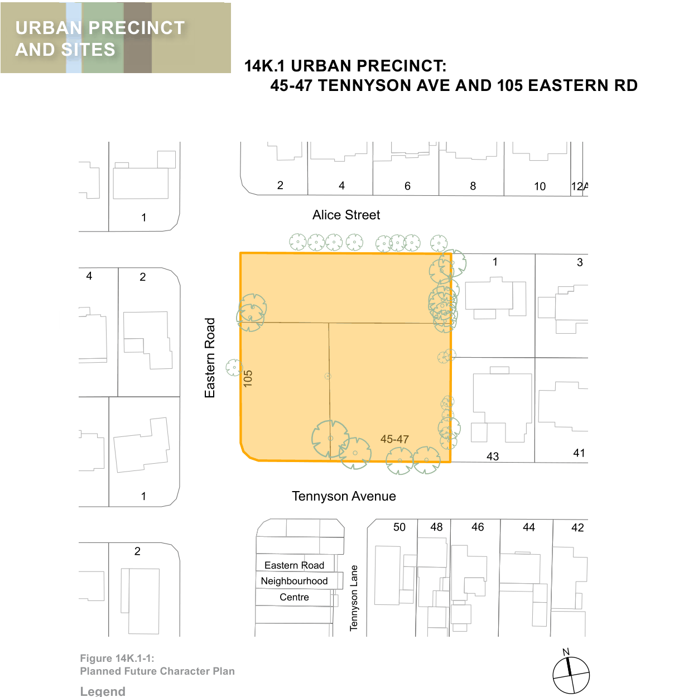

# Ku-ring-gai Development Control Plan - Part 14K 45-47 Tennyson Avenue and 105 Eastern Road, Turramurra

> This chapter is split into 5 section file(s), one per numbered heading, in the order they appear in the PDF.

Source PDF: [kdcp-section-b-part-14k-45-47-tennyson-avenue-and-105-eastern-road-turramurra.pdf](kdcp-section-b-part-14k-45-47-tennyson-avenue-and-105-eastern-road-turramurra.pdf)

### 14A

### PART

45-47 Tennyson Avenue and 105 Eastern Road,

#### Turramurra

14K.1 	 Urban Precinct

14K.2 	 Pedestrian and Vehicular Access 14K.3 	 Building Setbacks 14K.4 	 Built Form

14K.5 	 Public Domain

### 45-47 TENNYSON AVENUE AND 105 EASTERN ROAD

> [Picture on page 2: a picture, saved as a picture (images/part-14k-45-47-tennyson-avenue-and-105-eastern-road-turramu-page-2-1.gif, 150 dpi).]
> Words printed on the picture (title and legend, copied from the PDF):
> 115A
> 12
> 12A
> 10
> 8
> 6
> 4
> 2

### 14K.1 URBAN PRECINCT:

### 45-47 TENNYSON AVE AND 105 EASTERN RD

#### Alice Street

3

1

5

#### cester Place

5

6

#### Eastern Road

39

5

#### Tennyson Avenue

#### shire Place

40 38

2

4

Eastern Road Neighbourhood Centre

Tennyson Lane

#### Figure 14K.1-1:

#### Planned Future Character Plan

93A

94

#### Legend

45-47 Tennyson Avenue and 105 Eastern Road Precinct

Existing Trees

<!-- sections -->
## Sections

1. [14K.1 URBAN PRECINCT:](01-14k-1-urban-precinct.md)
2. [14K.2 PEDESTRIAN AND VEHICULAR ACCESS](02-14k-2-pedestrian-and-vehicular-access.md)
3. [14K.3 BUILDING SETBACKS](03-14k-3-building-setbacks.md)
4. [14K.4 BUILT FORM](04-14k-4-built-form.md)
5. [14K.5 PUBLIC DOMAIN](05-14k-5-public-domain.md)
