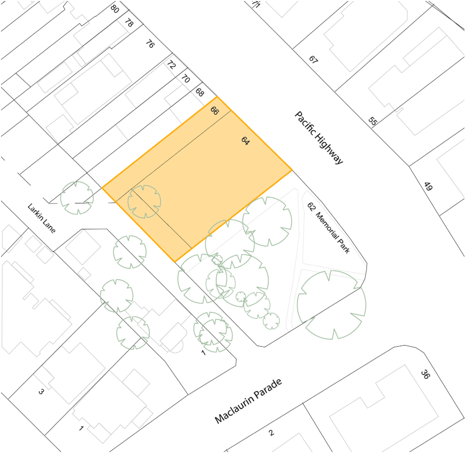

### 14L.1 URBAN PRECINCT:

## 62 (PART) & 64-66 PACIFIC HIGHWAY

> [Picture on page 2: a picture, saved as a picture (images/part-14l-62-part-64-66-pacific-highway-page-2-3.gif, 150 dpi).]

N

#### Figure 14L.1-1:

#### Planned Future Character Plan

#### Legend

62 (part) & 64-66 Pacific Highway, Roseville

Existing Trees

#### Objectives

1	 To facilitate the

redevelopment of the site

to achieve a landmark

building with high quality

urban form and that

fully engages with the

relationship to Roseville

Memorial Park and

surrounding public domain. 2	 To ensure new

development contributes

to the creation of a vibrant

local centre through the

provision of active street

frontages and public space

engagement.

3	 To ensure new

development is respectful

to the surrounding context,

with articulated height

and massing providing an

appropriate interface to the

Roseville Memorial Park

and adjoining properties. 4	 To ensure that new

development does not

result in adverse impacts

on the amenity and solar

access of adjoining

properties, including the

Roseville Memorial Park. 5	 To contribute to the quality

and appearance of the

public domain.

6	 Maximise the interface

between new development

and Roseville Memorial

Park to provide enhanced

amenity, casual

surveillance and encourage

use of the park.

7	 To retain and protect

established trees in

Roseville Memorial Park. 8	 To provide a visual

extension of Roseville

Memorial Park into Larkin

Lane.

### 14L.1 URBAN PRECINCT:
