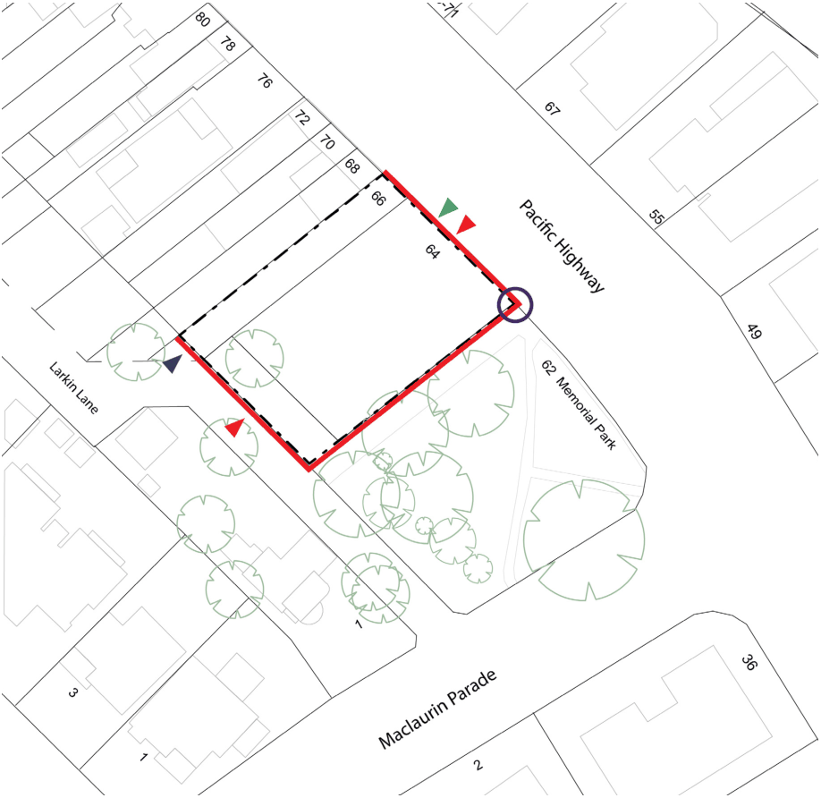

### 14L.2 PEDESTRIAN AND VEHICULAR ACCESS

> [Picture on page 4: a picture, saved as a picture (images/part-14l-62-part-64-66-pacific-highway-page-4-2.gif, 150 dpi).]

N

#### Figure 14L.2-1:

#### Pedestrian and Vehicular Access Plan

#### Legend

Pedestrian Access

Indicative Residential Entry Point

Indicative Secondary Entry Point to Ground Floor Commercial Uses

Indicative Vehicular Access Point

Primary Entry to Ground Floor Commercial Uses

Existing Trees

#### Objectives

1	 To enable safe pedestrian

access and permeability

connecting the site to

public spaces and the

wider Roseville centre. 2	 To minimise pedestrian

and vehicle conflicts. 3	 To minimise the number of

vehicle access points. 4	 To ensure future

development provides

adequate car parking

for both commercial and

residential components 5	 To provide adequate

and accessible on-site

service areas and loading

facilities.

6	 To provide for future

transport and vehicle

options including electric

vehicle charging stations,

e-bicycles and the like.

### 14L.2 PEDESTRIAN AND VEHICULAR ACCESS

### (continued)

#### Controls

1 Provision of pedestrian access linkages to Roseville Memorial Park,

Larkin lane and the rest of Roseville Local centre. 2 Primary entry to ground floor commercial uses must be provided

on the corner of Pacific Highway and Roseville Memorial Park.

Secondary entry points may be provided on Pacific Highway and

Larkin Lane frontages.

3 On-site parking is to be provided for non-residential uses at the

minimum rates set out below:

| Land Use | Parking Rate |
|---|---|
| Registered Club | 1 space per 20m2 GFA for patrons plus 1 space per 2 employees. |
| Retail | As per car parking rates set out in 22R.1 of this DCP. |
| Commercial | As per car parking rates set out in 22R.1 of this DCP. |

Note: The car parking rate for any residential component is to be as

per Part 8B.2 Car Parking Provisions for Mixed Use Development 4 All car parking is to be provided in the basement of new

development.

5 All service and loading areas are to be located in the basement to

minimise conflict between pedestrians and vehicles, and minimise

amenity impacts.

6 Parking areas are to be designed and constructed so that electric

vehicle charging points can be installed.
