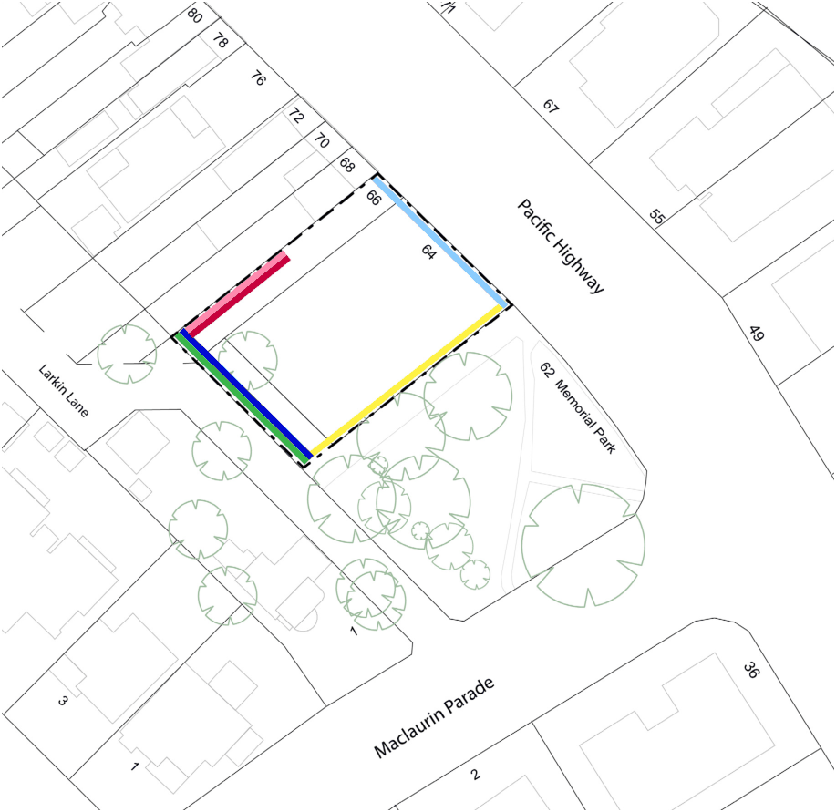

### 14L.3 BUILDING SETBACKS

> [Picture on page 6: a picture, saved as a picture (images/part-14l-62-part-64-66-pacific-highway-page-6-2.gif, 150 dpi).]

N

#### Figure 14L.3-1:

#### Building Setbacks Plan

#### Legend

2m Front Setback for Upper Levels above Pacific Highway 3 storey/11.5m Street Wall 3m Side Setback  from Roseville Memorial Park

6m Rear Setback from Larkin Lane (up to 5 storey)

12m Rear Setback from Larkin Lane (6-7 storey) 6m Side Setback on Northern Boundary (1-4 storey above the commercial/retail podium)

9m Side Setback on Northern Boundary (5-6 storey above the commercial/retail podium)

Existing Trees

### 14L.3 BUILDING SETBACKS (continued)

#### Objectives

#### Controls

1 All development must comply with the setback controls illustrated in

Figure 14L.3-1 and outlined below to facilitate building articulations,

modulation, adequate visual and acoustic privacy and access to

sunlight:

1	 To provide building and

basement setbacks that

allow for the retention

of existing significant

trees within the Roseville

Memorial Park.

i) 6m setback is to be provided from Larkin Lane (up to 5 storey

(ground level + 4 storeys)), providing a consistent rear setback

requirement with adjoining properties.

ii)	 12m setback is to be provided from Larkin Lane (6 and 7 storey)

to allow for solar access.

2	 To create cohesive

streetscape with

consistent building

alignments and setbacks.

iii)	 3m setback from boundary adjoining Roseville Memorial Park at

ground level.

iv)	 Balconies at the upper levels are permitted within the 3m side

setback from the boundary with Roseville Memorial park,

subject to not adversely impacting on tree canopy.

v)	 2m setback for upper levels above street wall along Pacific

Highway frontage. Note: This setback does not apply to the corner element. Refer

to 14L.4 Built Form for more detailed control on the requirements

for the corner element.

vi)	 Along the northern edge of the site, no setbacks are required to

be provided upto 20m from the Pacific Highway. Beyond that the

setbacks are to be provided as follows:

• 1-4 storeys above the commercial/retail podium – 6m

• 5-6 storeys above the commercial/retail podium – 9m

vii)	 Basement levels are permitted to extend to the Larkin Lane

boundary subject to the provision of a minimum 3m soil depth to

enable for the establishment of street trees.

2 Basement and building setbacks are to ensure the protection and

retention of trees in Roseville Memorial Park through meeting the

requirements of Protection of Trees on Development Sites (AS

4970-2009).
