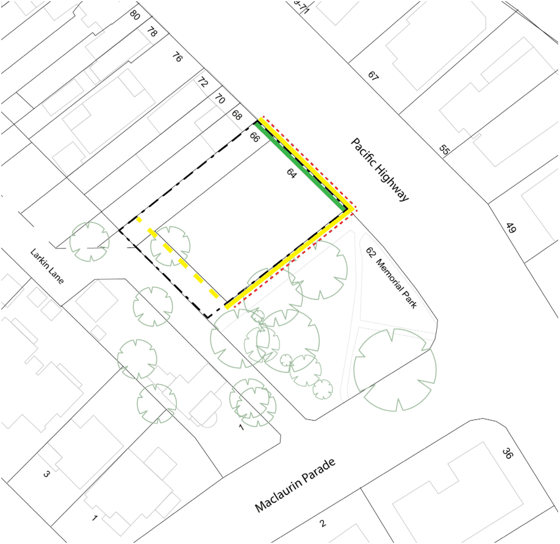

### 14L.4 BUILT FORM

> [Picture on page 8: a picture, saved as a picture (images/part-14l-62-part-64-66-pacific-highway-page-8-2.gif, 150 dpi).]

N

#### Figure 14L.4-1:

#### Built Form Plan

#### Legend

Awnings Primary Active Street Frontage

Secondary Active Street Frontage

Street Wall Height (3 storey/11.5m)

Existing Trees

#### Objectives

1	 To ensure new

development is respectful

to the surrounding context,

with articulated height

and massing providing

an appropriate interface

to the Roseville Memorial

Park and adjoining

properties.

2	 To facilitate the

redevelopment of the site

to achieve a landmark

building with high

quality urban form and

architectural design. 3	 To create a cohesive

streetscape with

consistent street wall

along the western side of

the Pacific Highway. 4	 To provide a consistent

urban form and human

scale along all public

interfaces.

5	 To ensure buildings are

designed to interact and

engage with pedestrians

at all public domain

interfaces to create

a vibrant and safe

streetscape.

6	 To minimise the visual

bulk and scale of new

buildings when viewed

from the public domain. 7	 To ensure building

facades are well designed,

articulated and address

public streets, footpaths,

public spaces and parks. 8	 To minimise the visual

impact of service facilities.

### 14L.4 BUILT FORM (continued)

#### Controls

1 Provision of a landmark building of high quality form and design.

The building form will be viewed in the round and highly visible from

the public domain on all sides. The landmark building should:

i) Turn the corner and address both street frontages.

ii)	 Provide building entries on corners as an effective way of

achieving architectural expression.

iii)	 Incorporate corner articulations that differentiate the mass at the

corner reinforcing the building as a landmark or focal point.

iv)	 Include chamfered/rounded corners extending through the

height of the façade detailed as stronger visual elements.

v)	 Utilise, where possible, variation in height within the massing,

potentially allowing the corner to be expressed as a taller

element.

vi)	 Use different materials/colours to create a distinct architectural

expression.

2 3 storey/11.5m street wall is to be provided to the Pacific Highway

boundary, providing a consistent street wall height requirement with

the adjoining properties to the north.

3 Primary entry to ground floor commercial uses must be provided

on the corner of Pacific Highway and Roseville Memorial Park.

Secondary entry points may be provided on Pacific Highway and

Larkin Lane frontages.

4 Active street frontages must be provided to the primary active

frontages being the Pacific Highway frontage and Roseville

Memorial Park and the secondary active frontage being Larkin

Lane.

5 Floor to ceiling glazing is to be provided at the ground level to the

primary active frontages in order to encourage visual connection

between the public domain and building interior and active street

frontage.

6 Ground floor uses or elements which require blank walls are to be

located on the secondary active frontage to Larkin Lane. 7 Restaurants, cafes and outdoor dining are encouraged to front the

Roseville Memorial Park.

8 Provide continuous awnings to the Pacific Highway and Memorial

Park frontages.

9 Awnings are not to extend over Roseville Memorial Park, or disturb

tree canopy. All awnings are to be cantilevered. 10 Service elements are to be integrated into the overall design of

the roof, so that that they are not visible from the public domain

or any surrounding development. These elements include lift

overruns, plant equipment, chimneys, vent stacks, water storage,

communication devices and signage.
