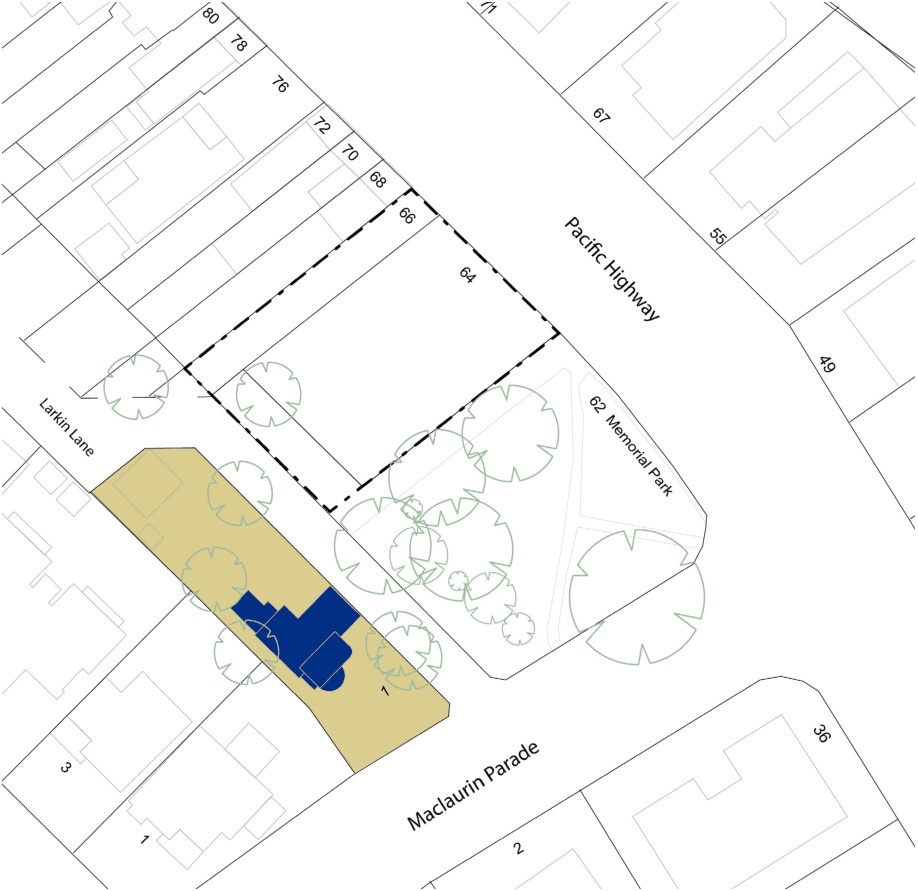

### 14L.5 HERITAGE

> [Picture on page 10: a picture, saved as a picture (images/part-14l-62-part-64-66-pacific-highway-page-10-2.gif, 150 dpi).]

N

#### Figure 14L.5-1:

#### Heritage Plan

#### Legend

Heritage Building ‘Killicrankie’

Heritage Item

Existing Trees

#### Objectives

1	 To consider the impact

on the historic curtilage

and setting of the

Heritage Item located

at 1 Maclaurin Parade,

Roseville.

2	 To retain the significance

of Heritage Item. 3	 To ensure that the scale

of new development does

not dominate, detract

from or compete with the

Heritage Item.

4	 To ensure that new

development respects and

conserves the significance

of the Heritage Item its

setting.

5	 To ensure that new

development does not

visually dominate the

adjoining or nearby

Heritage Item.

6	 To ensure new

development provides

an interface of  scale

and bulk to preserve the

amenity to the adjacent

Heritage Item or building

within a HCA.

7	 To ensure that the scale

of new development does

not dominate, detract

from or compete with the

Heritage Item.

8	 To protect significant

views and vistas to and

from the Heritage Item.

### 14L.5 HERITAGE (continued)

#### Controls

#### Heritage Impact Assessment

1 New development is to include a Heritage Impact Statement

(HIS), which is prepared in accordance with NSW Heritage

best practice guidelines. The HIS is to address the effect of the

proposed development on the property at 1 Maclaurin Avenue and

demonstrate that the proposed works will not adversely impact upon

its significance, including any related heritage features within the

item’s identified curtilage and setting.

#### Built Form

2 In relation to the heritage item, new development on the subject site

is to have regard to:

i) the form of the existing heritage item including its height,

roofline, setbacks and building alignment;

ii)	 dominant architectural language such as horizontal lines and

vertical segmentation;

iii)	 materials and colours;

iv)	 siting and orientation; and

v)	 the setting and context.

#### Views

3 New development must not reduce or impair important views to and

from the Heritage Item from the public domain.
