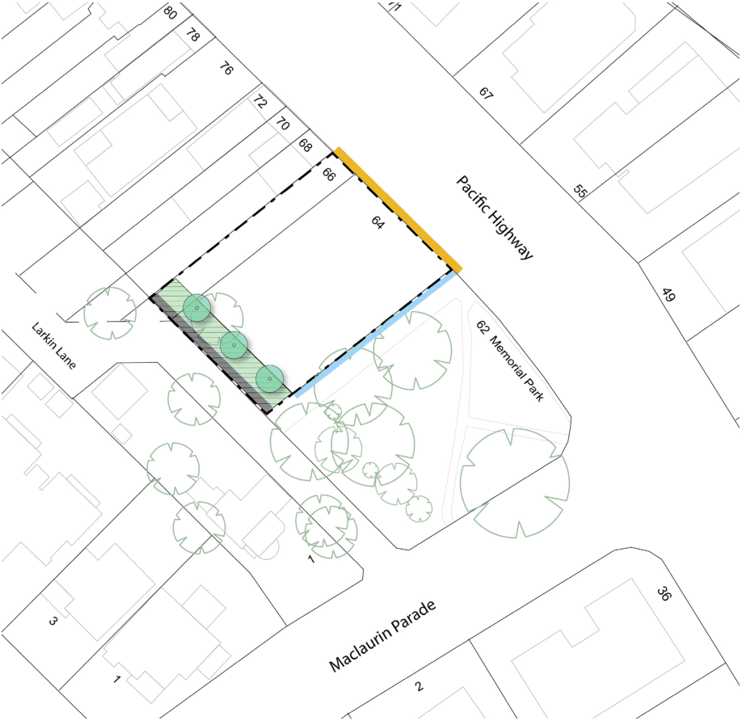

### 14L.6 PUBLIC DOMAIN

> [Picture on page 12: a picture, saved as a picture (images/part-14l-62-part-64-66-pacific-highway-page-12-2.gif, 150 dpi).]

N

#### Figure 14L.6-1

#### Public Domain Controls

#### Legend

Streetscape Paving (in accordance with local centres public domain technical manual ‘Ku-ring-gai Local Centre paving mix’

Transparent Balustrade at ground level

6m Setback Zone

Minimum 2m wide path within 6m setback

Soft Landscape within 6m setback including a minimum of 3 trees

Existing Trees

#### Objectives

1	 To provide a high quality

streetscape that engages

and activates the Local

Centre, and contributes to

its economic viability. 2	 To improve and enhance

pedestrian and visual

connection to Roseville

Memorial Park and the

local centre.

3	 To provide continuity in the

streetscape and improve

pedestrian amenity along

the Pacific Highway and

Larkin Lane.

4	 To respect the heritage

significance of the

memorials within Roseville

Memorial Park.

5	 To protect the existing

vegetation within Roseville

Memorial Park.

6	 To provide visual

extension of the park into

Larkin Lane within the

setback zones.

7	 To minimise

overshadowing of the

park.

8	 To facilitate the planned

future activation of

Larkin Lane through

pedestrianisation and

landscaping.

### 14L.6 PUBLIC DOMAIN (continued)

#### Controls

1 Public domain works are to be in accordance with Figure 14L.6-1. It

is to be delivered through a Voluntary Planning Agreement (VPA) or

other delivery mechanism and include the following:

i) 6 metre setback from Larkin Lane with minimum 2 metre wide

path and remainder as soft landscape.

ii)	 Paving to Pacific Highway frontage must be in accordance with

the Public Domain Technical Manual for Local Centres, or as

agreed with Council’s Public Domain Coordinator.

iii)	 Any external works must respect the locations of memorials

within the Roseville Memorial Park.

iv)	 Any signage or any other elements must not detract from the

memorials within the Roseville Memorial Park, and must respect

the memorials.

v)	 Light spill from the building into the Roseville Memorial Park

must be minimised.

vi)	 Balustrades surrounding any outside ground level terraces

interfacing with the Roseville Memorial Park should be

transparent for visual continuity with the park.

vii)	 Provide tree planting within the landscape zone of Larkin Lane,

to provide continuity to Roseville Memorial Park.

### THIS PAGE IS INTENTIONALLY BLANK
