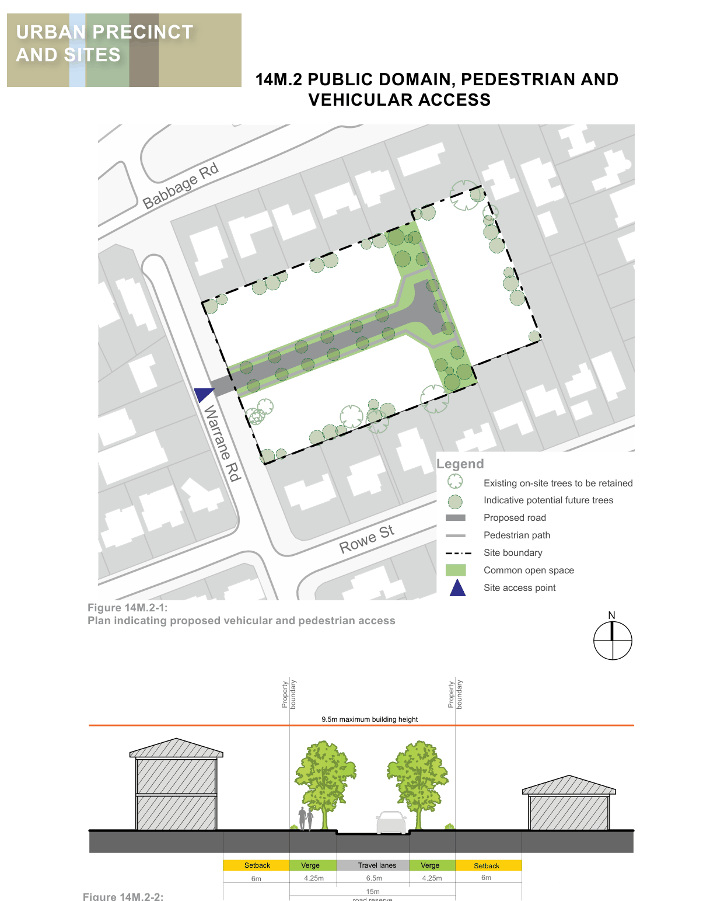

### 14M.1 URBAN PRECINCT:

## 47 WARRANE ROAD

#### Babbage Rd

#### Rowe St

#### Warrane Rd

#### DCP Controls

#### Legend

### Allan St

#### Objectives

1	 To ensure new built

form retains the scale

and character of the

surrounding low density

residential area. 2	 To ensure the streetscape

is integrated into the

surrounding neighbouring

context.

3	 To retain, protect and

increase tree canopy on

new subdivided sites and

on neighbouring sites. 4	 To ensure the built form of

corner buildings responds

to the character of the two

streets they address. 5	 To ensure new

development is compatible

with the bulk, scale,

height and roof form of

neighbouring buildings. 6	 To ensure the landscaped

setback areas support the

Ku-ring-gai character of

built form within a garden

setting including canopy

trees.

7	 To ensure the amenity

of existing properties is

maintained

### 14M.1 URBAN PRECINCT:

## 47 WARRANE ROAD (continued)

#### Controls Planned Future Character

The site is located at 47 Warrane Road, Roseville Chase, south of

Babbage Road and Warringah Road. The land is the former location

of the East Roseville Bowling Club and surrounded by low density

residential housing.

The planned future character seeks to integrate elements of the existing

area and reflect the Ku-ring-gai character of high quality dwellings and

landscaping.

1 All development within the site is to be designed to support and

enhance the planned future character of the site. This is to be done

through compliance with the site-specific requirements stated in this

Part 14M of the DCP, and compliance with other relevant parts of

Section A, B, C of the DCP.

2 New development is to include the following key elements:

i) The streetscape of Warrane Road and the new road on site is

to be cohesive with the character of the surrounding low density

residential dwellings.

ii)	 Provide new trees and increased canopy cover in accordance

with Part 4A.4 of the DCP.

iii)	 Minimise impacts on neighbouring residential properties through

landscaping, setbacks, built form, bulk and scale.

iv)	 The siting of buildings is to demonstrate clear visible entry points

to dwellings from the street.

v)	 Roofs are to be pitched and hipped in the style that relates

sympathetically to neighbouring dwellings.

vi)	 Provide a high standard of external finishes and appropriate

level of architectural detail.

vii)	 Provide a 3m wide deep soil landscape buffer, excluding

retaining walls, to common boundaries with existing

neighbouring lots, as indicated in figure 14M.1-1.

viii)	Provide planting within the deep soil landscape buffers that

enables screening to adjacent neighbouring properties.

## 47 WARRANE ROAD

ix)	 Development is to avoid the Tree Protection Zones (TPZ) for all

existing and proposed large trees on the site and neighbouring

sites.

> [Picture on page 4: a map, saved as a picture (images/part-14m-47-warrane-road-roseville-chase-page-4-1.gif, 150 dpi); the street names and other small labels are on the picture.]
> Words printed on the picture (title and legend, copied from the PDF):
> Legend3m landscape buffer (nil excavation)
> Existing on-site trees to be retained
> Indicative potential future trees
> Common open space
> Site access point
> Plan indicating proposed vehicular and pedestrian access
> 9.5m maximum building height
> 47 WARRANE ROAD, ROSEVILLE CHASE
> DCP Diagrams- Landscape
> Setback Verge Travel lanes
> 6m 4.25m 6.5m 4.25m 6m

Figure 14M.2-1:

Figure 14M.2-2:
