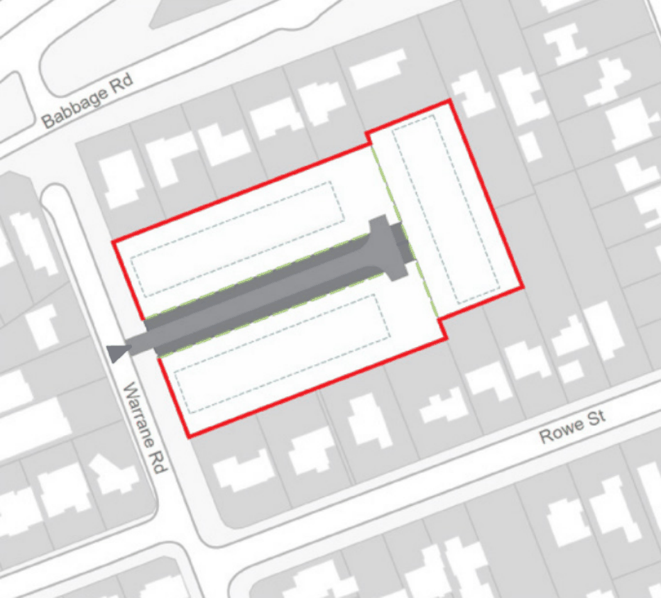
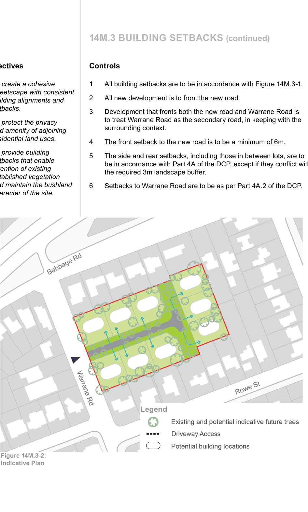

### 14M.3 BUILDING SETBACKS

> [Picture on page 6: a picture, saved as a picture (images/part-14m-47-warrane-road-roseville-chase-page-6-2.gif, 150 dpi).]

#### Figure 14M.3-1:

#### Planned Building setbacks

#### Legend

#### DCP Controls

Developable area 6m min. setback from internal road Setback to boundary as per DCP - Part 4 Proposed road

N

Site access point

Note: All other setbacks as per DCP - Part 4

> [Picture on page 7: a map, saved as a picture (images/part-14m-47-warrane-road-roseville-chase-page-7-1.gif, 150 dpi); the street names and other small labels are on the picture.]
> Words printed on the picture (title and legend, copied from the PDF):
> streetscape with consistent
> building alignments and
> and amenity of adjoining
> residential land uses.
> 3	 To provide building
> setbacks that enable
> retention of existing
> and maintain the bushland
> character of the site.

Figure 14M.3-2:

#### Objectives

1	 To create a cohesive

2	 To protect the privacy

### 14M.3 BUILDING SETBACKS (continued)

#### Controls

1 All building setbacks are to be in accordance with Figure 14M.3-1. 2 All new development is to front the new road.

3 Development that fronts both the new road and Warrane Road is

to treat Warrane Road as the secondary road, in keeping with the

4 The front setback to the new road is to be a minimum of 6m. 5 The side and rear setbacks, including those in between lots, are to

be in accordance with Part 4A of the DCP, except if they conflict with

the required 3m landscape buffer.

6 Setbacks to Warrane Road are to be as per Part 4A.2 of the DCP.
