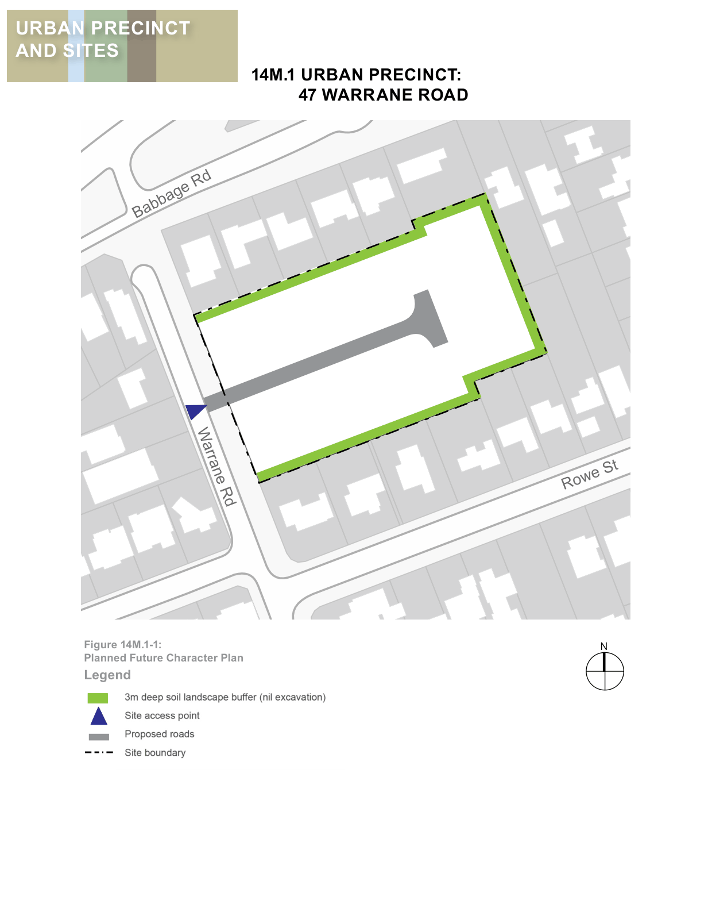

# Ku-ring-gai Development Control Plan - Part 14M 47 Warrane Road, Roseville Chase

> This chapter is split into 4 section file(s), one per numbered heading, in the order they appear in the PDF.

Source PDF: [kdcp-section-b-part-14m-47-warrane-road-roseville-chase.pdf](kdcp-section-b-part-14m-47-warrane-road-roseville-chase.pdf)

### 14M

### PART

## 47 Warrane Road, Roseville Chase

14M.1 	 Urban Precinct 14M.2 	Public Domain, Pedestrian and Vehicular Access 14M.3 	Building Setbacks

## 47 WARRANE ROAD

> [Picture on page 2: a picture, saved as a picture (images/part-14m-47-warrane-road-roseville-chase-page-2-1.gif, 150 dpi).]
> Words printed on the picture (title and legend, copied from the PDF):
> N
> Planned Future Character Plan
> 3m landscape buffer (nil excavation)
> Site access point
> Proposed roads
> Site boundary
> 47 WARRANE ROAD, ROSEVILLE CHASE
> DCP Diagrams- Landscape

Figure 14M.1-1:

<!-- sections -->
## Sections

1. [14M.1 URBAN PRECINCT:](01-14m-1-urban-precinct.md)
2. [14M.2 PUBLIC DOMAIN, PEDESTRIAN AND](02-14m-2-public-domain-pedestrian-and.md)
3. [14M.3 BUILDING SETBACKS](03-14m-3-building-setbacks.md)
4. [47 WARRANE ROAD](04-47-warrane-road.md)
