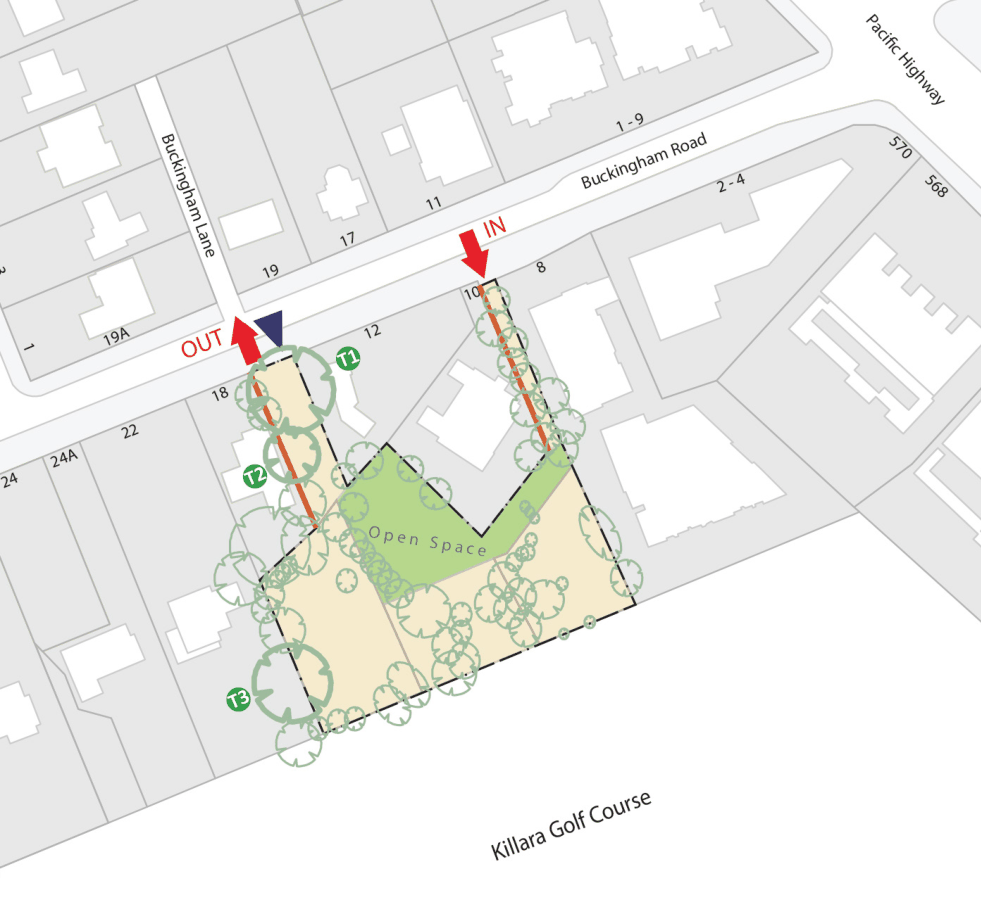

### 14N.2 PEDESTRIAN AND

### VEHICULAR ACCESS

> [Picture on page 4: a picture, saved as a picture (images/part-14n-8a-14-16-buckingham-road-killara-page-4-3.gif, 150 dpi).]

#### Figure 14N.2-1:

#### Plan indicating proposed vehicular and pedestrian access

#### Legend

Pedestrian Access

Vehicle Access - One Way

Open Space Heritage Setback Zone

Deep Soil Landscape Screening to Access Handle 10 and 18 Buckingham Road

T1, T2, T3 - Blue Gum High Forest Critically Endangered Ecological Community

Existing Trees

N

## 47 WARRANE ROAD

### 8A,14,16 BUCKINGHAM ROAD

#### Objectives

1	 To provide vehicle access

for residents and service

providers that integrates

with the surrounding road

networks and activities. 2	 To ensure pedestrian

permeability within the site. 3	 To enable good surveillance

and pedestrian safety

throughout the site. 4	 To minimise impacts on

existing mature vegetation

and trees.

5	 To maintain stability and

strength of the sub-surface

soils.

6	 To minimise vehicular

noise and privacy impacts

to adjacent low density

dwellings.

7	 To discourage the provision

of excess car parking

spaces.

### 14N.2 PEDESTRIAN AND

### VEHICULAR ACCESS (continued)

#### Controls

#### Pedestrian and Vehicle Access

1 Site access points, driveways and paths are to consider the location

of major trees and retain existing significant trees, in particular T1, T2

and T3 (see Figure 14N.2-1).

2 Vehicular access in and out of the site is to be via a maximum 3m

wide one way loop road and include the following (see Figure 14.2-1):

i) entry is to be between 8 and 10 Buckingham Road, exit is to be

between 12 and 18 Buckingham Road; and

ii)	 no passing bay or other hardstands are to be provided in the site

access handles.

3 Deep soil landscape screening is to be provided and maximised to

the length of the access handle boundary with 10 and 18 Buckingham

Road. Minimal landscaping is required to the boundary of 8

Buckingham Road (see Figure 14N.2-1).

4 Pedestrian and cycle access into the site is to be provided in between

12 and 18 Buckingham Road and is to include boundary screening

landscaping (see Figure 14N.2-1).

5 Basement parking is to be provided within the footprint of each

building. Basement parking between separate buildings may be

connected only by a single car lane tunnel between buildings.

Provision of basement parking bays or any other vehicle related

infrastructure outside the building footprint is not permitted.

#### Parking

6 Parking provision will be in accordance with Part 7B of the DCP. 7 Parking areas are to provide infrastructure for future installation of EV

charging points to all parking bays.

8 Where car parking spaces exceed the parking requirements in

Council’s DCP or in the Guide to Traffic Generating Development

(which ever applies to the site), the spaces will be included as gross

floor area.
