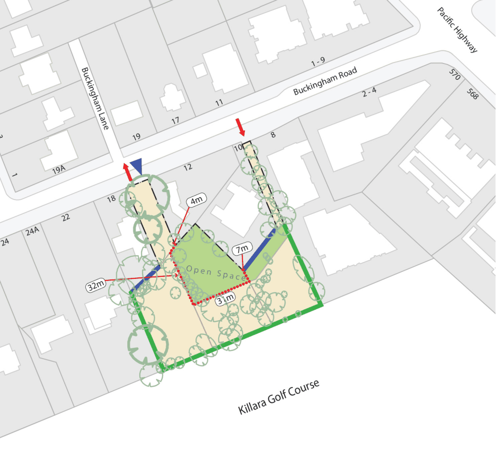

### 14N.3 BUILDING SETBACKS

> [Picture on page 6: a picture, saved as a picture (images/part-14n-8a-14-16-buckingham-road-killara-page-6-2.gif, 150 dpi).]

#### Figure 14N.3-1:

#### Planned Building Setbacks

#### Legend

6m Setback

9m Setback

Open Space Perimeter

Open Space Heritage Setback Zone

Blue Gum High Forest Critically Endangered Ecological Community

Existing Trees

Vehicular Access Points

Pedestrian Access Points

N

## 47 WARRANE ROAD

### 8A,14,16 BUCKINGHAM ROAD

#### Objectives

1	 To preserve the visual

amenity of adjoining

heritage properties and low

density dwellings. 2	 To enable the retention

of existing established

vegetation, including large

trees.

3	 To enable delivery of Ku-

ring-gai’s unique landscape

character of built form

within a landscaped setting,

including canopy trees.

### 14N.3 BUILDING SETBACKS (continued)

#### Controls

1 All building setbacks are to be in accordance with Figure 14N.3-1. 2 Provide a minimum 6m setback to:

i) the boundary with the Killara Golf Club,

ii) the boundary with 8 Buckingham Road,

iii) the boundary with 22 Buckingham Road. Note: Upper floor setbacks are to be in accordance with Part 19F.2 3 Provide a minimum 9m setback to

i) the southeastern boundary to 10 Buckingham Road.

ii) the southern boundary to 18 Buckingham Road. 4 Provide an Open Space Heritage Setback Zone, with dimensions as

illustrated in Figure 14N.3-1.

5 Development is to demonstrate the protection of Tree Protection

Zones as follows:

i) Development is not to encroach into more than 10% of the Tree

Protection Zone of trees inside a Landscape Area Buffer and/

or setback. Setbacks are to be increased to accommodate Tree

Protection Zones where necessary.

ii) Where trees are located outside a Landscape Area Buffer and/or

setback, development is to demonstrate protection of Tree

Protection Zones.

Note: If the proposed encroachment is greater than 10% of the Tree

Protection Zone or inside the structural root zone, the project

arborist must demonstrate that the tree(s) would remain viable.
