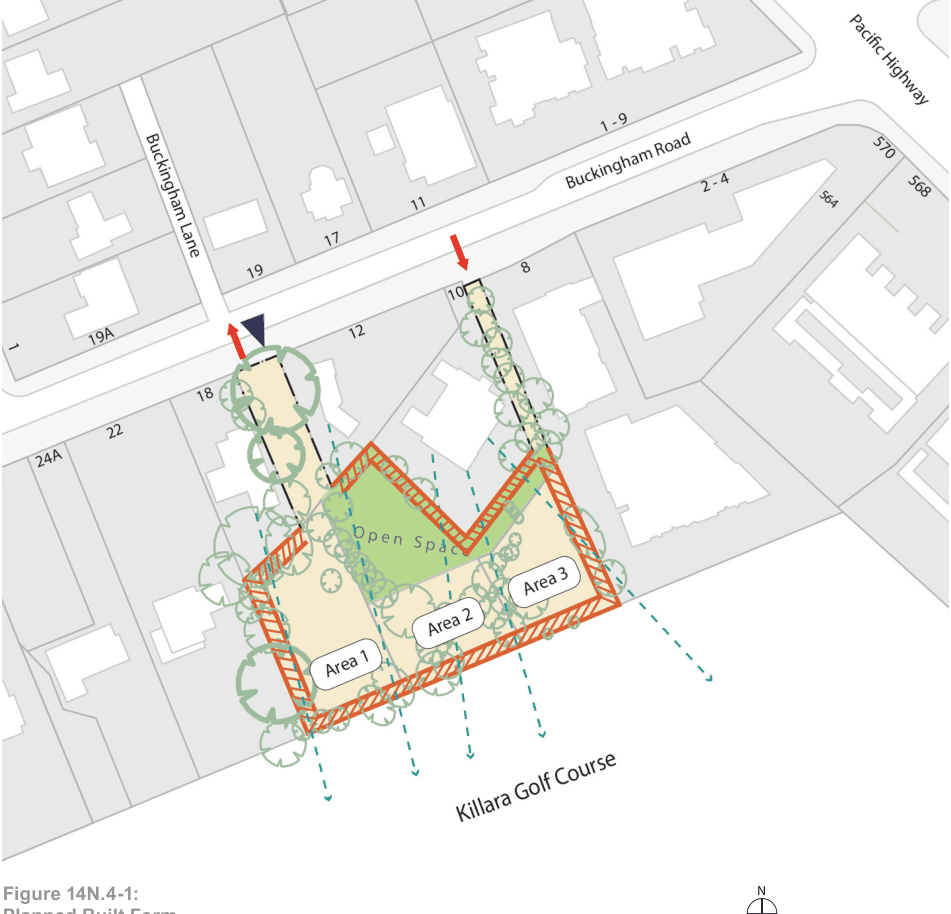
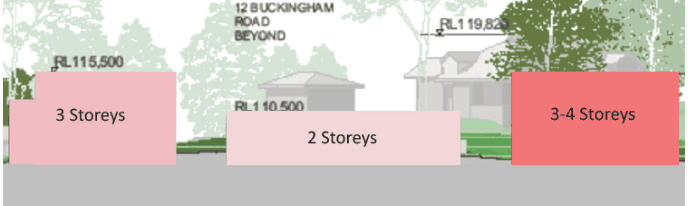

### 14N.4 BUILT FORM

> [Picture on page 8: a picture, saved as a picture (images/part-14n-8a-14-16-buckingham-road-killara-page-8-2.gif, 150 dpi).]
> Words printed on the picture (title and legend, copied from the PDF):
> N

Figure 14N.4-1:

#### Planned Built Form

#### Legend

View Corridors

Open Space Heritage Setback Zone

6m Deep Soil Landscaped Area Buffer

Blue Gum High Forest Critically Endangered Ecological Community

Existing Trees

Vehicular Access Points

Pedestrian Access Points

## 47 WARRANE ROAD

### 8A,14,16 BUCKINGHAM ROAD

#### Objectives

1	 To reduce bulk and scale

impacts of new high

density development on

the adjacent low density

neighbourhood. 2	 To preserve the visual

amenity of neighbouring

low density dwellings and

Heritage Items. 3	 To ensure appropiate

space is provided between

new developments. 4	 To ensure passive visual

surveillance and safe

pedestrian access across

the site.

5	 To ensure the long term

protection of existing

vegetation and trees and

minimise the impacts of

new development.

#### Figure 14N.4-2:

#### Indicative diagram of building height

### 14N.4 BUILT FORM (continued)

#### Controls

1 The siting of buildings is to provide clear, visible building entry points

and demonstrate good surveillance of pathways and communal

access.

2 A minimum of 3 small footprint buildings are to be provided on the

site with separation compliant with part 7A.4 of the DCP. 3 New buildings are to be sited and orientated to provide view

corridors from 10 Buckingham Road to the Golf Course. 4 Building height is not to exceed the following (see Figure 14N.1-1,

Figure 14N.4-1 and Figure 14N.4-2):

i) Area 1: 3 storeys     ii) Area 2: 2 storeys     iii) Area 3: 4 storeys 5 Level 3 is to be stepped back on all elevations facing 18 and 22

Buckingham Road by a minimum of 2 metres. 6	    Levels 3-4 is to be stepped back on all elevations facing 10

Buckingham Road by a minimum of 2 metres. 7 All plant equipment and services to buildings are to be located within

the basement of buildings. No plant equipment is to be located on

any rooftop.

8 Where the Deep Soil Landscaped Area Buffer (see Figure 14N.4-1)

contains Greenweb areas, planting within the Greenweb area is to

comprise of species from the Blue Gum High Forest community,

including ground shrub and canopy, and include trees with a mature

height of minimum 15m.

9 Design and setting of built form and hard landscaping is to

demonstrate retention of existing vegetation and trees outlined in the

tree retention plan.

10 Any future proposed landscaping is to be of a species and design

compatible with the existing site.

11 The site layout is to avoid, minimise and mitigate impacts upon Blue

Gum High Forest (BGHF). Future development is to be sited to

avoid impacts upon BGHF. Impacts that are unavoidable are to be

minimised having consideration to overshadowing and changes to

the hydrological conditions. Proposed Mitigation measures are to be

consistent with part 18.7 of the KDCP.

12 A Vegetation Management Plan (VMP) addressing the ongoing

management of the Blue Gum High Forest (BGHF) within the site is

to be prepared by an appropriately qualified consultant. The VMP is

to include measures to restore the integrity of the BGHF.

> [Picture on page 9: a picture, saved as a picture (images/part-14n-8a-14-16-buckingham-road-killara-page-9-64.gif, 150 dpi).]
