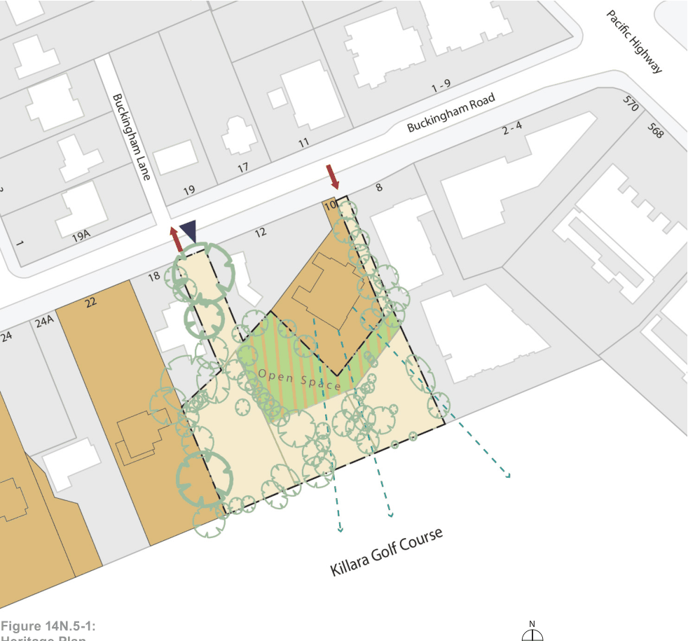

### 14N.5 HERITAGE

> [Picture on page 10: a picture, saved as a picture (images/part-14n-8a-14-16-buckingham-road-killara-page-10-2.gif, 150 dpi).]
> Words printed on the picture (title and legend, copied from the PDF):
> N

Figure 14N.5-1:

#### Heritage Plan

#### Legend

Open Space Heritage setback zone

Heritage Items

Blue Gum High Forest Critically Endangered Ecological Community

Existing Trees

View Corridors

Vehicular Access Points

Pedestrian Access Points
