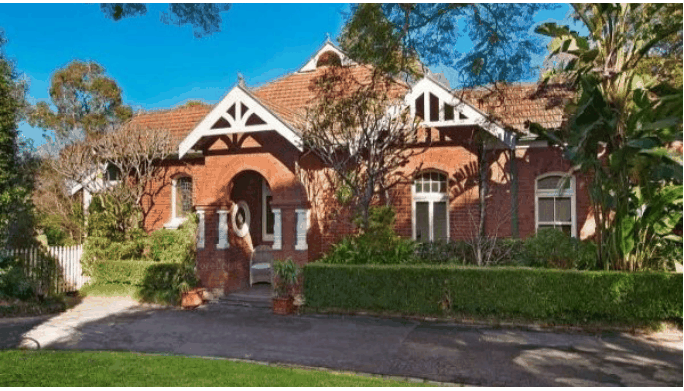
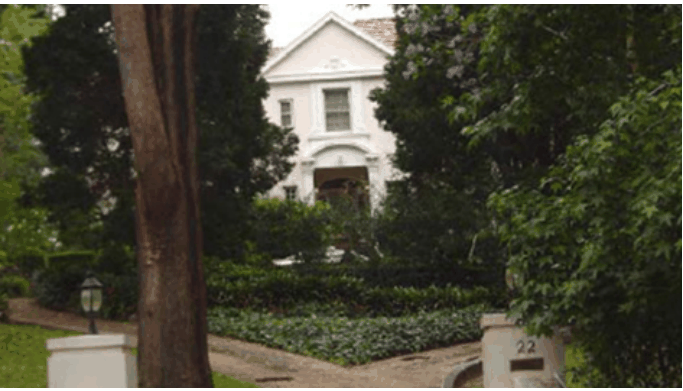

## 47 WARRANE ROAD

### 8A,14,16 BUCKINGHAM ROAD

#### Objectives

1	 To conserve the setting

and amenity of adjacent

Heritage Items. 2	 Ensure new buildings

respond to the scale,

design, setting and

character of the Heritage

Item.

3	 To ensure new

development does not

visually dominate the

adjacent Heritage Items. 4	 To retain views and vistas

between Killara Golf Club

and the Heritage Item at

10 Buckingham Road. 5	 To retain the bushland

context of the Heritage

Items and the leafy

character of the area. 6	 To integrate into the low

density street frontage

and retain the street

presentation of the

Heritage Items at 10 and

22 Buckingham Road.

### 14N.5 HERITAGE (continued)

#### Controls

1	 Site layout and new buildings are to give consideration to being in the

vicinity of neighbouring Heritage Items at 10 and 22 Buckingham Road

(refer to section 19F of the DCP).

2	 Provide view corridors to and from the Heritage Item at 10 Buckingham

Road (see Figure 14N.5-1).

3	 Provide an expanded curtilage at No.10 Buckingham Road, in the form

of an Open Space Heritage Setback Zone (see Figure 14N.5-1), to the

effect of:

i) the eastern boundary of the Heritage Item to have adequate

landscaping to the boundary with 10 Buckingham Road.

ii) the areas to the southeastern and southwestern boundaries are

to be used as open space and preserve the visual amenity of the

Heritage Item, as indicated on figure 14N.5-1.

#### Figure 14N.5-2:

#### No. 10 Buckingham Road.

> [Picture on page 11: a picture, saved as a picture (images/part-14n-8a-14-16-buckingham-road-killara-page-11-45.gif, 150 dpi).]

#### No. 22 Buckingham Road.

> [Picture on page 11: a picture, saved as a picture (images/part-14n-8a-14-16-buckingham-road-killara-page-11-47.gif, 150 dpi).]
