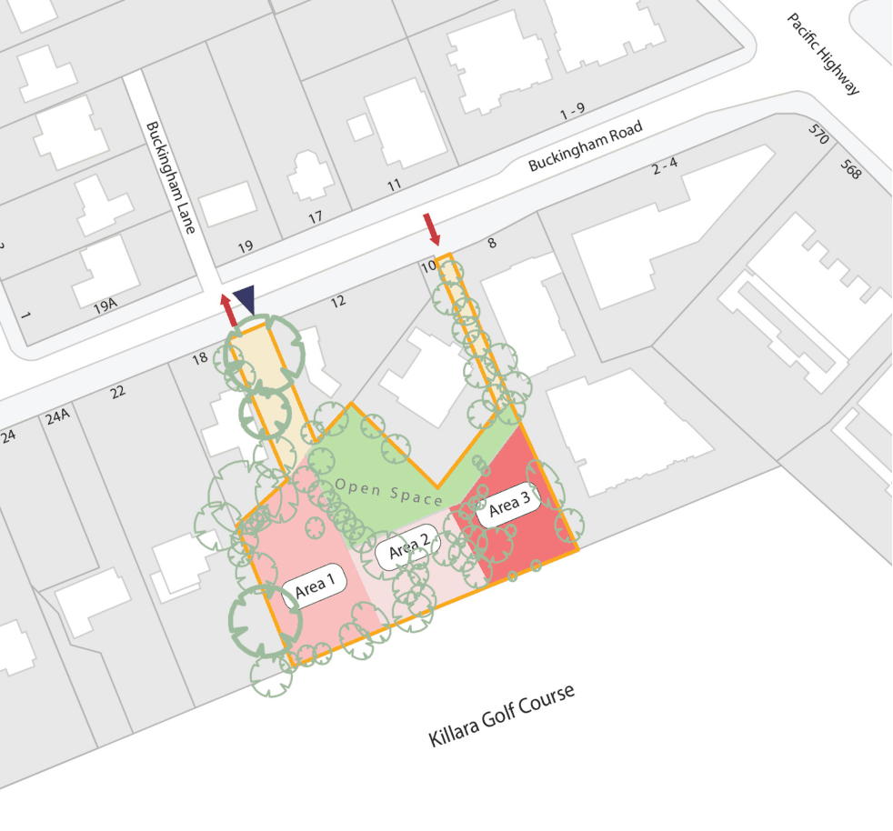

# Ku-ring-gai Development Control Plan - Part 14N 8A, 14, 16 Buckingham Road, Killara

> This chapter is split into 6 section file(s), one per numbered heading, in the order they appear in the PDF.

Source PDF: [kdcp-section-b-part-14n-8a-14-16-buckingham-road-killara.pdf](https://planfortomorrow.sharepoint.com/sites/Planfortomorrow/Shared%20Documents/00%20NSW-Planning-Resources/dcp/ku-ring-gai-development-control-plan/part-14n-8a-14-16-buckingham-road-killara/kdcp-section-b-part-14n-8a-14-16-buckingham-road-killara.pdf)

### 14N

### PART

#### 8A, 14, 16 Buckingham Road, Killara

14N.1 	 Urban Precinct

14N.2 	 Pedestrian and Vehicular Access

14N.3 	 Building Setbacks

14N.4 	 Built Form

14N.5	 Heritage

### 8A,14,16 BUCKINGHAM ROAD

### 14N.1 URBAN PRECINCT:

### 8A, 14, 16 BUCKINGHAM ROAD

> [Picture on page 2: a picture, saved as a picture (images/part-14n-8a-14-16-buckingham-road-killara-page-2-3.gif, 150 dpi).]

N

#### Figure 14N.1-1:

#### Planned Future Character Plan

#### Legend

## 47 WARRANE ROAD

8A, 14, 16 Buckingham Road Urban Precinct

Area 1 - 3 Storey

Area 2 - 2 Storey Area 3 - 4 Storey

### 8A,14,16 BUCKINGHAM ROAD

Open Space Heritage Setback Zone

Blue Gum High Forest Critically Endangered Ecological Community

Existing Trees

#### Objectives

1	 To ensure new

development is integrated

and consistent with the

Ku-ring-gai landscape

character.

2	 To reduce the impacts of

bulk and scale on adjacent

residential neighbourhoods

and Heritage Items. 3	 To provide a transition

between new medium to

high density residential

buildings and the adjacent

established low density

residential neighbourhood

fronting Buckingham Road. 4	 To retain the character

of the Buckingham Road

streetscape. 5	 To ensure long term

improvement and

protection of the Blue Gum

High Forest.

<!-- sections -->
## Sections

1. [14N.1 URBAN PRECINCT:](01-14n-1-urban-precinct.md)
2. [14N.2 PEDESTRIAN AND](02-14n-2-pedestrian-and.md)
3. [14N.3 BUILDING SETBACKS](03-14n-3-building-setbacks.md)
4. [14N.4 BUILT FORM](04-14n-4-built-form.md)
5. [14N.5 HERITAGE](05-14n-5-heritage.md)
6. [47 WARRANE ROAD](06-47-warrane-road.md)
