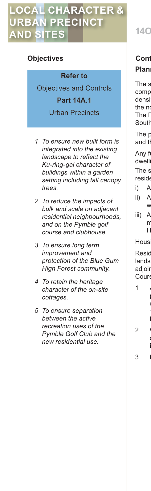
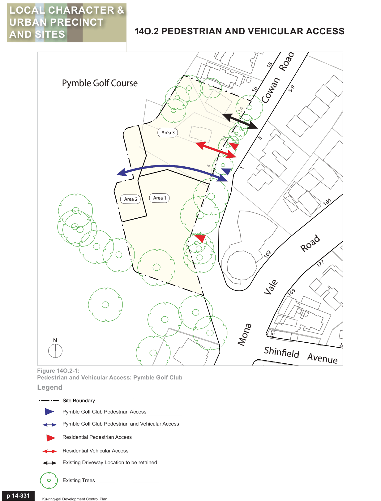

### 14O.1 URBAN PRECINCT:

### PYMBLE GOLF CLUB

### Pymble Golf Course

### Cowan    Road

#### A

#### A

#### B

### Road

### Vale

### Mona

### Shinfield    Avenue

7

#### Legend

#### A B

> [Picture on page 3: a map, saved as a picture (images/part-14o-4-12-and-14-cowan-road-st-ives-pymble-golf-club-page-3-1.gif, 150 dpi); the street names and other small labels are on the picture.]
> Words printed on the picture (title and legend, copied from the PDF):
> Objectives and Controls
> integrated into the existing
> landscape to reflect the
> Ku-ring-gai character of
> buildings within a garden
> setting including tall canopy
> course and clubhouse.
> High Forest community.
> character of the on-site
> 5	 To ensure separation
> between the active
> recreation uses of the
> new residential use.

#### Objectives

Refer to

#### Part 14A.1

1	 To ensure new built form is

2	 To reduce the impacts of

bulk and scale on adjacent

and on the Pymble golf

3	 To ensure long term

protection of the Blue Gum

4	 To retain the heritage

Pymble Golf Club and the

### 14O.1 URBAN PRECINCT:

### PYMBLE GOLF CLUB (continued)

#### Controls Planned Future Character

The site is located at 4, 12 and 14 Cowan Road, St Ives. The land

comprises of part of the Pymble Golf Club, now rezoned to permit high

density housing. The site adjoins medium density residential housing to

the north and south, and a church, petrol station and shops to the east.

The Pymble Golf Club clubhouse and golf links will remain to the West and

South of the new residential area.

The planned future character requires the retention of the Golf Club facility

and the visual presence of its main entry on Cowan Road. Any future development is to reflect Ku-ring-gai’s character of high-quality

dwellings in a landscaped garden setting, including tall canopy trees. The site comprises of 3 areas illustrated in 14.O.1-1 that are zoned for

residential development as follows:

i) Area 1 - High density apartment buildings;

ii)	 Area 2 - Medium density apartment buildings to facilitate the interface

with Pymble Golf Club;

iii)	 Area 3 - Medium density apartment buildings to facilitate interface to

medium density residential neighbourhood to the North and relocated

Heritage Cottages.

Housing on the site will allow for a mix of unit typologies. Residential flat buildings are to provide high quality integration into their

landscaped setting and include tall canopy trees and screening shrubs to

adjoining neighbouring dwellings and to the adjacent Clubhouse and Golf

Course.

1 All future development of the site is to support and enhance the

planned future character of the site. This is to be achieved through

compliance with the site-specific requirements stipulated in this Part

14O of the DCP, and compliance with other relevant parts of Section A,

B and C of the DCP.

2 Where there is an inconsistency between Part 14O and other sections

of the DCP, the controls in Part 14O will prevail to the extent of that

inconsistency.

3 New development is to include the following key components:

a.	 setbacks that provide suitable separation and transition between

### PYMBLE GOLF CLUB

high density, low density and medium density residential

development, and to the Pymble Golf Club recreation areas;

b.	 crime prevention through environmental design (CPTED), including

passive surveillance;

c.	 water sensitive urban design (WSUD) measures to meet the

requirements outlined in 24C.3 and 24C.6 of the DCP;

d.	 retention of existing vegetation including Blue Gum High Forest

communities within and adjacent to the site;

e.	 conservation of the on site retained and relocated cottages at 12

and 14 Cowan Road;

f. appropriate treatments are to be incorporated at the interface

between the residential development and Pymble Golf Club

recreation areas, including landscape screening, vegetation and

fencing.

> [Picture on page 4: a map, saved as a picture (images/part-14o-4-12-and-14-cowan-road-st-ives-pymble-golf-club-page-4-1.gif, 150 dpi); the street names and other small labels are on the picture.]
> Words printed on the picture (title and legend, copied from the PDF):
> Pedestrian and Vehicular Access: Pymble Golf Club
> Pymble Golf Club Pedestrian Access
> Pymble Golf Club Pedestrian and Vehicular Access
> Residential Pedestrian Access
> Residential Vehicular Access
> Existing Driveway Location to be retained

Figure 14O.2-1:
