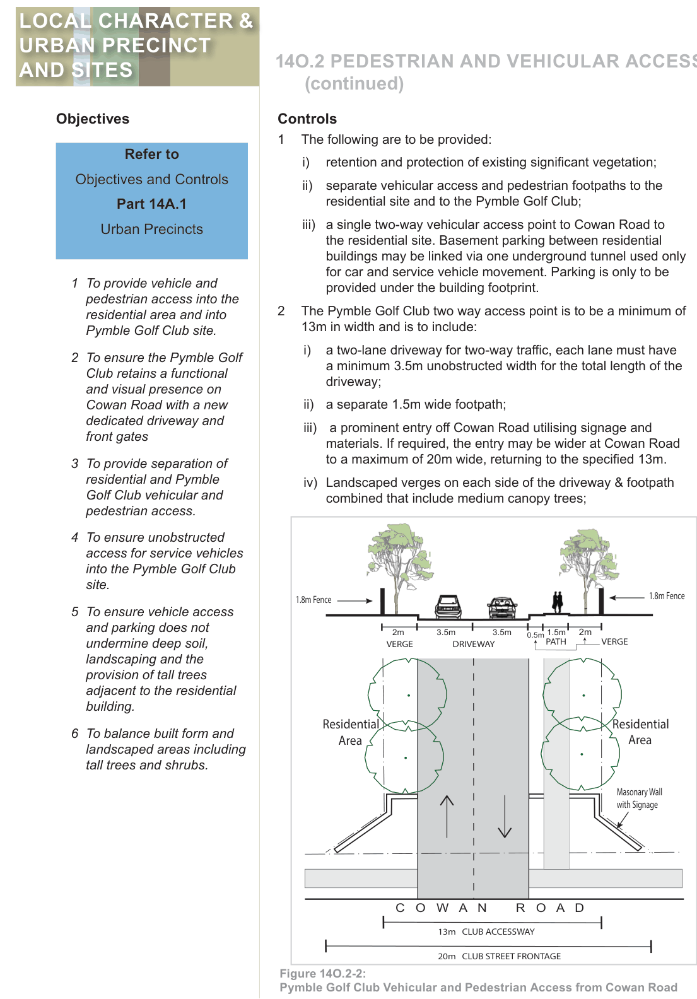
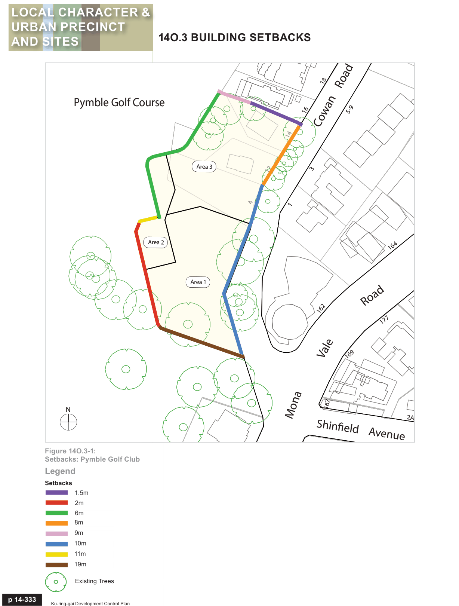

### 14O.2 PEDESTRIAN AND VEHICULAR ACCESS

### Pymble Golf Course

#### Legend

### Cowan    Road

18

### Road

### Vale

### Mona

4

### Shinfield    Avenue

> [Picture on page 5: a map, saved as a picture (images/part-14o-4-12-and-14-cowan-road-st-ives-pymble-golf-club-page-5-1.gif, 150 dpi); the street names and other small labels are on the picture.]
> Words printed on the picture (title and legend, copied from the PDF):
> Objectives and Controls
> pedestrian access into the
> residential area and into
> Pymble Golf Club site.
> Club retains a functional
> and visual presence on
> dedicated driveway and
> residential and Pymble
> Golf Club vehicular and
> 4	 To ensure unobstructed
> access for service vehicles
> and parking does not
> undermine deep soil,
> landscaping and the
> provision of tall trees
> adjacent to the residential
> landscaped areas including
> tall trees and shrubs.
> 2m 3.5m 3.5m 0.5m 2m
> 13m   CLUB ACCESSWAY
> 20m   CLUB STREET FRONTAGE
> Pymble Golf Club Vehicular and Pedestrian Access from Cowan Road

Figure 14O.2-2:

### 14O.2 PEDESTRIAN AND VEHICULAR ACCESS

#### Objectives

Refer to

#### Part 14A.1

1	 To provide vehicle and

2	 To ensure the Pymble Golf

Cowan Road with a new

3	 To provide separation of

into the Pymble Golf Club

5	 To ensure vehicle access

6	 To balance built form and

### (continued)

#### Controls

1 The following are to be provided:

i) retention and protection of existing significant vegetation;

ii)	 separate vehicular access and pedestrian footpaths to the

residential site and to the Pymble Golf Club;

iii)	 a single two-way vehicular access point to Cowan Road to

the residential site. Basement parking between residential

buildings may be linked via one underground tunnel used only

for car and service vehicle movement. Parking is only to be

provided under the building footprint.

2 The Pymble Golf Club two way access point is to be a minimum of

13m in width and is to include:

i) a two-lane driveway for two-way traffic, each lane must have

a minimum 3.5m unobstructed width for the total length of the

ii)	 a separate 1.5m wide footpath;

iii)	 a prominent entry off Cowan Road utilising signage and

materials. If required, the entry may be wider at Cowan Road

to a maximum of 20m wide, returning to the specified 13m.

iv)	 Landscaped verges on each side of the driveway & footpath

combined that include medium canopy trees;

### PYMBLE GOLF CLUB

> [Picture on page 6: a map, saved as a picture (images/part-14o-4-12-and-14-cowan-road-st-ives-pymble-golf-club-page-6-1.gif, 150 dpi); the street names and other small labels are on the picture.]
> Words printed on the picture (title and legend, copied from the PDF):
> Setbacks: Pymble Golf Club

Figure 14O.3-1:
