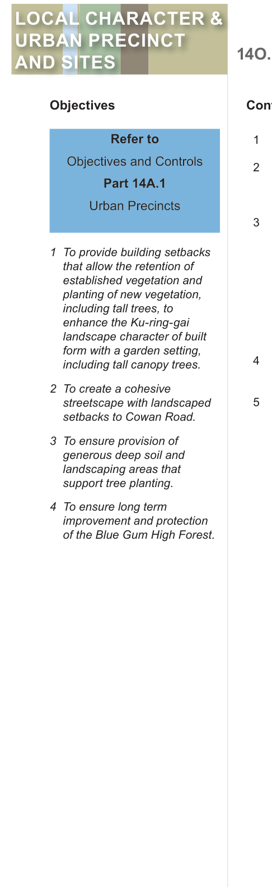
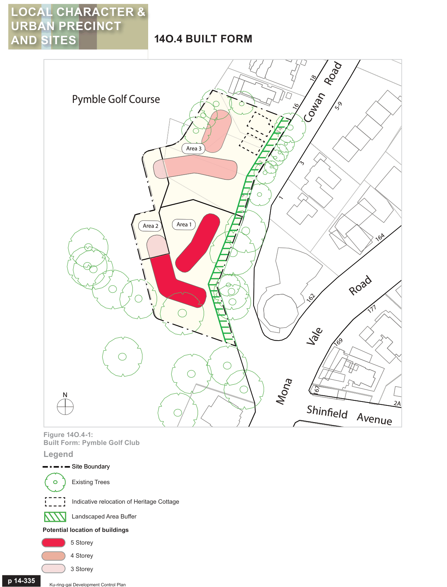

### 14O.3 BUILDING SETBACKS

### Pymble Golf Course

### Cowan    Road

183

### Road

### Vale

### Mona

### Shinfield    Avenue

#### Legend

> [Picture on page 7: a map, saved as a picture (images/part-14o-4-12-and-14-cowan-road-st-ives-pymble-golf-club-page-7-1.gif, 150 dpi); the street names and other small labels are on the picture.]
> Words printed on the picture (title and legend, copied from the PDF):
> Objectives and Controls
> established vegetation and
> planting of new vegetation,
> including tall trees, to
> enhance the Ku-ring-gai
> landscape character of built
> including tall canopy trees.
> streetscape with landscaped
> setbacks to Cowan Road.
> generous deep soil and
> landscaping areas that
> support tree planting.
> improvement and protection

#### Objectives

Refer to

#### Part 14A.1

1	 To provide building setbacks

that allow the retention of

form with a garden setting,

2	 To create a cohesive

3	 To ensure provision of

4	 To ensure long term

of the Blue Gum High Forest.

### 14O.3 BUILDING SETBACKS (continued)

#### Controls

1 Building setbacks are to be in accordance with Figure 14O-3.

2 Buildings adjacent to the relocated heritage cottages and

driveway and pedestrian access to the Pymble Golf Club must

be setback from the fourth storey and above.

3 Front setbacks to Cowan Road must be a minimum of 10m,

increasing to 12m where required to retain existing vegetation

identified as part of the Blue Gum High Forest critically

endangered ecological community.

i) a reduced setback of 8m is permitted in front of the

relocated heritage cottages at 12 & 14 Cowan Road;

ii)	 all front setbacks must comprise deep soil zones.

4 New buildings must be set back a minimum of 12m from

relocated heritage cottages.

5 All setbacks are to be densely landscaped with tall trees, large

shrubs, and screening vegetation to provide privacy to adjoining

properties and reduce impacts from communal open spaces and

balconies.

### PYMBLE GOLF CLUB

> [Picture on page 8: a map, saved as a picture (images/part-14o-4-12-and-14-cowan-road-st-ives-pymble-golf-club-page-8-1.gif, 150 dpi); the street names and other small labels are on the picture.]
> Words printed on the picture (title and legend, copied from the PDF):
> Built Form: Pymble Golf Club
> Indicative relocation of Heritage Cottage
> Landscaped Area Buffer
> Potential location of buildings

Figure 14O.4-1:
