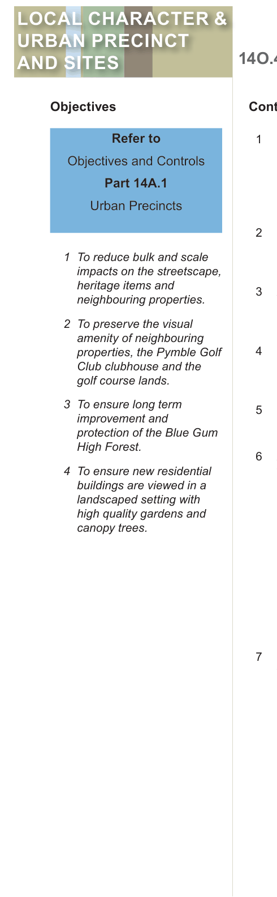
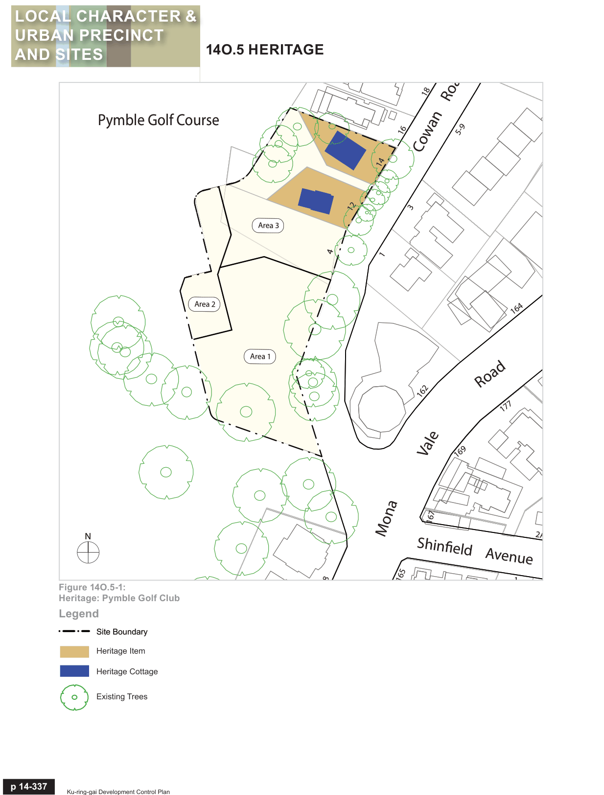

### 14O.4 BUILT FORM

### Pymble Golf Course

#### Legend

### Cowan    Road

183

### Road

### Vale

### Mona

### Shinfield    Avenue

### 14O.4 BUILT FORM (continued)

> [Picture on page 9: a map, saved as a picture (images/part-14o-4-12-and-14-cowan-road-st-ives-pymble-golf-club-page-9-2.gif, 150 dpi); the street names and other small labels are on the picture.]
> Words printed on the picture (title and legend, copied from the PDF):
> Objectives and Controls
> impacts on the streetscape,
> heritage items and
> amenity of neighbouring
> properties, the Pymble Golf
> Club clubhouse and the
> golf course lands.
> landscaped setting with
> high quality gardens and

#### Objectives

#### Controls

1 Built form is to comply with the following:

Refer to

i) Area 1: A maximum of 5 storeys with top storey set backs;

ii)	 Area 2: A maximum of 3 storeys;

#### Part 14A.1

iii)	 Area 3: A maximum of 4 storeys with top storey set backs.

2 The Cowan Road frontage must include clearly defined building

entries, balconies or communal rooms to promote passive

surveillance and a positive public interface.

1	 To reduce bulk and scale

3 A Vegetation Management Plan addressing the ongoing

management of the Blue Gum High Forest within the site is to be

prepared by an appropriately qualified consultant.

4 Landscaping is to be consistent to established landscape and

retain elements, including vegetation identified as part of the

Blue Gum High Forest Community.

2	 To preserve the visual

5 Fencing is provided on the boundary to Cowan Road and

between residential uses and Pymble Golf Club.

3	 To ensure long term

protection of the Blue Gum

6 All fencing is to be a dark-coloured open metal palisade style

fence mounted on a solid sandstone base that is between

200mm and 450mm in height. Total fence heights including the

sandstone base are to be provided as follows:

vii)	 1200mm adjoining Cowan Road Street Frontage;

4	 To ensure new residential

buildings are viewed in a

viii)	1800mm adjoining neighbouring residential properties;

ix)	 1800mm adjoining the new residential area and the Pymble

Golf Club, including along the Pymble Golf Club access

driveway.

Note: This fencing control does not apply to the heritage items. Refer to Part 19 Heritage Item Fencing. 7 Signage identifying the Pymble Golf Club is to be provided as

follows:

### PYMBLE GOLF CLUB

viii)	located on masonry walls;

ix)	 one sign per side of entry driveway;

x)	 in proportion to the scale of the masonry walls;

xi)	 not illuminated.

> [Picture on page 10: a map, saved as a picture (images/part-14o-4-12-and-14-cowan-road-st-ives-pymble-golf-club-page-10-1.gif, 150 dpi); the street names and other small labels are on the picture.]
> Words printed on the picture (title and legend, copied from the PDF):
> Heritage: Pymble Golf Club

Figure 14O.5-1:
