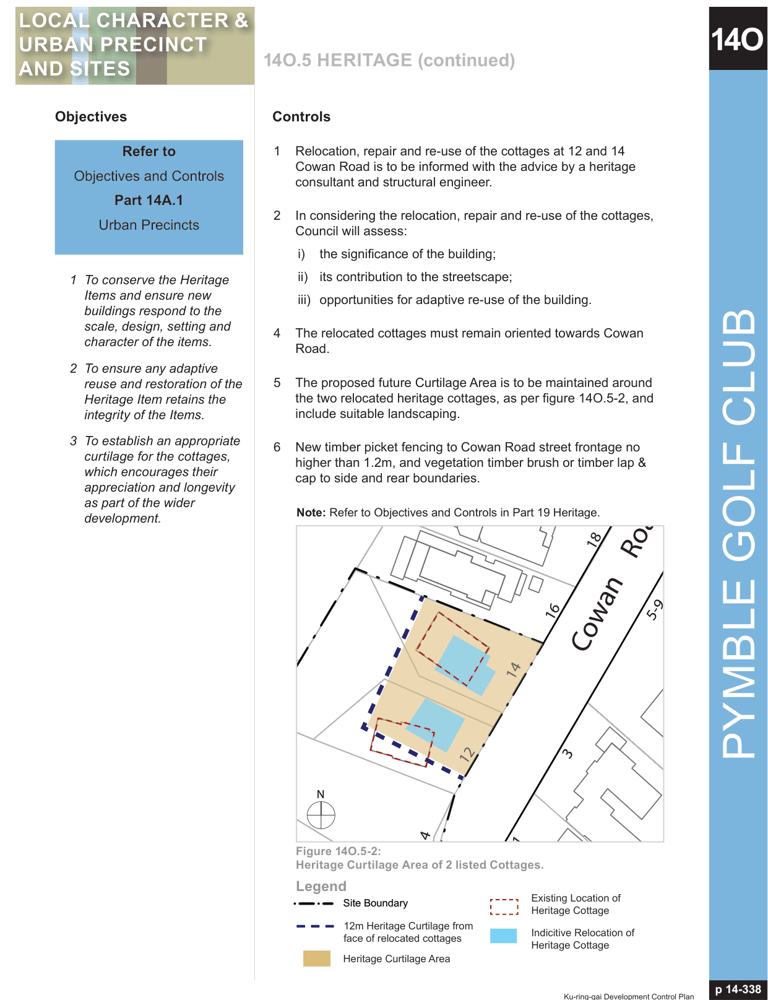

### 14O.5 HERITAGE

### Pymble Golf Course

#### Legend

### Cowan    Road

18

### Road

### Vale

### Mona

### Shinfield    Avenue

> [Picture on page 11: a map, saved as a picture (images/part-14o-4-12-and-14-cowan-road-st-ives-pymble-golf-club-page-11-1.gif, 150 dpi); the street names and other small labels are on the picture.]
> Words printed on the picture (title and legend, copied from the PDF):
> Objectives and Controls
> consultant and structural engineer.
> Items and ensure new
> buildings respond to the
> scale, design, setting and
> character of the items.
> include suitable landscaping.
> Heritage Item retains the
> integrity of the Items.
> Note: Refer to Objectives and Controls in Part 19 Heritage.
> curtilage for the cottages,
> which encourages their
> appreciation and longevity
> Heritage Curtilage Area of 2 listed Cottages.
> Existing Location of
> 12m Heritage Curtilage from
> face of relocated cottages
> Indicitive Relocation of
> Heritage Curtilage Area

Figure 14O.5-2:

### 14O.5 HERITAGE (continued)

#### Objectives

#### Controls

Refer to

1 Relocation, repair and re-use of the cottages at 12 and 14

Cowan Road is to be informed with the advice by a heritage

#### Part 14A.1

2 In considering the relocation, repair and re-use of the cottages,

Council will assess:

i) the significance of the building;

ii)	 its contribution to the streetscape;

iii)	 opportunities for adaptive re-use of the building.

1	 To conserve the Heritage

4 The relocated cottages must remain oriented towards Cowan

#### 22

#### 24

5 The proposed future Curtilage Area is to be maintained around

the two relocated heritage cottages, as per figure 14O.5-2, and

2	 To ensure any adaptive

reuse and restoration of the

6 New timber picket fencing to Cowan Road street frontage no

higher than 1.2m, and vegetation timber brush or timber lap &

cap to side and rear boundaries.

3	 To establish an appropriate

as part of the wider

### Pymble Golf Course

### Cowan    Road

#### 14

#### 16

#### 18

#### 20

### PYMBLE GOLF CLUB

#### 12

#### 4

#### 1

#### 3

#### 5-9

#### Legend

### ad
